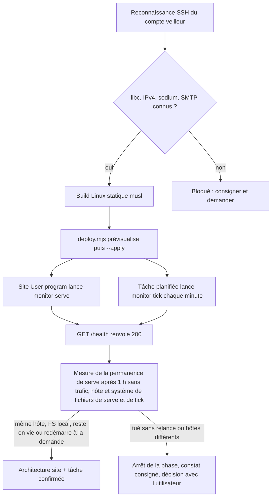
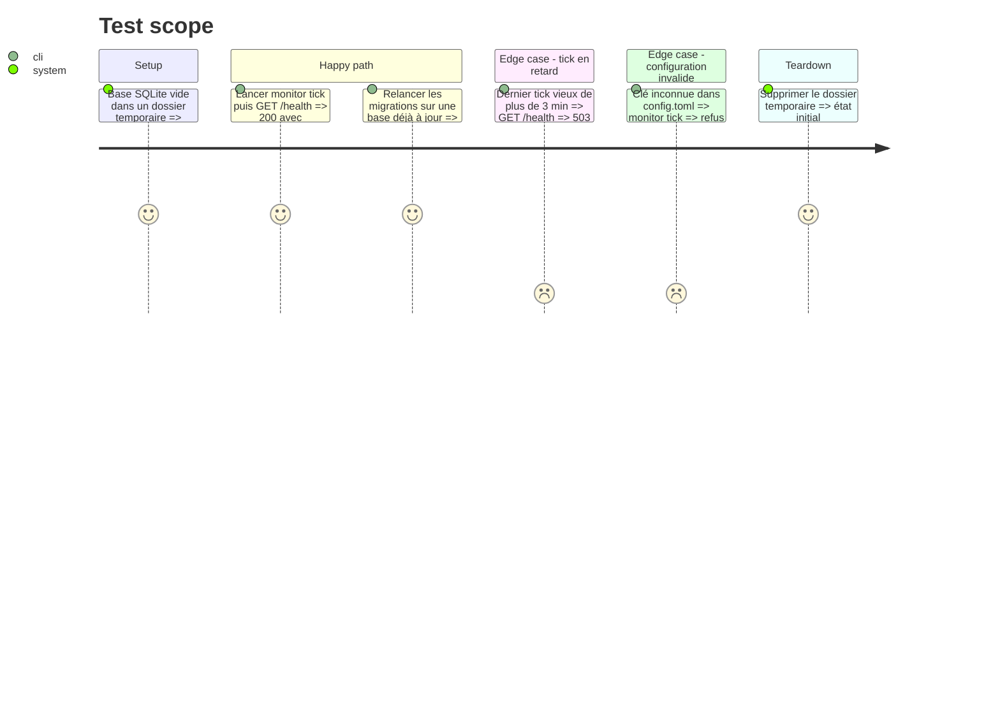

<!-- Fill or omit these sections; never add, rename, or reorder one. -->

# Instruction: Reconnaissance Alwaysdata et squelette déployé

## Architecture projection

> Tree of the final files. ✅ create · ✏️ modify · ❌ delete

```txt
.
├── .gitignore                         ✏️ ignore monitor/target/, monitor/deploy/targets.json, monitor/config.toml, monitor/remote.toml, *.db
├── .gitattributes                     ✅ /monitor export-ignore, LF pour monitor/
├── .github/workflows/monitor.yml      ✅ matrice ubuntu-24.04 + windows-latest, cargo fmt/clippy/test --locked, actions épinglées par SHA, paths: monitor/**
└── monitor/
    ├── rust-toolchain.toml            ✅ version de Rust épinglée, identique à rust-version et au workflow
    ├── Cargo.toml                     ✅ crate binaire « monitor » (nom provisoire, l'outil n'a pas encore de nom), rust-version
    ├── Cargo.lock                     ✅ versionné, builds --locked
    ├── README.md                      ✅ rôle, commandes, garde-fous
    ├── config.example.toml            ✅ chemins, sites, destinataire des alertes, sans secret
    ├── docs/hebergement.md            ✅ constats de la reconnaissance (OS, libc, permanence, IPv4/IPv6, SMTP, sodium)
    ├── deploy/targets.example.json    ✅ modèle de la cible du veilleur
    ├── scripts/deploy.mjs             ✅ envoi du binaire Linux, prévisualisation par défaut, --apply
    └── src/
        ├── main.rs                    ✅ clap 4 derive, sous-commandes serve, tick, status, site, ack
        ├── config.rs                  ✅ serde + toml, --config ou MONITOR_CONFIG sinon ~/monitor/config.toml, validation stricte
        ├── store.rs                   ✅ rusqlite bundled, WAL, migrations idempotentes (PRAGMA user_version)
        ├── serve.rs                   ✅ axum, GET /health (200 si le dernier tick date de moins de 3 min, sinon 503)
        └── tick.rs                    ✅ enregistre l'horodatage du passage (contrôles en phase 2)
```

## User Journey



## Test Scope



## Tasks to do

### `1)` Reconnaissance du compte veilleur

> Établir par mesure, et non par hypothèse, ce que le compte Alwaysdata permet.

1. Faire choisir par l'utilisateur le compte Alwaysdata qui héberge le veilleur et l'inscrire dans `monitor/deploy/targets.json` (ignoré par git).
2. En SSH, relever `uname -m`, `ldd --version`, `cat /etc/os-release`, la présence de `sqlite3` et l'espace disque.
3. Sur le compte du site A (`<compte-site-a>`), relever `php -v` et `php -m | grep -i sodium`, ainsi que la sortie IPv4 et IPv6 (`curl -4` et `curl -6` vers un hôte public).
4. Vérifier qu'un e-mail part du compte veilleur via `smtp-[compte].alwaysdata.net`, sans authentification, depuis une tâche planifiée.
5. Consigner chaque constat, avec la commande et sa sortie, dans `monitor/docs/hebergement.md`.

### `2)` Squelette Rust

> Un binaire qui démarre, lit sa configuration et tient son état, sans aucun contrôle encore.

1. `cargo new --bin monitor` dans `monitor/`, édition 2024. Épingler la version de Rust dans `rust-toolchain.toml`, `rust-version` et `monitor.yml`, à garder synchronisés. Dépendances : clap, serde, toml, thiserror, anyhow, log, env_logger, rusqlite (bundled), axum, tokio (current_thread, seulement pour `serve`), dirs.
2. Écrire `config.rs` : `deny_unknown_fields`, chemins absolus, aucun secret sérialisé. Le fichier est pris dans `--config`, sinon dans `MONITOR_CONFIG`, sinon dans `~/monitor/config.toml` (via `dirs::home_dir()`). `dirs::config_dir()` ne sert qu'à `remote.toml` sous Windows, en phase 6.
3. Écrire `store.rs` : WAL, `busy_timeout`, migrations numérotées et idempotentes, table `ticks`.
4. Écrire `serve.rs` : écoute sur l'IP et le port reçus en arguments ou en variables d'environnement, route `/health` seule, réponse 404 muette pour tout le reste.
5. Écrire `tick.rs`, qui enregistre le passage. Aucun `unwrap` hors des tests.

### `3)` Build Linux statique

> Produire un binaire qui tourne sur Alwaysdata quelle que soit sa glibc.

1. Installer rustup et la cible `x86_64-unknown-linux-musl` dans WSL. Le repli est `cargo-zigbuild` si `rusqlite` bundled ne compile pas avec musl.
2. Vérifier `file monitor` (statique), puis `./monitor --version` en SSH sur le compte veilleur.

### `4)` Script de déploiement du veilleur

> Envoyer le binaire comme le reste du parc : prévisualisation, puis `--apply`, avec un retour arrière.

1. Écrire `monitor/scripts/deploy.mjs` en reprenant les garde-fous de `scripts/deploy.mjs` (branche `main`, BatchMode, verrou `mkdir`, prévisualisation par défaut) et en important `scripts/deploy-lib.mjs` plutôt qu'en le copiant.
2. Envoyer vers `~/monitor/bin/monitor.new`, conserver `monitor.prev`, renommer de façon atomique, puis vérifier `/health`.
3. Afficher la commande de retour arrière.

### `5)` Mise en service et mesure de permanence

> Trancher l'inconnue « processus permanent » à partir d'un relevé.

1. Créer le site « User program », dont la commande est `~/monitor/bin/monitor serve`, sur un sous-domaine dédié.
2. Créer la tâche planifiée `* * * * * ~/monitor/bin/monitor tick`.
3. Relever le PID de `serve` à T0, à T0 + 1 h sans trafic, puis après une requête. Consigner le résultat dans `monitor/docs/hebergement.md`.
4. Pendant la mesure, envelopper temporairement la commande du site et celle de la tâche par `sh -c '{ hostname; stat -f -c %T ~/monitor; } >> ~/monitor/host.log; exec ~/monitor/bin/monitor <serve|tick>'`, puis revenir aux commandes nues. Aucun code n'est ajouté pour ce relevé. Le WAL n'est retenu que si l'hôte est le même et le système de fichiers local.
5. Si `serve` est arrêté sans être relancé à la demande, ou si les hôtes diffèrent, arrêter la phase et consigner le constat. Ne pas basculer en service Alwaysdata : il tourne sur un autre serveur et n'est joignable qu'en IPv6.

### `6)` Intégration au dépôt sans toucher au module

> Le module PrestaShop et son déploiement restent identiques à l'octet près.

1. Mettre à jour `.gitignore`, créer `.gitattributes` et `.github/workflows/monitor.yml` (déclenché seulement sur `monitor/**`, sur `ubuntu-24.04` et `windows-latest`, pour que le crate compile sous Windows dès le départ, comme la reprise locale de la phase 5 l'exige).
2. Vérifier que `pnpm deploy:check` produit toujours le même nombre de fichiers en staging, et que `composer` et `phpunit` ne voient pas `monitor/`.

## Test acceptance criteria

| Task | Acceptance criteria              |
| ---- | -------------------------------- |
| 1    | `monitor/docs/hebergement.md` répond, avec la sortie de commande à l'appui, sur la libc, l'architecture, la présence de sodium sur le site A, la sortie IPv4/IPv6 et l'envoi SMTP sans authentification |
| 2    | `cargo test --locked` passe. `/health` renvoie 200 après un tick récent et 503 après un tick vieux de plus de 3 min. Une clé de configuration inconnue est refusée |
| 3    | Le binaire musl répond à `--version` sur le compte veilleur |
| 4    | Sans `--apply`, rien ne change sur le serveur. Avec `--apply`, `/health` répond 200 et la commande de retour arrière restaure `monitor.prev` |
| 5    | La permanence de `serve`, ainsi que l'hôte et le système de fichiers vus par `serve` et par `tick`, sont mesurés et consignés. L'URL `/health` du veilleur répond en HTTPS depuis Internet en IPv4. Le site et la tâche ont retrouvé leurs commandes nues |
| 6    | `pnpm deploy:check` liste les mêmes fichiers qu'avant la phase. `git archive HEAD` ne contient aucun chemin `monitor/`. `monitor.yml` passe sur `ubuntu-24.04` et `windows-latest` |
