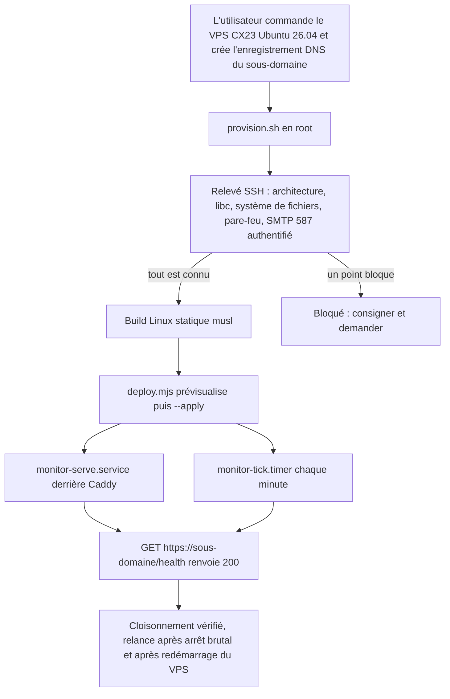
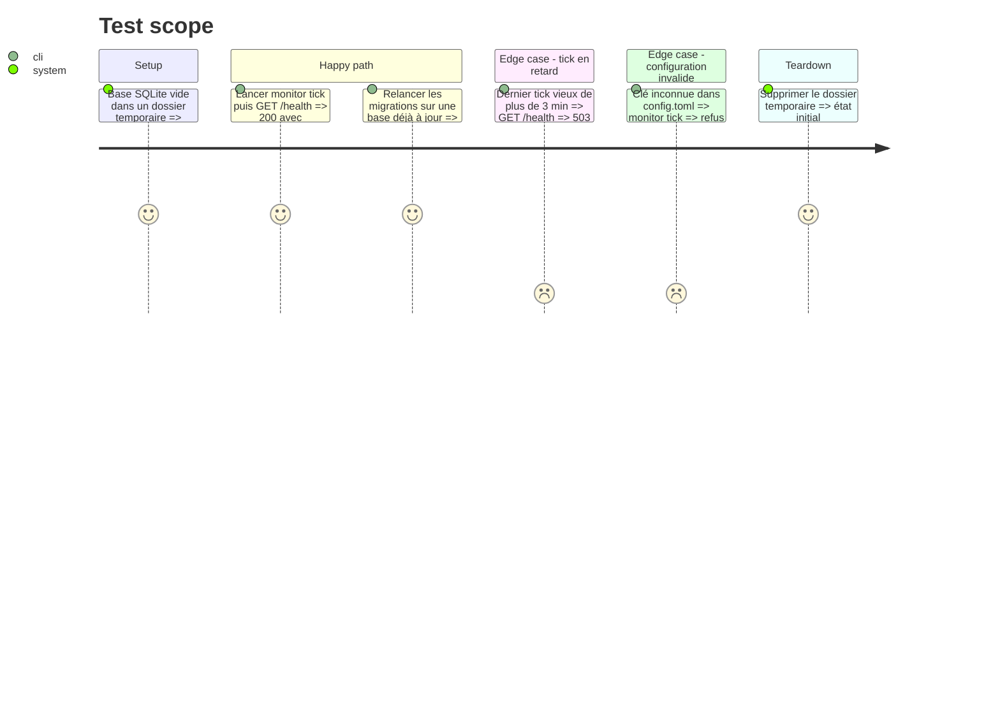

<!-- Fill or omit these sections; never add, rename, or reorder one. -->

# Instruction: Installation du VPS et squelette déployé

## Architecture projection

> Tree of the final files. ✅ create · ✏️ modify · ❌ delete

```txt
.
├── .gitignore                         ✏️ ignore monitor/target/, monitor/deploy/targets.json, monitor/config.toml, monitor/remote.toml, *.db
├── .gitattributes                     ✅ /monitor export-ignore, LF pour monitor/
├── .github/workflows/monitor.yml      ✅ matrice ubuntu-24.04 + windows-latest, cargo fmt/clippy/test --locked, actions épinglées par SHA, paths: monitor/**
└── monitor/
    ├── rust-toolchain.toml            ✅ version de Rust épinglée, identique à rust-version et au workflow
    ├── Cargo.toml                     ✅ crate binaire « monitor » (nom provisoire, l'outil n'a pas encore de nom), rust-version
    ├── Cargo.lock                     ✅ versionné, builds --locked
    ├── README.md                      ✅ rôle, commandes, garde-fous
    ├── config.example.toml            ✅ chemins, sites, destinataire des alertes, sans secret
    ├── docs/hebergement.md            ✅ constats sur le VPS (OS, libc, système de fichiers, réseau, SMTP, cloisonnement) et sur le site A (sodium, IPv4/IPv6)
    ├── deploy/targets.example.json    ✅ modèle de la cible du veilleur
    ├── deploy/provision.sh            ✅ installation du VPS en root, idempotente : mises à jour automatiques, pare-feu, SSH par clé, utilisateur monitor, Caddy, unités, règle sudo
    ├── deploy/systemd/monitor-serve.service ✅ serve sur 127.0.0.1, durci, relancé en cas d'échec
    ├── deploy/systemd/monitor-tick.service  ✅ tick en oneshot, durci
    ├── deploy/systemd/monitor-tick.timer    ✅ chaque minute
    ├── deploy/Caddyfile.example       ✅ sous-domaine → 127.0.0.1, TLS automatique
    ├── scripts/deploy.mjs             ✅ envoi du binaire Linux, prévisualisation par défaut, --apply, redémarrage de serve
    └── src/
        ├── main.rs                    ✅ clap 4 derive, sous-commandes serve, tick, status, site, ack
        ├── config.rs                  ✅ serde + toml, --config ou MONITOR_CONFIG sinon ~/monitor/config.toml, validation stricte
        ├── store.rs                   ✅ rusqlite bundled, WAL, migrations idempotentes (PRAGMA user_version)
        ├── serve.rs                   ✅ axum, GET /health (200 si le dernier tick date de moins de 3 min, sinon 503)
        └── tick.rs                    ✅ enregistre l'horodatage du passage (contrôles en phase 2)
```

## User Journey



## Test Scope



## Tasks to do

### `1)` Commande, installation et relevé du VPS

> Établir par mesure, et non par hypothèse, ce que le VPS permet.

1. Faire commander par l'utilisateur un Hetzner CX23 (x86, pas un CAX en Arm64) en Ubuntu 26.04 LTS (fait le 2026-10-15, Helsinki, pare-feu Hetzner 22, 80, 443 et ICMP attaché), dans un emplacement européen, avec sa clé SSH pour root. Lui faire créer l'enregistrement A (et AAAA) du sous-domaine du veilleur. Inscrire l'hôte dans `monitor/deploy/targets.json` (ignoré par git).
2. Écrire `monitor/deploy/provision.sh`, idempotent et lancé une fois en root par l'utilisateur, ou avec son accord explicite :
   - `unattended-upgrades` ;
   - `ufw`, qui n'ouvre que 22, 80 et 443 ;
   - `sshd` sans mot de passe ;
   - l'utilisateur `monitor`, avec un dossier personnel en 0700, `UMask=0077` et la clé de déploiement dans `authorized_keys` ;
   - Caddy, pris dans le dépôt Debian ;
   - les unités de `deploy/systemd/` ;
   - une règle sudo limitée à `/usr/bin/systemctl restart monitor-serve.service`.
3. En SSH, relever `uname -m`, `ldd --version`, `/etc/os-release`, `findmnt -no FSTYPE -T /home/monitor`, `df -h /home`, `ufw status` et `ss -tlnp`.
4. Sur le compte du site A (`<compte-site-a>`), relever `php -v` et `php -m | grep -i sodium`, ainsi que la sortie IPv4 et IPv6 (`curl -4` et `curl -6` vers un hôte public). Cette mesure sert à l'agent PHP et ne dépend pas du VPS.
5. Depuis le VPS, envoyer un e-mail par la boîte Alwaysdata servant de relais :
   - commande : `curl --url smtp://smtp-<compte>.alwaysdata.net:587 --ssl-reqd` ;
   - identifiants lus dans un fichier `--netrc-file` en 0600, jamais en argument, puisque la liste des processus est visible des autres utilisateurs ;
   - consigner le refus éventuel du relais pour une IP extérieure.
6. Consigner chaque constat, avec la commande et sa sortie, dans `monitor/docs/hebergement.md`.

### `2)` Squelette Rust

> Un binaire qui démarre, lit sa configuration et tient son état, sans aucun contrôle encore.

1. `cargo new --bin monitor` dans `monitor/`, édition 2024. Épingler la version de Rust dans `rust-toolchain.toml`, `rust-version` et `monitor.yml`, à garder synchronisés. Dépendances : clap, serde, toml, thiserror, anyhow, log, env_logger, rusqlite (bundled), axum, tokio (current_thread, seulement pour `serve`), dirs.
2. Écrire `config.rs` : `deny_unknown_fields`, chemins absolus, aucun secret sérialisé. Le fichier est pris dans `--config`, sinon dans `MONITOR_CONFIG`, sinon dans `~/monitor/config.toml` (via `dirs::home_dir()`). `dirs::config_dir()` ne sert qu'à `remote.toml` sous Windows, en phase 6.
3. Écrire `store.rs` : WAL, `busy_timeout`, migrations numérotées et idempotentes, table `ticks`.
4. Écrire `serve.rs` : écoute sur l'IP et le port reçus en arguments ou en variables d'environnement, route `/health` seule, réponse 404 muette pour tout le reste.
5. Écrire `tick.rs`, qui enregistre le passage. Aucun `unwrap` hors des tests.

### `3)` Build Linux statique

> Produire un binaire qui ne dépend pas de la glibc de l'hôte.

1. Installer rustup et la cible `x86_64-unknown-linux-musl` dans WSL. Le repli est `cargo-zigbuild` si `rusqlite` bundled ne compile pas avec musl.
2. Vérifier `file monitor` (statique), puis `~/monitor/bin/monitor --version` en SSH sur le VPS.

### `4)` Script de déploiement du veilleur

> Envoyer le binaire comme le reste du parc : prévisualisation, puis `--apply`, avec un retour arrière.

1. Écrire `monitor/scripts/deploy.mjs` en reprenant les garde-fous de `scripts/deploy.mjs` (branche `main`, BatchMode, verrou `mkdir`, prévisualisation par défaut) et en important `scripts/deploy-lib.mjs` plutôt qu'en le copiant.
2. Envoyer vers `~/monitor/bin/monitor.new`, conserver `monitor.prev` et renommer de façon atomique. Redémarrer ensuite `serve` par `sudo -n /usr/bin/systemctl restart monitor-serve.service`, puis vérifier `/health`. Le timer lance `tick` depuis le nouveau binaire dès la minute suivante.
3. Afficher la commande de retour arrière : restauration de `monitor.prev`, puis redémarrage de `serve`.

### `5)` Mise en service et cloisonnement

> Un veilleur qui revient seul après une panne, et que les autres utilisateurs du VPS ne lisent pas.

1. Écrire les unités de `monitor/deploy/systemd/` :
   - `serve` écoute sur `127.0.0.1:8080`, avec `Restart=on-failure` et `OOMScoreAdjust=-500` ;
   - `tick` est un `oneshot` lancé par `OnCalendar=*:*:00` ;
   - durcissement commun : `User=monitor`, `NoNewPrivileges=yes`, `ProtectSystem=strict`, `ProtectHome=read-only`, `ReadWritePaths=/home/monitor/monitor/data` (la base seule, pas le binaire), `PrivateTmp=yes` et `UMask=0077`.
2. Écrire `monitor/deploy/Caddyfile.example` (sous-domaine, puis `reverse_proxy 127.0.0.1:8080`). Placer la vraie version dans `/etc/caddy/Caddyfile` sur le VPS seulement : le sous-domaine n'est pas publié dans le dépôt.
3. Activer `monitor-serve.service` et `monitor-tick.timer`, puis vérifier `/health` en HTTPS, en IPv4 et en IPv6, depuis le poste.
4. Vérifier la relance automatique :
   - après `systemctl kill monitor-serve.service` ;
   - après un `reboot` du VPS, demandé à l'utilisateur.
5. Vérifier le cloisonnement :
   - `stat -c %a /home/monitor` doit donner `700` ;
   - `sudo -u nobody cat /home/monitor/monitor/config.toml` doit être refusé ;
   - `sudo -l -U monitor` ne doit lister que la règle de redémarrage ;
   - consigner `systemd-analyze security monitor-serve.service`.
   Si Hermes est déjà installé : `sudo -u hermes cat /home/monitor/monitor/config.toml` doit être refusé, et `id hermes` ne doit montrer ni `sudo` ni `docker`.

### `6)` Intégration au dépôt sans toucher au module

> Le module PrestaShop et son déploiement restent identiques à l'octet près.

1. Mettre à jour `.gitignore`, créer `.gitattributes` et `.github/workflows/monitor.yml` (déclenché seulement sur `monitor/**`, sur `ubuntu-24.04` et `windows-latest`, pour que le crate compile sous Windows dès le départ, comme la reprise locale de la phase 5 l'exige).
2. Vérifier que `pnpm deploy:check` produit toujours le même nombre de fichiers en staging, et que `composer` et `phpunit` ne voient pas `monitor/`.

## Test acceptance criteria

| Task | Acceptance criteria              |
| ---- | -------------------------------- |
| 1    | `monitor/docs/hebergement.md` répond, sortie de commande à l'appui, sur l'architecture, la libc, l'OS et le système de fichiers local de `/home/monitor`, ainsi que sur le pare-feu (22, 80 et 443 seulement). Il répond aussi sur la présence de sodium sur le site A, sa sortie IPv4/IPv6, et l'envoi SMTP authentifié sur le port 587 depuis le VPS |
| 2    | `cargo test --locked` passe. `/health` renvoie 200 après un tick récent et 503 après un tick vieux de plus de 3 min. Une clé de configuration inconnue est refusée |
| 3    | Le binaire musl répond à `--version` sur le VPS |
| 4    | Sans `--apply`, rien ne change sur le serveur. Avec `--apply`, `serve` est redémarré et `/health` répond 200 avec un tick postérieur à la bascule. La commande de retour arrière restaure `monitor.prev` et redémarre `serve` |
| 5    | `/health` répond 200 en HTTPS depuis Internet, en IPv4 et en IPv6, et `serve` n'écoute que sur `127.0.0.1`. Après `systemctl kill` comme après un redémarrage du VPS, `/health` revient à 200 en moins de 3 min sans intervention. `/home/monitor` est en 0700, `config.toml` est illisible pour un autre utilisateur, et `monitor` n'a que la règle sudo de redémarrage |
| 6    | `pnpm deploy:check` liste les mêmes fichiers qu'avant la phase. `git archive HEAD` ne contient aucun chemin `monitor/`. `monitor.yml` passe sur `ubuntu-24.04` et `windows-latest` |
