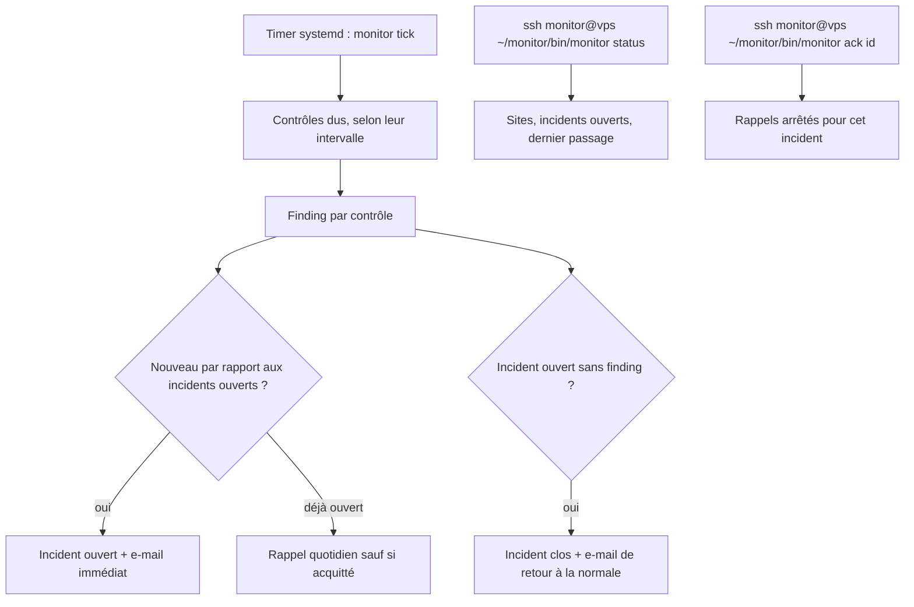
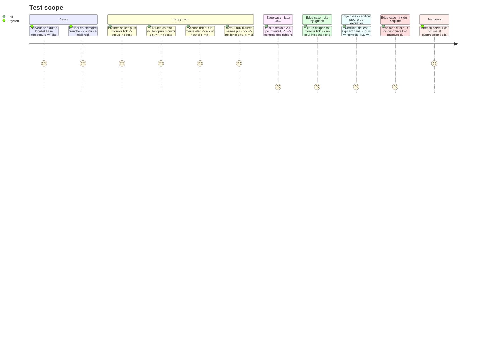

<!-- Fill or omit these sections; never add, rename, or reorder one. -->

# Instruction: Contrôles externes et alertes par e-mail

## Architecture projection

> Tree of the final files. ✅ create · ✏️ modify · ❌ delete

```txt
monitor/
├── Cargo.toml                         ✏️ ureq (rustls), rustls, x509-parser, lettre (smtp, rustls), regex
├── config.example.toml                ✏️ section [[site]] (id, url, kind, keyword_url, keyword, interval), [alerts] (to, from, smtp_host, smtp_port, smtp_user, password_file)
└── src/
    ├── main.rs                        ✏️ sous-commandes check <site> --once, status, ack <incident>
    ├── tick.rs                        ✏️ planifie les contrôles dus, limite le passage à 50 s
    ├── store.rs                       ✏️ migrations : check_runs, incidents (ouvert, clos, acquitté, dernier rappel)
    ├── finding.rs                     ✅ Finding { site, check, severity, key, detail }, cycle de vie des incidents
    ├── checks/mod.rs                  ✅ trait Check, registre par type de site
    ├── checks/content.rs              ✅ statut 200 et mot-clé attendu sur une URL donnée
    ├── checks/installer.rs            ✅ install.php et setup-config.php (WordPress), /install/ (PrestaShop) servis
    ├── checks/exposed.rs              ✅ .env, .git/HEAD, sauvegardes de config, dumps SQL, avec un témoin contre les faux 404
    ├── checks/tls.rs                  ✅ expiration du certificat, nom couvert
    ├── checks/headers.rs              ✅ HSTS, X-Content-Type-Options, X-Frame-Options ou frame-ancestors (information seulement)
    ├── alert.rs                       ✅ trait Notifier, envoi SMTP authentifié via lettre (587, STARTTLS), notifier en mémoire pour les tests
    └── http.rs                        ✅ agent ureq partagé : délais, User-Agent identifiable, aucune redirection hors domaine
└── tests/
    ├── external_checks.rs             ✅ serveur local de fixtures, état sain et état « incident »
    └── fixtures/                      ✅ pages WordPress saine, setup-config.php ouvert, .env, .git/HEAD, faux 404
```

## User Journey



## Test Scope



## Tasks to do

### `1)` Modèle des constats et des incidents

> Un constat stable, et un incident qui ne s'ouvre et ne se ferme qu'une fois.

1. Définir `Finding`, avec une clé stable `site/check/key`, et une gravité (critique, avertissement, information).
2. Ajouter la migration des tables `check_runs` et `incidents`.
3. Écrire la transition : nouveau constat → ouvert, constat absent → clos, `ack` → acquitté (plus de rappel, clôture automatique conservée).

### `2)` Client HTTP borné

> Un seul agent HTTP, prévisible et poli.

1. Configurer `ureq` avec rustls : délai de 10 s, 2 Mo de corps au plus, User-Agent `monitor/<version>` et redirections limitées au domaine du site.
2. Distinguer l'erreur réseau, qui donne un seul constat « injoignable », de la réponse HTTP.

### `3)` Contrôles externes

> Couvrir l'exposition vue de l'extérieur, avec une famille de contrôles par incident vécu.

1. `content` : l'URL configurée doit répondre 200 et contenir le mot-clé (pour le site A, l'URL et le mot-clé de la sonde UptimeRobot actuelle).
2. `installer` : un constat critique si `wp-admin/install.php` ou `wp-admin/setup-config.php` renvoie 200 avec un formulaire d'installation, ou si `/install/` est servi sur un PrestaShop. La réponse attendue est 403 ou 404.
3. `exposed` : interroger d'abord une URL témoin aléatoire, puis `.env`, `.git/HEAD`, `wp-config.php.bak`, `wp-config.php~` et `*.sql` courants. Un constat n'est émis que si la réponse diffère du témoin et porte la signature attendue (par exemple `ref:` pour `.git/HEAD`).
4. `tls` : relever l'expiration et le nom du certificat par une poignée de main rustls. Avertissement à moins de 14 jours, critique à moins de 3 jours ou si le nom n'est pas couvert.
5. `headers` : relever les en-têtes de sécurité, montrés dans `status` mais jamais envoyés par e-mail.

### `4)` Planification dans `tick`

> Chaque passage fait ce qui est dû, sans déborder sur le suivant.

1. Pour chaque site, lancer les contrôles dont l'intervalle est écoulé (5 min par défaut).
2. Arrêter le passage à 50 s et reporter le reste au passage suivant.
3. Ajouter `monitor check <site> --once`, qui affiche les constats sans écrire ni alerter.

### `5)` Alertes par e-mail

> Un e-mail par incident, lisible sur un téléphone, et jamais vers un client.

1. Envoyer via `lettre` par la boîte Alwaysdata servant de relais (`smtp-[compte].alwaysdata.net`), port 587 en STARTTLS obligatoire, en s'authentifiant avec l'adresse de la boîte. Le mot de passe est lu au moment de l'envoi dans le fichier de `password_file`. Ce fichier est refusé s'il est lisible par le groupe ou par les autres, ou s'il appartient à un autre utilisateur. Le mot de passe n'apparaît jamais dans un log ni dans une erreur. L'expéditeur est l'adresse de la boîte, et le destinataire unique est pris dans `[alerts]`.
2. Objet `[monitor] <site> : <constat>`, corps avec l'URL, l'heure du premier signal et la commande `ack`.
3. Envoyer un e-mail de retour à la normale, plus un rappel quotidien des incidents ouverts non acquittés.
4. En cas d'échec d'envoi, garder l'incident « à notifier » et réessayer au passage suivant.

### `6)` Pilotage par SSH

> Voir et acquitter sans ouvrir de nouvelle porte.

1. `monitor status` : sites, dernier passage, incidents ouverts avec leur âge, en-têtes manquants.
2. `monitor ack <id>`.
3. Déclarer le site A dans `~/monitor/config.toml` sur le veilleur, jamais dans le dépôt, puis déployer le binaire avec `monitor/scripts/deploy.mjs`, qui n'envoie pas de configuration.

## Test acceptance criteria

| Task | Acceptance criteria              |
| ---- | -------------------------------- |
| 1    | Un même constat répété sur plusieurs passages ne produit qu'un incident et qu'un e-mail. Sa disparition clôt l'incident |
| 2    | Un site qui ne répond pas produit un seul constat « injoignable », dans un passage d'au plus 50 s |
| 3    | Sur les fixtures de l'incident, `installer` et `content` émettent chacun un constat critique. Sur un site qui renvoie 200 partout, `exposed` n'émet rien |
| 4    | Un contrôle n'est jamais lancé avant la fin de son intervalle. `check --once` n'écrit rien dans la base |
| 5    | Le notifier en mémoire reçoit exactement un e-mail d'ouverture et un de clôture par incident. Un échec SMTP est retenté au passage suivant. Un `password_file` en 0644 est refusé sans qu'aucun envoi soit tenté, et le mot de passe n'apparaît dans aucune sortie |
| 6    | En production, `ssh monitor@<vps> ~/monitor/bin/monitor status` liste le site A sans incident, avec un dernier passage de moins de 2 min, et un premier e-mail de test est arrivé par le relais. `git ls-files monitor/` ne contient ni `config.toml` ni `smtp-password` |
