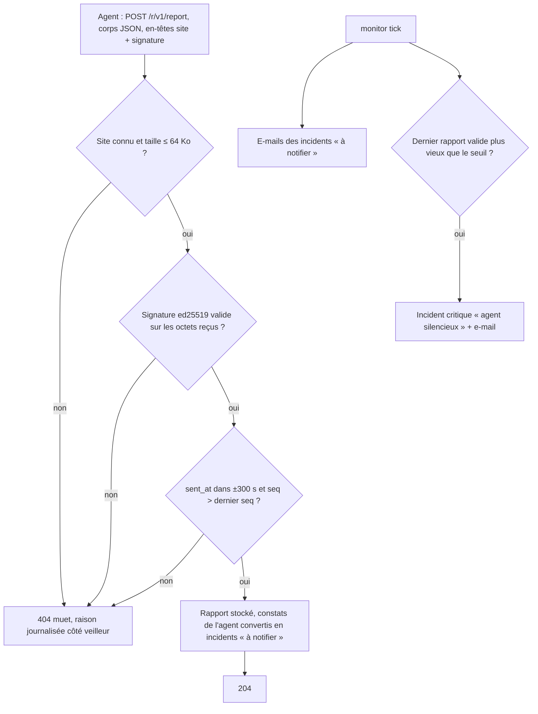
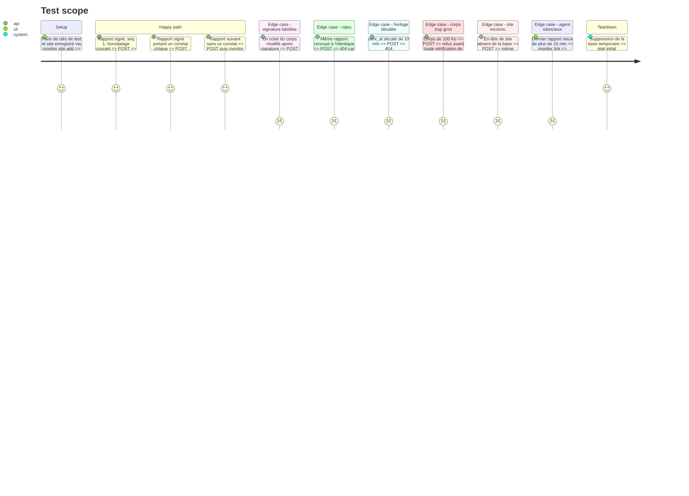

<!-- Fill or omit these sections; never add, rename, or reorder one. -->

# Instruction: Point d'entrée des rapports signés et silence des agents

## Architecture projection

> Tree of the final files. ✅ create · ✏️ modify · ❌ delete

```txt
monitor/
├── Cargo.toml                         ✏️ ed25519-dalek, base64, serde_json, tower-http (limite de corps, délai)
├── docs/protocole-agent.md            ✅ format du rapport v1, en-têtes, règles d'acceptation, rotation de clé
└── src/
    ├── main.rs                        ✏️ site add <id> --pubkey, site list, site rotate-key, site remove
    ├── store.rs                       ✏️ migrations : site_keys, reports (dernier seq, dernier rapport valide)
    ├── report.rs                      ✅ schéma du rapport v1 (serde, deny_unknown_fields), conversion en Finding
    ├── ingest.rs                      ✅ vérification de la signature, de l'horodatage, du seq et du débit
    ├── serve.rs                       ✏️ POST /r/v1/report, limite de 64 Ko, délai de 10 s, réponse 404 muette en cas d'échec
    └── checks/heartbeat.rs            ✅ dans tick : un agent muet au-delà du seuil ouvre un incident critique
└── tests/
    ├── ingest.rs                      ✅ rapports valides, falsifiés, rejoués, périmés et surdimensionnés
    └── fixtures/rfc8032.json          ✅ vecteurs de test ed25519, qui garantissent la compatibilité avec libsodium
```

## User Journey



## Test Scope



## Tasks to do

### `1)` Protocole v1

> Écrire le contrat avant le code, parce que c'est la pièce la plus exposée.

1. Rédiger `monitor/docs/protocole-agent.md` :
   - en-têtes `X-Monitor-Site` et `X-Monitor-Signature` (base64 de la signature détachée sur les octets bruts du corps) ;
   - corps JSON `{ v, site, seq, sent_at, agent, findings[], facts{} }`.
2. Règles d'acceptation : le site du corps est égal à celui de l'en-tête, horodatage dans ±300 s, `seq` strictement croissant, au plus un rapport accepté par site et par 60 s.
3. Rotation : `site rotate-key` remplace la clé publique. L'ancienne est refusée dès la rotation.

### `2)` Gestion des clés de site

> La clé privée reste sur le site. Le veilleur ne garde que des clés publiques.

1. `monitor site add <id> --pubkey <base64>` : vérifier que la clé fait 32 octets et refuser un id déjà pris.
2. `site list`, `site remove` (avec une confirmation sans `--yes`), `site rotate-key`.

### `3)` Ingestion

> Refuser tôt, refuser pareil et journaliser la vraie raison.

1. Ordre des vérifications : taille, site connu, signature, schéma, horodatage, `seq`, débit.
2. Tout refus renvoie la même réponse 404 sans corps. La raison n'est écrite que dans le log du veilleur.
3. Pour un rapport accepté : enregistrer `seq` et la date du dernier rapport valide, puis faire passer les constats dans le cycle des incidents de la phase 2, en préfixant leurs contrôles par `agent:`. Les incidents ouverts ou clos ici restent « à notifier » : `serve` n'appelle jamais le `Notifier`, c'est le passage suivant de `tick` qui notifie.

### `4)` Silence d'agent

> Un agent qui se tait est lui-même un signal.

1. Dans `tick`, ouvrir un incident critique « agent silencieux » pour tout site dont l'agent est déclaré et dont le dernier rapport valide dépasse `agent_silence`, par défaut 15 min (soit trois passages de 5 min manqués).
2. Le premier rapport valide qui suit clôt cet incident.

### `5)` Durcissement du point d'entrée

> Exposer le moins de surface possible.

1. Les seules routes sont `/health` et `/r/v1/report`. Tout le reste reçoit une réponse 404.
2. La limite de corps et le délai de 10 s s'appliquent avant toute lecture du JSON.
3. Le log ne contient jamais de corps de rapport, seulement le site, `seq` et la raison.

## Test acceptance criteria

| Task | Acceptance criteria              |
| ---- | -------------------------------- |
| 1    | `protocole-agent.md` décrit les en-têtes, le schéma v1 et les règles d'acceptation, et les tests d'ingestion en reprennent chaque règle |
| 2    | Une clé publique qui ne fait pas 32 octets est refusée. Après `rotate-key`, un rapport signé avec l'ancienne clé est refusé |
| 3    | Les vecteurs RFC 8032 sont vérifiés. Un rapport falsifié, rejoué, périmé, surdimensionné ou d'un site inconnu reçoit la même réponse 404 et n'est pas stocké. Un constat critique accepté produit exactement un e-mail, envoyé par `tick` |
| 4    | Un site sans rapport depuis plus de 15 min a un incident critique ouvert. Le rapport valide suivant le clôt |
| 5    | Une requête vers une route non déclarée renvoie 404. Le log d'un refus ne contient pas le corps reçu |
