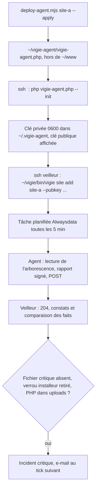
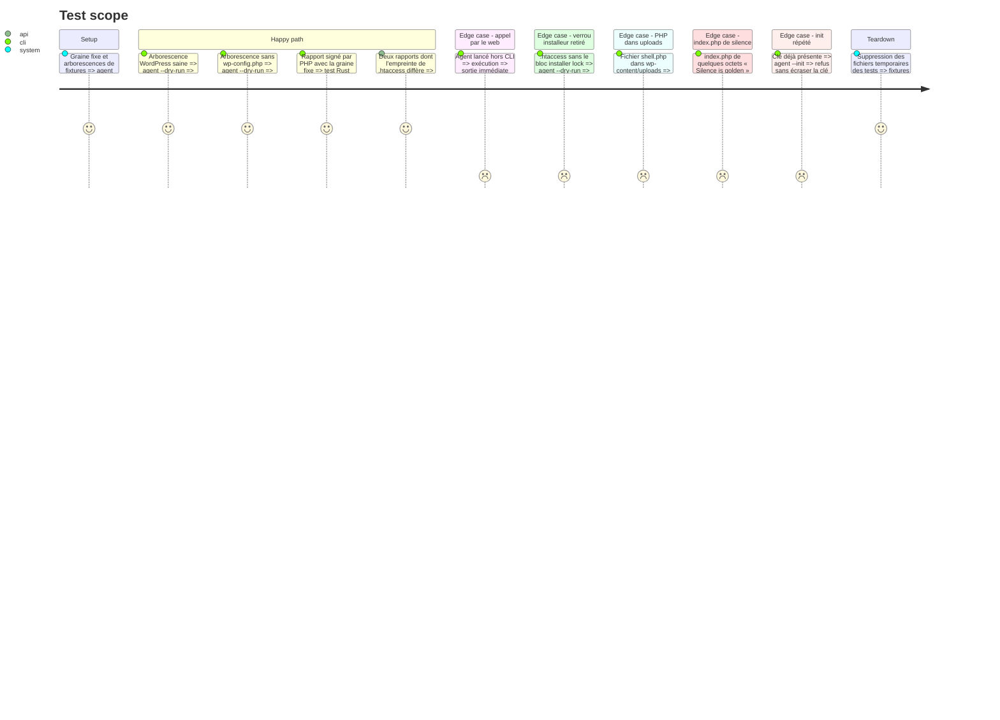

<!-- Fill or omit these sections; never add, rename, or reorder one. -->

# Instruction: Agent PHP et pose sur le site A

## Architecture projection

> Tree of the final files. ✅ create · ✏️ modify · ❌ delete

```txt
vigie/
├── agent/php/
│   ├── vigie-agent.php              ✅ fichier unique : refus hors CLI, --init, contrôles en lecture seule, rapport signé
│   ├── config.example.json            ✅ site, endpoint, root, kind, critical[], must_contain[], uploads
│   └── tests/
│       ├── run.php                    ✅ exécuteur minimal, sans Composer, code 1 en cas d'échec
│       ├── AgentTest.php              ✅ arborescences de fixtures : WordPress sain, sans wp-config.php, PHP dans uploads
│       └── fixtures/                  ✅ mini-arborescences WordPress
├── tests/
│   ├── fixtures/php-signed-report.json ✅ rapport signé par PHP avec une graine fixe, vérifié côté Rust
│   └── interop.rs                     ✅ ed25519-dalek vérifie la signature produite par sodium
├── src/
│   ├── report.rs                      ✏️ faits v1 : empreintes des fichiers critiques, PHP dans uploads, versions
│   └── facts.rs                       ✅ comparaison avec le rapport précédent : fichier modifié, nouveau PHP dans uploads
├── scripts/deploy-agent.mjs           ✅ envoie l'agent hors du webroot, prévisualisation par défaut, --apply
└── docs/agent-php.md                  ✅ pose, enregistrement de la clé, tâche planifiée, retrait
```

## User Journey



## Test Scope



## Tasks to do

### `1)` Squelette de l'agent

> Un fichier PHP sans dépendance, inerte s'il est appelé par le web.

1. Quitter immédiatement si `PHP_SAPI !== 'cli'`, ou si l'extension sodium est absente (avec un message et le code 3).
2. Lire la configuration JSON hors du webroot (`~/.vigie-agent/config.json`) et refuser toute clé inconnue.
3. `--init` génère la paire de clés, écrit la clé privée en 0600, affiche la clé publique en base64 et refuse d'écraser une clé existante.
4. `--dry-run` affiche le rapport sans l'envoyer.

### `2)` Contrôles en lecture seule

> Couvrir l'intégrité vue de l'intérieur sans jamais écrire dans le site.

1. `critical[]` : présence et SHA-256 de chaque fichier. Pour le site A : `wp-config.php`, `.htaccess`, `.user.ini`, `wordfence-waf.php` et `index.php`.
2. `must_contain[]` : un fichier doit contenir une chaîne. Pour le site A, `.htaccess` doit contenir `# BEGIN <site> installer lock`.
3. `uploads` : liste bornée (500 entrées, 20 s au total) des `.php` présents sous `wp-content/uploads/`, avec chemin, taille et empreinte. Seul un `index.php` de silence de moins de 64 octets est exempté.
4. Faits : version de WordPress lue dans `wp-includes/version.php`, version de PHP, version de l'agent.
5. Aucun suivi de lien symbolique hors de `root`.

### `3)` Rapport signé et envoi

> Respecter exactement le protocole v1 de la phase 3.

1. `seq` est un entier en millisecondes depuis l'époque Unix, ce qui permet à l'agent de ne garder aucun état.
2. Signer les octets exacts du corps avec `sodium_crypto_sign_detached`, puis l'envoyer par `file_get_contents` avec un contexte de flux (vérification TLS active, délai de 15 s).
3. Code de retour différent de 0 si l'envoi échoue, pour que la tâche planifiée d'Alwaysdata envoie son e-mail d'erreur.

### `4)` Comparaison des faits côté veilleur

> L'agent ne garde aucun état : c'est le veilleur qui voit une dérive.

1. Comparer les faits au dernier rapport valide : une empreinte critique qui change donne un avertissement « fichier modifié », un nouveau `.php` dans uploads donne un constat critique.
2. Le premier rapport pose la référence. Un `.php` présent dans uploads dès ce rapport ouvre quand même un incident.

### `5)` Tests et interopérabilité

> Prouver que PHP et Rust parlent la même signature.

1. Écrire `tests/run.php` et `AgentTest.php` sur les arborescences de fixtures, en activant sodium dans le PHP local (`extension=sodium`, aujourd'hui absente du PHP 8.4 Windows).
2. Produire `php-signed-report.json` avec `sodium_crypto_sign_seed_keypair` sur une graine fixe, et le faire vérifier par `tests/interop.rs`.

### `6)` Pose sur le site A

> Un agent sur le compte `<compte-site-a>`, hors du webroot, lancé toutes les 5 minutes.

1. `deploy-agent.mjs` : envoyer vers `~/vigie-agent/` en reprenant les garde-fous de déploiement (prévisualisation par défaut, refus si la destination est sous `~/www/`).
2. Lancer `--init` en SSH, puis enregistrer la clé publique sur le veilleur avec `~/vigie/bin/vigie site add site-a --pubkey`.
3. Faire créer par l'utilisateur la tâche planifiée `*/5 * * * * php ~/vigie-agent/vigie-agent.php` dans le panneau du compte `<compte-site-a>`.
4. Documenter la pose, la rotation de clé et le retrait dans `docs/agent-php.md`.

## Test acceptance criteria

| Task | Acceptance criteria              |
| ---- | -------------------------------- |
| 1    | Lancé hors CLI, l'agent ne lit aucun fichier et n'envoie rien. `--init` refuse d'écraser une clé existante, et la clé privée créée est en 0600 |
| 2    | Sur les fixtures, l'absence de `wp-config.php`, le retrait du verrou installeur et un `shell.php` dans uploads donnent chacun un constat critique. Aucun fichier de l'arborescence n'est modifié (même mtime avant et après) |
| 3    | Le veilleur répond 204 au rapport de l'agent. Un envoi échoué fait sortir l'agent avec un code différent de 0 |
| 4    | Une empreinte de `.htaccess` modifiée entre deux rapports ouvre un incident d'avertissement. Un nouveau `.php` dans uploads ouvre un incident critique |
| 5    | `php vigie/agent/php/tests/run.php` et `cargo test --locked` passent, y compris le test d'interopérabilité |
| 6    | `ssh <veilleur> ~/vigie/bin/vigie status` montre le site A avec un dernier rapport d'agent de moins de 6 min et aucun incident |
