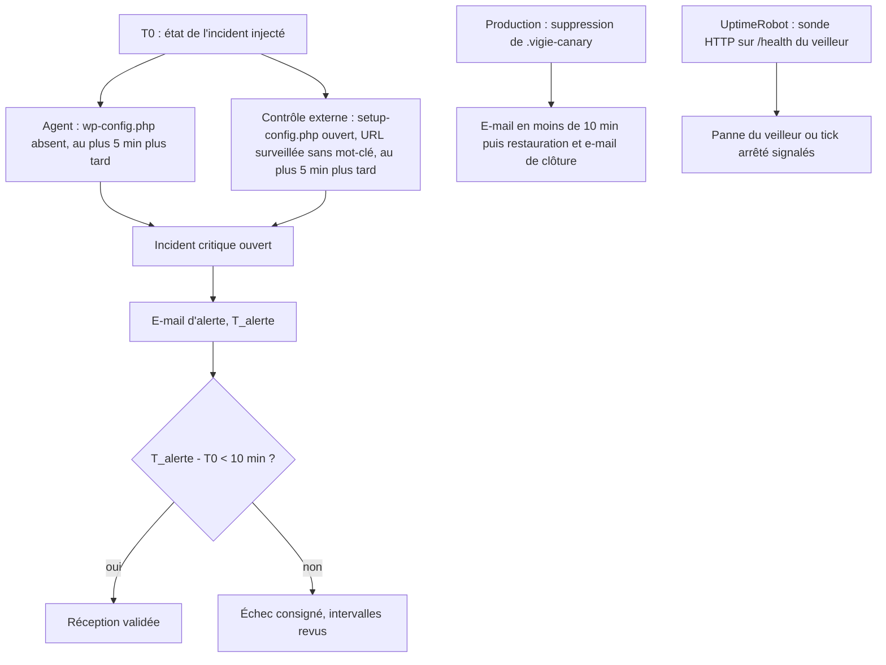
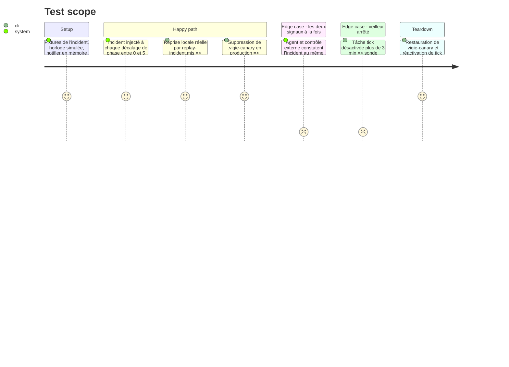

<!-- Fill or omit these sections; never add, rename, or reorder one. -->

# Instruction: Test de réception, reprise de l'incident du 2026-09-07

## Architecture projection

> Tree of the final files. ✅ create · ✏️ modify · ❌ delete

```txt
vigie/
├── src/clock.rs                       ✅ horloge injectable (système en production, simulée dans les tests)
├── src/tick.rs                        ✏️ lit l'heure via clock.rs
├── src/ingest.rs                      ✏️ lit l'heure via clock.rs
├── tests/
│   ├── replay_2026_09_07.rs           ✅ reprise de bout en bout sur fixtures, délai d'alerte mesuré
│   └── fixtures/incident-2026-09-07/  ✅ site sans wp-config.php, setup-config.php servi avec son formulaire, URL surveillée sans son mot-clé
├── scripts/replay-incident.mjs        ✅ reprise locale réelle : veilleur, agent PHP et serveur de fixtures, chronomètre
└── docs/reception.md                  ✅ procédure, résultats datés local et production, sonde UptimeRobot
```

## User Journey



## Test Scope



## Tasks to do

### `1)` Horloge injectable

> Pouvoir mesurer un délai de 10 minutes sans attendre 10 minutes.

1. Ajouter `clock.rs` (trait `Clock`, implémentation système et implémentation simulée).
2. Faire lire l'heure à `tick`, `ingest` et `heartbeat` uniquement par ce trait.

### `2)` Reprise sur fixtures

> Rejouer l'état exact de septembre : pas de `wp-config.php`, installeur servi, contenu absent.

1. Construire `fixtures/incident-2026-09-07/` d'après la mémoire de déploiement du dépôt privé du site A (incident du 2026-09-07).
2. Dans `replay_2026_09_07.rs`, injecter l'incident à chaque décalage d'une minute par rapport aux passages de l'agent et du contrôle externe, simuler 15 min et relever le premier e-mail.
3. Exiger moins de 10 min dans tous les cas et sortir le pire cas mesuré.

### `3)` Reprise locale réelle

> Le même scénario avec les vrais processus.

1. `replay-incident.mjs` lance `vigie serve` en local (build Windows, vérifié par la CI depuis la phase 1), le serveur de fixtures et l'agent PHP en boucle de 5 min, ainsi que `tick` chaque minute, avec un SMTP de capture local ou un notifier fichier.
2. Chronométrer T0 → premier e-mail, consigner le résultat et tout arrêter dans un `finally`.

### `4)` Reprise en production, sans risque

> Prouver la chaîne réelle sans remettre le site A dans l'état exploité.

1. Ajouter `.vigie-canary` (vide) à `critical[]` de l'agent du site A et le déposer dans `~/www/<site-a>/`.
2. Le supprimer en notant T0, attendre l'e-mail et noter T_alerte, puis le restaurer et attendre l'e-mail de clôture.
3. Ne jamais toucher `wp-config.php`, `.htaccess` ni l'installeur en production.

### `5)` Surveillance du veilleur

> Une seule sonde externe, celle qui couvre la panne du VPS ou du veilleur.

1. Faire remplacer par l'utilisateur la sonde UptimeRobot actuelle (mot-clé `<mot-clé>` sur `<url-surveillée>`) par une sonde HTTP(s) sur `/health` du veilleur, qui alerte sur toute réponse autre que 2xx (le 503 d'un `tick` en retard compris). Le contrôle `content` du veilleur reprend la vérification de l'URL surveillée.
2. Couper `tick` plus de 3 min et vérifier que UptimeRobot alerte, puis le réactiver.
3. Relire les conditions de l'offre gratuite d'UptimeRobot pour un usage dans une prestation payante, et consigner la réponse et sa source.

### `6)` Procès-verbal

> Une trace datée que la plus petite version utile tient sa promesse.

1. Rédiger `docs/reception.md` : procédure, pire cas simulé, mesure locale, mesure en production, sonde UptimeRobot et conditions d'utilisation.
2. Signaler à l'utilisateur que la ligne « sonde de disponibilité » des points ouverts de la mémoire de déploiement du dépôt privé du site A peut être mise à jour (fichier d'un autre dépôt, non modifié ici).

## Test acceptance criteria

| Task | Acceptance criteria              |
| ---- | -------------------------------- |
| 1    | Aucun appel direct à l'horloge système ne reste dans `tick`, `ingest` ni `heartbeat`. Les tests existants passent avec l'horloge simulée |
| 2    | Pour chaque décalage de phase, le premier e-mail part moins de 10 min après l'injection. Le pire cas mesuré est affiché |
| 3    | La reprise locale réelle produit un e-mail d'alerte moins de 10 min après T0, et aucun processus ne reste après la fin du script |
| 4    | En production, l'e-mail d'alerte arrive moins de 10 min après la suppression du fichier témoin, et l'e-mail de clôture suit sa restauration |
| 5    | UptimeRobot alerte quand `tick` est arrêté. Les conditions de l'offre gratuite sont consignées avec leur source |
| 6    | `docs/reception.md` contient les trois mesures datées et le verdict de réception |
