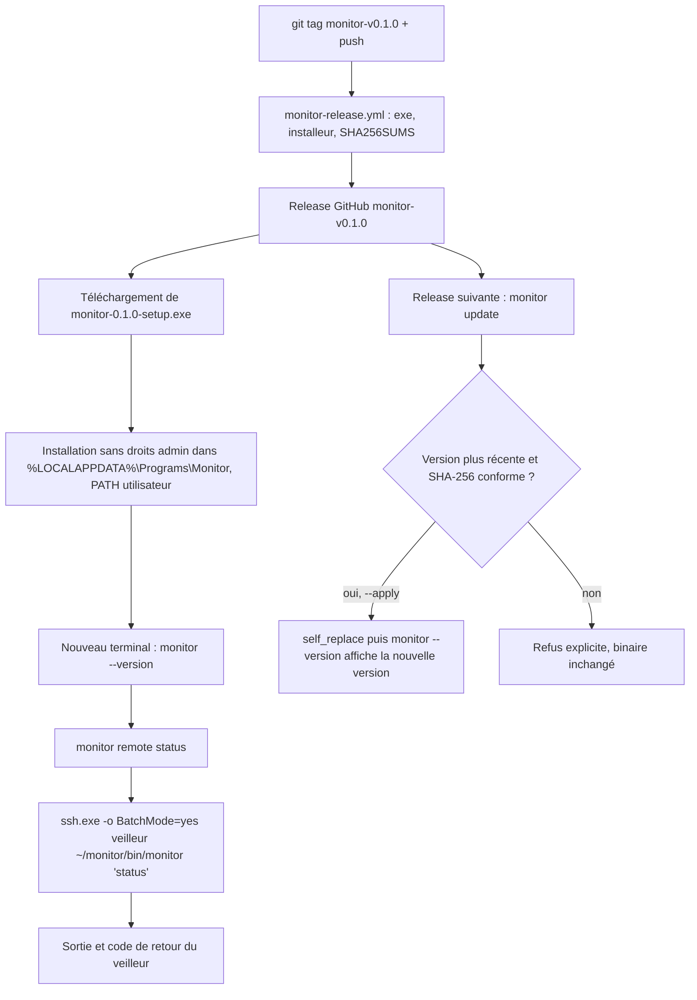

<!-- Fill or omit these sections; never add, rename, or reorder one. -->

# Instruction: Distribution Windows du poste de pilotage

## Architecture projection

> Tree of the final files. ✅ create · ✏️ modify · ❌ delete

```txt
.
├── .github/workflows/
│   └── monitor-release.yml            ✅ tags monitor-v* et workflow_dispatch, exe Windows, installeur, SHA256SUMS
└── monitor/
    ├── Cargo.toml                     ✏️ semver, sha2, self_replace, tempfile
    ├── remote.example.toml            ✅ host (alias ~/.ssh/config), ssh, remote_bin
    ├── packaging/windows/monitor.iss  ✅ installeur Inno Setup par utilisateur, ajout au PATH utilisateur, AppVersion reçu par /D
    ├── scripts/build.ps1              ✅ build release, lecture de la version de Cargo.toml, ISCC /DAppVersion=… si présent
    ├── docs/installation-windows.md   ✅ installation, mise à jour, clé SSH côté Windows, désinstallation
    ├── README.md                      ✏️ section « Poste Windows »
    └── src/
        ├── main.rs                    ✏️ sous-commandes update [--apply] et remote <commande>
        ├── update.rs                  ✅ reprise de email-to-markdown/app/src/updater.rs, filtrée sur monitor-v*
        └── remote.rs                  ✅ relais SSH : liste blanche des commandes, validation, quoting POSIX
```

## User Journey



## Test Scope

```mermaid
---
title: Test scope
---
journey
  section Setup
    Réponses GitHub simulées (liste de releases, SHA256SUMS) dans les tests unitaires => updater testable sans réseau: 5: system
    remote.toml pointant vers un alias SSH du veilleur => relais prêt: 5: system
  section Happy path
    Push du tag monitor-v0.1.0 => workflow => exe, setup.exe et SHA256SUMS dans la release: 5: cli
    setup.exe lancé sans droits admin => nouveau terminal => monitor --version répond: 5: cli
    monitor remote status => relais SSH => même sortie que ssh veilleur ~/monitor/bin/monitor status: 5: cli
    monitor update => prévisualisation => versions locale et distante affichées, rien de modifié: 5: cli
    Release monitor-v0.1.1 publiée, poste en 0.1.0 => monitor update --apply => monitor --version affiche 0.1.1: 5: cli
  section Edge case - tag du module
    Push d'un tag v1.11.0 du module PrestaShop => aucun déclenchement de monitor-release.yml: 1: cli
  section Edge case - version incohérente
    Tag monitor-v0.2.0 alors que Cargo.toml indique 0.1.0 => workflow => échec avant publication: 1: cli
  section Edge case - empreinte fausse
    SHA256SUMS ne correspond pas au binaire téléchargé => update --apply => refus, binaire inchangé: 1: cli
  section Edge case - comparaison de versions
    Version locale 0.9.0, release 0.10.0 => update => mise à jour proposée: 1: cli
  section Edge case - injection d'argument
    monitor remote ack "1; rm -rf ~" => validation => refus avant tout appel à ssh: 1: cli
  section Edge case - clé SSH absente
    Aucune clé Windows autorisée sur le veilleur => monitor remote status => échec immédiat sans invite de mot de passe: 1: cli
  section Edge case - réinstallation
    setup.exe relancé sur une installation existante => PATH utilisateur => une seule entrée Monitor: 1: cli
  section Teardown
    Désinstallation => dossier supprimé et entrée retirée du PATH utilisateur: 5: cli
```

## Tasks to do

### `1)` Build Windows de release

> La CI Windows tourne depuis la phase 1 : il reste à produire le binaire publié avec la même chaîne.

1. Reprendre dans `monitor-release.yml` la version de Rust épinglée en phase 1 (`rust-toolchain.toml`, `rust-version`, `monitor.yml`), comme `email-to-markdown/app/aidd_docs/memory/deployment.md` l'impose.
2. Garder toutes les sous-commandes dans le binaire Windows, `serve` et `tick` compris : aucune n'est désactivée par plateforme.

### `2)` Installeur Inno Setup

> Reprendre `email-to-markdown/app/packaging/windows/email-to-markdown.iss`, adapté à un outil en ligne de commande.

1. Écrire `monitor.iss` :
   - `DefaultDirName={localappdata}\Programs\Monitor`, `PrivilegesRequired=lowest`, `ArchitecturesAllowed=x64compatible` ;
   - un nouvel `AppId` (GUID généré à l'implémentation, jamais celui d'email-to-markdown) ;
   - ni raccourci ni `[Run]`, puisqu'il n'y a pas de zone de notification.
2. Ajouter `{app}` au PATH de l'utilisateur (`HKCU\Environment`, `ChangesEnvironment=yes`) seulement s'il n'y figure pas déjà, et le retirer à la désinstallation. C'est le seul ajout par rapport au modèle d'email-to-markdown, qui ne touche pas au PATH.
3. Écrire `monitor/scripts/build.ps1` sur le modèle de `email-to-markdown/app/scripts/build.ps1` : recherche du linker MSVC, `cargo build --release --locked`, lecture de la version dans `Cargo.toml`, puis `ISCC /DAppVersion=<version>` s'il est installé. Le `.iss` déclare `#ifndef AppVersion` et échoue sans valeur : aucun fichier versionné n'est réécrit par un build, contrairement à email-to-markdown.

### `3)` Workflow de release

> Publier un binaire vérifiable sans se mélanger aux versions du module.

1. Déclencher `monitor-release.yml` sur les tags `monitor-v*` seulement, car `v*` désigne déjà les versions du module (`v1.10.0`). Ajouter un `workflow_dispatch` avec un tag en entrée, comme dans `lyremember/app/.github/workflows/release.yml`, pour rejouer un tag perdu.
2. Échouer si la version du tag diffère de celle de `monitor/Cargo.toml`.
3. Job Windows :
   - `cargo build --locked --release`, puis renommer en `monitor-<version>-windows-x86_64.exe`, où `<version>` est le tag sans le préfixe `monitor-v` (par exemple `monitor-0.1.0-windows-x86_64.exe`) ;
   - compiler l'installeur avec `ISCC /DAppVersion=<version>`, qui produit `monitor-<version>-setup.exe`. Vérifier sa présence sur le runner, sinon installer une version épinglée d'Inno Setup.
4. Job de publication : générer `SHA256SUMS` avec `sha256sum`, puis publier avec `softprops/action-gh-release`. Mettre `permissions: contents: read` en tête et `write` sur ce seul job, et épingler toutes les actions par SHA, comme dans `email-to-markdown/app/.github/workflows/release.yml`.

### `4)` `monitor update`

> La mise à jour d'email-to-markdown, sans ses deux pièges connus.

1. Porter `email-to-markdown/app/src/updater.rs` sur `ureq` (déjà présent depuis la phase 2, pas de `reqwest`).
2. Lister les releases et garder la plus haute version `monitor-v*` comparée avec `semver`, au lieu de `releases/latest` qui peut désigner une release du module.
3. Télécharger le binaire, vérifier son SHA-256 dans `SHA256SUMS`, et refuser une release sans ce fichier.
4. Remplacer avec `self_replace`, après `tmp.keep()` sur le `NamedTempFile` (règle `03-tempfile-keep-before-self-replace` d'email-to-markdown).
5. Prévisualisation par défaut, remplacement seulement avec `--apply`. Hors de Windows, répondre qu'aucun binaire n'est publié pour cette plateforme : le veilleur est mis à jour par `monitor/scripts/deploy.mjs`.

### `5)` Relais SSH

> Piloter le veilleur depuis Windows sans ouvrir de nouvelle surface réseau.

1. Lire `%APPDATA%\monitor\remote.toml` (`deny_unknown_fields`) :
   - `host`, un alias de `~/.ssh/config` ;
   - `ssh`, `ssh` par défaut, soit l'OpenSSH livré avec Windows ;
   - `remote_bin`, `~/monitor/bin/monitor` par défaut.
2. `monitor remote` n'accepte que `status`, `ack <id>`, `check <site> --once` et `site list|add|remove|rotate-key`, analysés avec les mêmes définitions clap que localement.
3. Valider les identifiants (`[a-z0-9-]+`) et les clés (base64 de 32 octets), puis entourer chaque argument de guillemets simples POSIX avant de construire la commande distante. `remote_bin` reste hors guillemets pour que le shell distant étende `~`, et il doit correspondre à `^~?/[A-Za-z0-9._/-]+$`.
4. Lancer `ssh -o BatchMode=yes -- <host> <commande>`, relayer stdout et stderr, et renvoyer le code de retour distant.
5. `site remove` demande la confirmation en local, puis transmet `--yes`.

### `6)` Documentation

> Quelqu'un qui n'a pas suivi le projet installe et met à jour sans aide.

1. Rédiger `monitor/docs/installation-windows.md` :
   - installation et désinstallation, y compris l'avertissement SmartScreen d'un `setup.exe` non signé (« Informations complémentaires », puis « Exécuter quand même ») ;
   - `monitor update`, avec la limite de `SHA256SUMS` : il détecte un fichier corrompu, pas une release compromise ;
   - création de la clé SSH côté Windows (`%USERPROFILE%\.ssh`, distincte de la clé WSL `~/.ssh/<cible>_ci`) et alias dans `~/.ssh/config` ;
   - procédure de release (`monitor-v*`).
2. Ajouter la section « Poste Windows » au `README.md` de `monitor/`.

## Test acceptance criteria

| Task | Acceptance criteria              |
| ---- | -------------------------------- |
| 1    | La version de Rust est la même dans `rust-toolchain.toml`, `rust-version` et les deux workflows. Le binaire publié répond à `serve --help` et à `tick --help` |
| 2    | `setup.exe` s'installe sans élévation dans `%LOCALAPPDATA%\Programs\Monitor`. Un nouveau terminal trouve `monitor`. Une réinstallation ne duplique pas l'entrée du PATH, et la désinstallation la retire avec le dossier |
| 3    | Le tag `monitor-v0.1.0` publie `monitor-0.1.0-windows-x86_64.exe`, `monitor-0.1.0-setup.exe` et un `SHA256SUMS` qui les couvre. Un tag `v*` ne déclenche rien, et un tag dont la version diffère de `Cargo.toml` échoue avant publication |
| 4    | Tests unitaires : sans `--apply`, le binaire est inchangé ; une empreinte fausse ou une release sans `SHA256SUMS` est refusée ; 0.9.0 → 0.10.0 est détecté ; une release du module est ignorée. De bout en bout, validé à la deuxième release : un poste en 0.1.0 passe en 0.1.1 avec `update --apply` |
| 5    | `monitor remote status` produit la même sortie et le même code de retour que `ssh <host> ~/monitor/bin/monitor status`. Un argument contenant `;` ou une espace est refusé avant l'appel à `ssh`. Sans clé autorisée, la commande échoue sans attendre de mot de passe |
| 6    | `installation-windows.md` couvre l'installation, la mise à jour, la clé SSH Windows, la release et la désinstallation |
