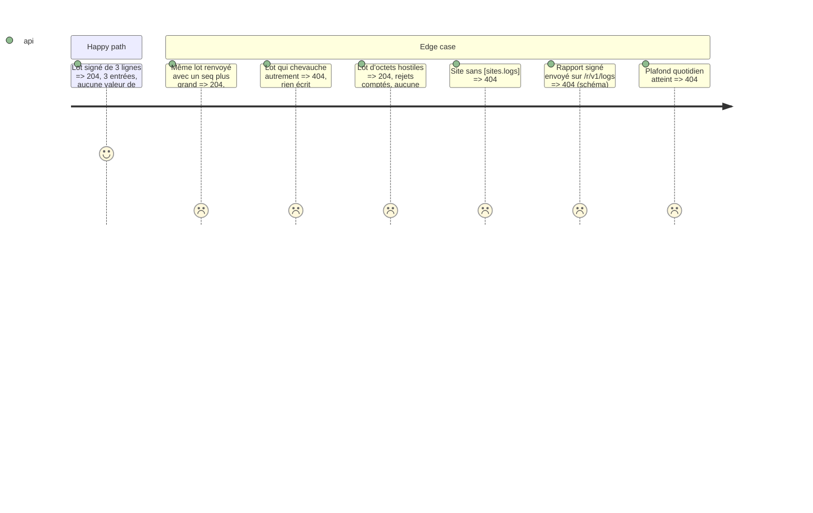

# Instruction: Point d'entrée /r/v1/logs et stockage

## Architecture projection

```txt
.
└── vigie/
    ├── migrations/000N.sql   ✅ log_batches (site, file, start, end, received_at, accepted, rejected JSON) ; log_entries (id, site, batch, timestamp_ms, host, ip, method, path, query_keys JSON, status, size, referer_present, referer_host, user_agent, duration_us) ; last_logs_seq dans site_keys
    ├── src/
    │   ├── config.rs         ✏️ [sites.logs] source, tz (fuseau IANA validé)
    │   ├── logs/receive.rs   ✅ schéma du lot, vérifications dans l'ordre, normalisation, écriture idempotente
    │   ├── store.rs          ✏️ écriture d'un lot et de ses entrées en une transaction, déduplication, plafond par jour
    │   └── serve.rs          ✏️ route POST /r/v1/logs, mêmes limites que /r/v1/report
    └── tests/
        └── logs_receive.rs   ✅ lot accepté, rejoué, chevauchant, hostile, site sans logs
```

## Test Scope



## Tasks to do

1. Schéma (`deny_unknown_fields`) : `v`=1, `type`=`logs`, `site`, `seq`, `sent_at`, `agent`, `file` (`http-AAAA-MM-JJ.log`, motif strict), `start`, `end` (`end - start` = taille décodée du `chunk`), `restarted` (booléen), `chunk` (base64 standard).
2. Vérifications calquées sur `ingest.rs` ; raison au journal avec request_id ; 404 muet.
3. Écriture par le writer de `serve` en IMMEDIATE ; `log_entries` sans aucun champ brut.

## Test acceptance criteria

| Task | Acceptance criteria |
| ---- | ------------------- |
| 1-3 | Chaque cas du Test Scope est un test ; un dump de la base après un lot contenant `?token=secret` ne contient pas `secret` |
