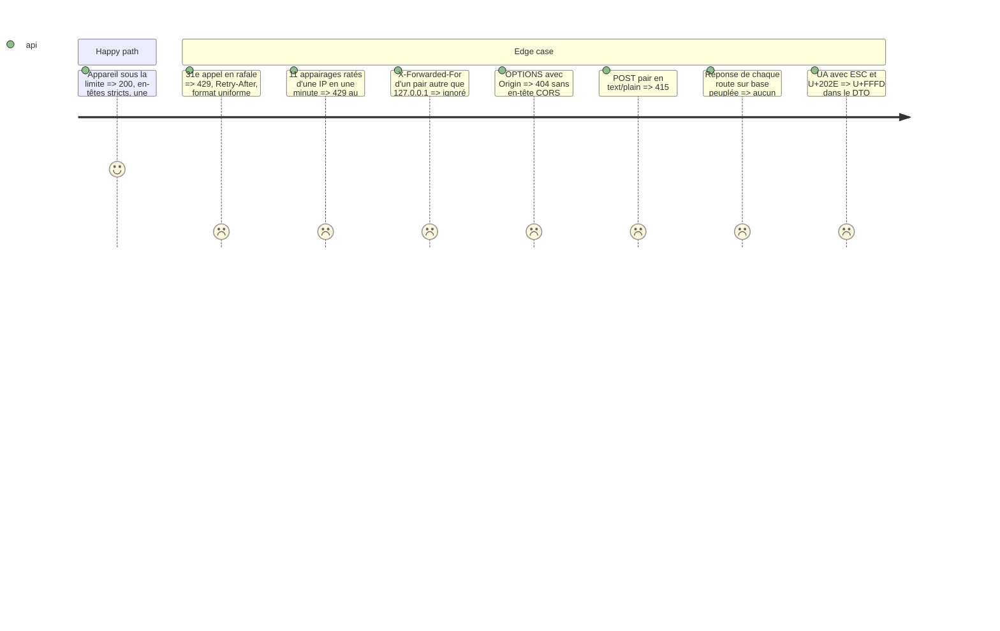

# Instruction: Garde-fous transverses : débit, journal, en-têtes, DTO

## Architecture projection

```txt
.
└── vigie/
    ├── src/
    │   ├── api/limit.rs      ✅ seaux à jetons bornés, IP cliente (proxy local seulement)
    │   ├── api.rs            ✏️ couche de journal et d'en-têtes, 415, OPTIONS, sanitize des champs de logs
    │   ├── error.rs          ✏️ ErrorCode::UnsupportedMediaType, BadRequest ; Retry-After sur 429
    │   └── config.rs         ✏️ 200 sites au plus
    └── tests/
        └── api_guards.rs     ✅ débit, journal, en-têtes, CORS, 415, liste blanche des DTO
```

## Test Scope



## Tasks to do

1. `limit.rs` : seau à jetons par clé (`Device(id)` ou `Ip(addr)`), `FakeClock` dans les tests ; table bornée à 4 096 clés.
2. Couche Tower sur `/api/v1` : journal (gabarit de route via `MatchedPath`), en-têtes, `OPTIONS` → 404.
3. 415 sur `POST` mal typé ; corps refusé sur `ack`.
4. `sanitize_log_text` partagé, utilisé par tout DTO qui porte un champ issu d'un log.
5. Test de liste blanche des DTO.

## Test acceptance criteria

| Task | Acceptance criteria |
| ---- | ------------------- |
| 1-5 | Chaque cas du Test Scope est un test ; la console 0.1.1 (requêtes de `vigie/app/src-tauri`) reste acceptée |
