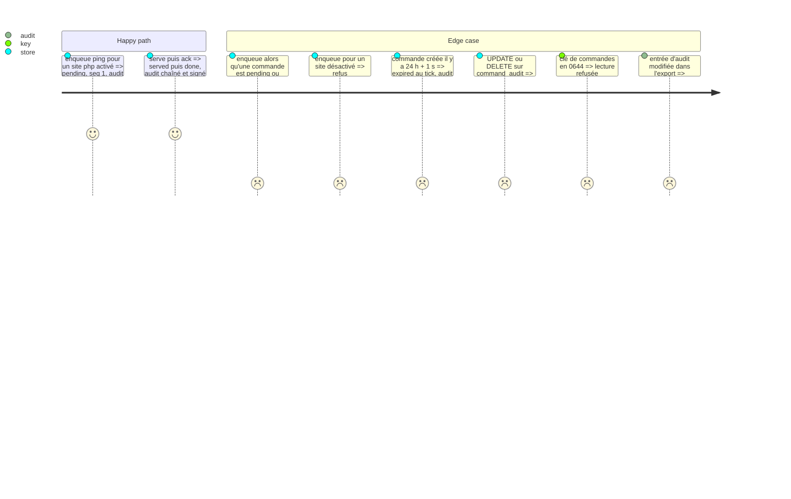

# Instruction: Clé de commandes, file et audit en base

## Architecture projection

```txt
.
└── vigie/
    ├── migrations/0008.sql   ✅ sites_commands (site, enabled, last_pull_seq, last_command_seq), commands, command_audit + déclencheurs append-only
    └── src/
        ├── command/
        │   ├── mod.rs        ✅ Command (id UUIDv7, site, seq, kind, params, état), Params typés, états, transitions
        │   ├── key.rs        ✅ clé de commandes : création exclusive 0600, lecture avec vérification des droits, signature du domaine vigie-commands-v1
        │   └── audit.rs      ✅ entrée d'audit, chaîne SHA-256, signature, vérification, export JSONL
        ├── store.rs          ✏️ file des commandes, activation par site, seq de retrait, expiration > 24 h, audit
        └── lib.rs            ✏️ déclare command
```

## Test Scope



## Tasks to do

1. Migration 0008 ; `serve` et l'API tolèrent ce schéma (pas de nouvelle exigence de version pour l'API de la console).
2. `CommandState` : `pending` → `served` → `done`/`failed`/`refused` ; `pending`/`served` → `expired` ; `pending` → `cancelled` (CLI). Toute autre transition est une erreur.
3. UUIDv7 : 48 bits d'heure en ms (horloge injectée), version et variante, 74 bits de `getrandom`.
4. Clé : 32 octets de graine Ed25519 en base64 dans `commands.key`, ouverte en création exclusive 0600 ; lecture refusée si droits ouverts, lien symbolique ou propriétaire différent.
5. Audit : `hash = SHA-256(prev_hash || json canonique de l'entrée sans hash ni signature)`, signature de `vigie-audit-v1\n` + hash. Première entrée : `prev_hash` à 32 zéros.
6. Toutes les écritures en transaction `IMMEDIATE` (#9).

## Test acceptance criteria

| Task | Acceptance criteria |
| ---- | ------------------- |
| 1-2  | Les transitions interdites échouent ; deux commandes non acquittées sur un site sont impossibles même par deux connexions concurrentes |
| 4    | La clé n'est jamais lue avec des droits ouverts ; jamais écrasée |
| 5    | Toute altération d'une entrée exportée est détectée à cette entrée ; la base refuse la réécriture |
