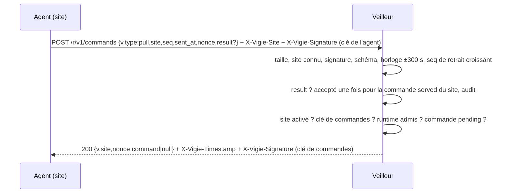

# Instruction: Point d'entrée /r/v1/commands

## Architecture projection

```txt
.
└── vigie/
    ├── src/
    │   ├── command/pull.rs   ✅ schéma du retrait, vérifications dans l'ordre, réponse signée
    │   └── serve.rs          ✏️ route POST /r/v1/commands, mêmes limites de taille et de délai que /r/v1/report
    └── tests/
        └── commands.rs       ✅ curl-équivalents : retrait, rejeu, horloge, clé absente, attaquant installé sur le site
```

## User Journey



## Test Scope

```mermaid
journey
  section Happy path
    ping en file, retrait signé => 200, commande signée, état served: 5: api
    retrait suivant avec result ok => done, audit, command null: 5: api
  section Edge case - rejeu
    même retrait rejoué => 404, état inchangé: 1: api
    result pour un command_id d'un autre site ou déjà acquitté => ignoré et journalisé, audit « result-rejected »: 1: api
  section Edge case - fail-closed
    clé de commandes absente => 404 ; site désactivé => command null signé: 1: api
    runtime retiré de la configuration après enqueue => refused, jamais servie: 1: api
  section Edge case - attaquant sur le site (clé de l'agent volée)
    retrait avec un champ command ou params forgé => 404 (schéma): 1: api
    rapport valide envoyé sur /r/v1/commands ou retrait sur /r/v1/report => 404: 1: api
    aucun chemin ne crée une commande: 1: api
```

## Tasks to do

1. Schéma du retrait (`deny_unknown_fields`) : `v`=1, `type`=`pull`, `site`, `seq`, `sent_at`, `nonce` (16 à 64 caractères base64url), `agent`, `result` facultatif.
2. Ordre des vérifications calqué sur `ingest.rs` ; refus → 404 commun, raison au journal avec request_id.
3. Réponse : JSON `{v, site, nonce, server_time, command}` ; `command` = `{id, seq, name, runtime, params, issued_at, expires_at}` ; en-têtes `X-Vigie-Timestamp`, `X-Vigie-Signature`, `Cache-Control: no-store`.
4. Une commande servie et non acquittée est re-servie telle quelle (même `id`, même `seq`) au retrait suivant, jusqu'à expiration : un agent qui a planté avant d'exécuter la reçoit encore ; c'est à lui de ne pas la rejouer (#6, `seq` persisté).
5. Débit : au plus un retrait accepté par site et par 30 s.

## Test acceptance criteria

| Task | Acceptance criteria |
| ---- | ------------------- |
| 1-3  | Chaque cas de la section Edge case est un test ; la signature de la réponse se vérifie avec la clé publique de commandes sur le préfixe, l'horodatage et les octets bruts |
| 4    | Re-servie identique ; jamais deux `seq` pour une même commande |
