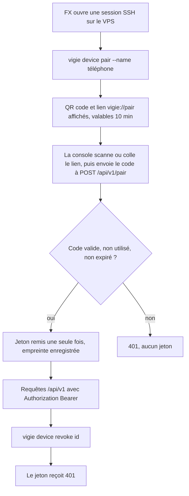
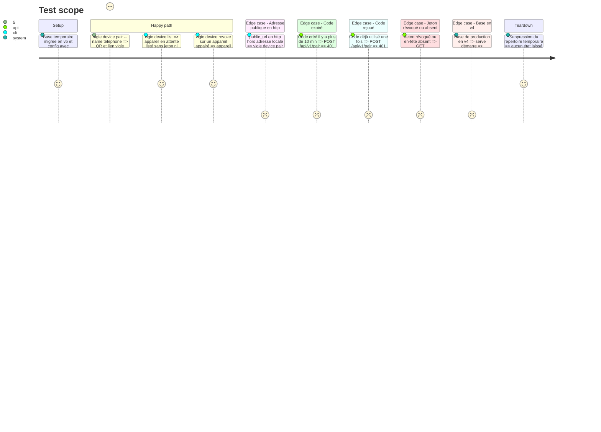

<!-- Fill or omit these sections; never add, rename, or reorder one. -->

# Instruction: Veilleur, appareils, appairage, authentification

## Architecture projection

> Tree of the final files. ✅ create · ✏️ modify · ❌ delete

```txt
.
├── .github/workflows/
│   └── vigie.yml              ✏️ exclure vigie/app/** des chemins déclencheurs
└── vigie/
    ├── Cargo.toml             ✏️ getrandom, sha2, qrcode (rendu Unicode en terminal)
    ├── Cargo.lock             ✏️ verrou des nouvelles dépendances
    ├── config.example.toml    ✏️ section [api] : public_url (adresse publique du veilleur)
    ├── README.md              ✏️ commandes device, routes /api/v1
    ├── src/
    │   ├── config.rs          ✏️ lecture et validation de [api]
    │   ├── main.rs            ✏️ sous-commande device pair|list|revoke
    │   ├── store.rs           ✏️ migration 5 (devices, pairings) et accès
    │   ├── device.rs          ✅ jetons, codes d'appairage, empreintes SHA-256
    │   ├── api.rs             ✅ routes /api/v1, extracteur d'authentification Bearer
    │   └── serve.rs           ✏️ monte /api/v1 dans le routeur
    ├── tests/
    │   ├── api_auth.rs        ✅ appairage, jeton valide, révoqué, absent
    │   └── cli.rs             ✏️ device pair, list, revoke
    └── docs/
        └── api-console.md     ✅ protocole d'appairage et d'authentification
```

## User Journey



## Test Scope



## Tasks to do

### `1)` Schéma des appareils

> Conserver les appareils et les codes d'appairage sans aucun secret en clair.

1. Migration 5 : table `devices` (id, nom, empreinte du jeton, créé le, vu le, révoqué le) et table `pairings` (empreinte du code, nom prévu, expire le, utilisé le).
2. Constante `SCHEMA_DEVICES` et accès du `Store` : créer un code, consommer un code en une transaction, trouver un appareil par empreinte, mettre à jour « vu le », lister, révoquer.
3. Test de montée de version depuis une base v4 remplie.

### `2)` Jetons et codes

> Produire des secrets imprévisibles et ne stocker que leur empreinte.

1. `device.rs` : jeton de 32 octets et code de 16 octets tirés par `getrandom`, encodés en base64url ; SHA-256 pour l'empreinte.
2. Comparaison des empreintes en temps constant.
3. Lien d'appairage, identique dans le QR code et en texte : `vigie://pair?u=<public_url>&c=<code>`. Collé tel quel sous Windows, il porte à la fois l'adresse et le code.

### `3)` Commandes device

> Appairer et retirer un appareil depuis le VPS.

1. `vigie device pair --name <nom>` : crée le code, affiche le QR code en Unicode, puis le lien texte et l'heure d'expiration.
2. `vigie device list` : id, nom, état (en attente, actif, révoqué), dates. Aucun secret.
3. `vigie device revoke <id>` : révocation immédiate, avec un message si l'id est inconnu.
4. `public_url` absent, ou en http sur une autre adresse que la boucle locale (127.0.0.1, ::1, localhost) : `device pair` s'arrête avec un message explicite.

### `4)` Routes d'appairage et d'authentification

> Échanger un code contre un jeton et protéger tout `/api/v1` sauf l'appairage.

1. `POST /api/v1/pair` (code seul, le nom vient de `device pair --name`) : consomme le code et renvoie le jeton une seule fois. Corps limité, réponse 401 uniforme en cas d'échec.
2. Extracteur Bearer : empreinte du jeton, recherche d'un appareil actif, mise à jour de « vu le » au plus une fois par minute, 401 sinon.
3. `GET /api/v1/overview` minimal (heure du serveur, dernier tick) pour éprouver l'authentification de bout en bout.
4. Aucun jeton ni code dans les journaux.

### `5)` Documentation et CI

> Rendre le protocole lisible et garder la CI du veilleur ciblée.

1. `docs/api-console.md` : appairage, format du QR code, durée de vie, révocation, codes de réponse.
2. README : commandes device et section `[api]`.
3. `vigie.yml` : exclure `vigie/app/**` des déclencheurs.

## Test acceptance criteria

| Task | Acceptance criteria |
| ---- | ------------------- |
| 1 | Une base v4 passe en v5 sans perte : incidents, rapports et clés restent lisibles. |
| 1 | Les tables ne contiennent que des empreintes : aucun jeton ni code en clair. |
| 2 | Deux appels successifs produisent deux jetons différents, et l'empreinte d'un jeton le retrouve. |
| 3 | `device pair` affiche un QR code lisible par un lecteur standard, et le même lien en texte. |
| 3 | Une `public_url` en http hors boucle locale est refusée. |
| 3 | `device list` n'affiche aucun secret, et `device revoke` d'un id inconnu sort en erreur explicite. |
| 4 | Un code valide donne un jeton une fois ; rejoué ou expiré, il donne 401. |
| 4 | `GET /api/v1/overview` répond 200 avec un jeton actif, et 401 sans jeton ou avec un jeton révoqué. |
| 4 | `/health` et `POST /r/v1/report` gardent leur comportement, et les tests existants passent. |
| 5 | La CI du veilleur ne se déclenche pas sur un changement limité à `vigie/app/`. |
