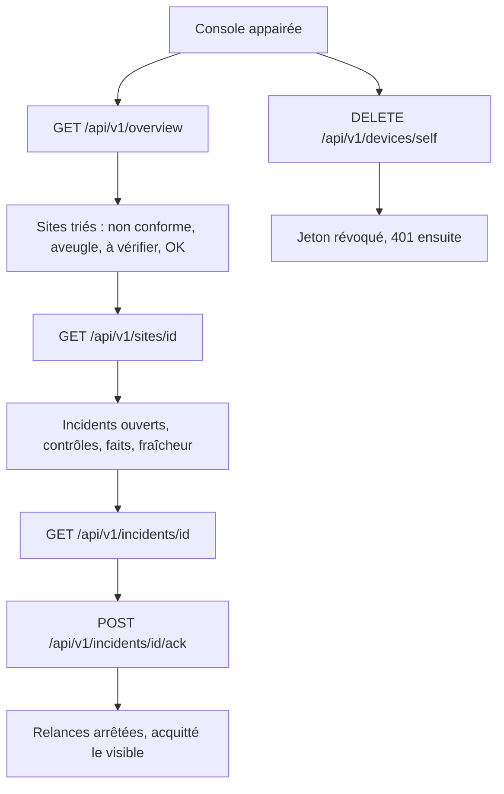
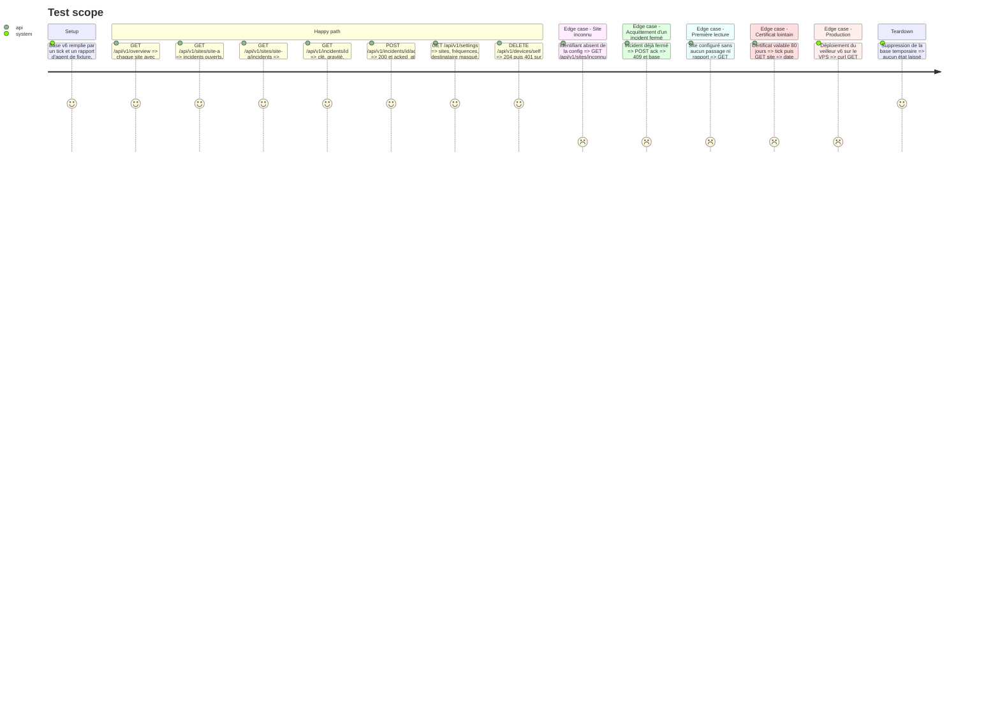

<!-- Fill or omit these sections; never add, rename, or reorder one. -->

# Instruction: Veilleur, API de lecture et acquittement

## Architecture projection

> Tree of the final files. ✅ create · ✏️ modify · ❌ delete

```txt
.
└── vigie/
    ├── README.md              ✏️ liste des routes /api/v1
    ├── src/
    │   ├── store.rs           ✏️ migration 6 (dernier résultat par contrôle), requêtes de lecture
    │   ├── tick.rs            ✏️ enregistre le résultat, la durée et les valeurs observées de chaque contrôle externe
    │   ├── ingest.rs          ✏️ enregistre le résultat des contrôles d'agent à chaque rapport accepté
    │   ├── checks/tls.rs      ✏️ remonte la date d'expiration comme valeur observée, même hors alerte
    │   ├── api.rs             ✏️ routes de lecture, acquittement, sérialisation stable
    │   ├── serve.rs           ✏️ transmet la configuration des sites (et plus seulement leurs id)
    │   └── main.rs            ✏️ passe la configuration complète à serve
    ├── tests/
    │   └── api_read.rs        ✅ lecture, acquittement, sites inconnus, base sans données
    └── docs/
        ├── api-console.md     ✏️ schéma de chaque réponse et correspondance avec les écrans
        └── hebergement.md     ✏️ section [api] en production, appairage et révocation d'un appareil
```

## User Journey



## Test Scope



## Tasks to do

### `1)` Dernier résultat de chaque contrôle

> Donner aux écrans Santé et Contrôles un état réel par contrôle, avec son heure.

1. Migration 6 : colonnes de `check_runs` pour le résultat (ok, constat, erreur), la gravité, le détail, la durée en millisecondes et les valeurs observées (JSON : code HTTP, date d'expiration TLS).
2. `tick.rs` et `ingest.rs` écrivent ces colonnes à chaque passage. `tls.rs` remonte toujours la date d'expiration.
3. Aucun historique : on conserve seulement le dernier passage, comme aujourd'hui.

### `2)` Routes de lecture

> Exposer à la console tout ce que le veilleur sait déjà, sans rien recalculer côté client.

1. `GET /api/v1/overview` complet : heure du serveur, dernier tick, et pour chaque site son état (non conforme, aveugle, à vérifier, OK, première lecture), le nombre de points ouverts, le constat le plus grave et l'heure de dernière lecture.
2. `GET /api/v1/sites/:id` : type, URL, faits de l'agent, dernier rapport, incidents ouverts du plus grave au moins grave, contrôles avec leur dernier résultat.
3. `GET /api/v1/sites/:id/incidents` : incidents fermés des 30 derniers jours.
4. `GET /api/v1/incidents/:id` : détail complet, avec les dates d'envoi des e-mails.
5. `GET /api/v1/settings` : sites, fréquences, silence d'agent, destinataire masqué, appareils avec « vu le », et l'appareil appelant signalé.
6. Règle d'état unique dans le veilleur. « Aveugle » correspond à un incident heartbeat ou à un silence d'agent ouvert.

### `3)` Acquittement

> Arrêter les relances d'un incident depuis la console.

1. `POST /api/v1/incidents/:id/ack` : même effet que `vigie ack <id>`, idempotent sur un incident déjà acquitté.
2. Incident fermé : 409. Id inconnu : 404.
3. Journal du veilleur : l'acquittement mentionne l'id de l'appareil.
4. `DELETE /api/v1/devices/self` : l'appareil appelant se révoque lui-même. C'est la seule écriture sur les appareils accessible par l'API.

### `4)` Documentation

> Fixer le contrat que la console consommera.

1. `docs/api-console.md` : chaque route, ses champs, ses codes de réponse, et l'écran qui l'utilise.
2. README : liste des routes.

### `5)` Mise en service de l'API

> Ouvrir l'API en production dès cette phase, pour que la console se vérifie contre un veilleur en https.

1. `public_url` ajouté par FX dans la config du VPS. Caddy relaie déjà tous les chemins, rien n'y change.
2. Déploiement par `deploy.mjs`, lancé par FX, avec la vérification du verrou restée ouverte dans `hebergement.md`.
3. Migrations 5 et 6 appliquées au démarrage de `serve`. Les rapports d'agent et les alertes continuent sans interruption.
4. `hebergement.md` : section API, `vigie device pair` lancé sous l'utilisateur du service, révocation d'un appareil perdu.

## Test acceptance criteria

| Task | Acceptance criteria |
| ---- | ------------------- |
| 1 | Après un tick, chaque contrôle externe a un résultat, une durée et une heure. Un certificat valable 80 jours expose sa date d'expiration. |
| 1 | Une base v5 passe en v6 sans perte, et le dernier passage existant reste lisible avec un résultat vide. |
| 2 | L'ordre de `overview` suit non conforme, aveugle, à vérifier, OK, comme l'écran Main. |
| 2 | Un site sans passage ni rapport est rendu « première lecture », sans valeur par défaut présentée comme mesurée. |
| 2 | Aucune réponse ne contient de mot de passe, de clé ou de jeton, et le destinataire est masqué. |
| 3 | Après un acquittement par l'API, le tick suivant n'envoie pas de relance pour cet incident. |
| 3 | L'acquittement d'un incident fermé est refusé sans modifier la base. |
| 3 | Après `DELETE /api/v1/devices/self`, le jeton reçoit 401 et `vigie device list` montre l'appareil révoqué. |
| 4 | Chaque route documentée correspond à un test qui en vérifie la forme. |
| 5 | En production, `/api/v1/overview` sans jeton répond 401, `/health` répond 200, et le rapport d'agent suivant est accepté. |
