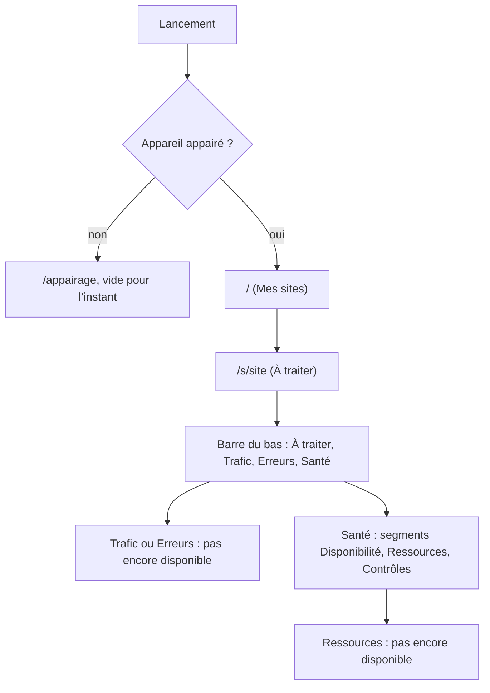
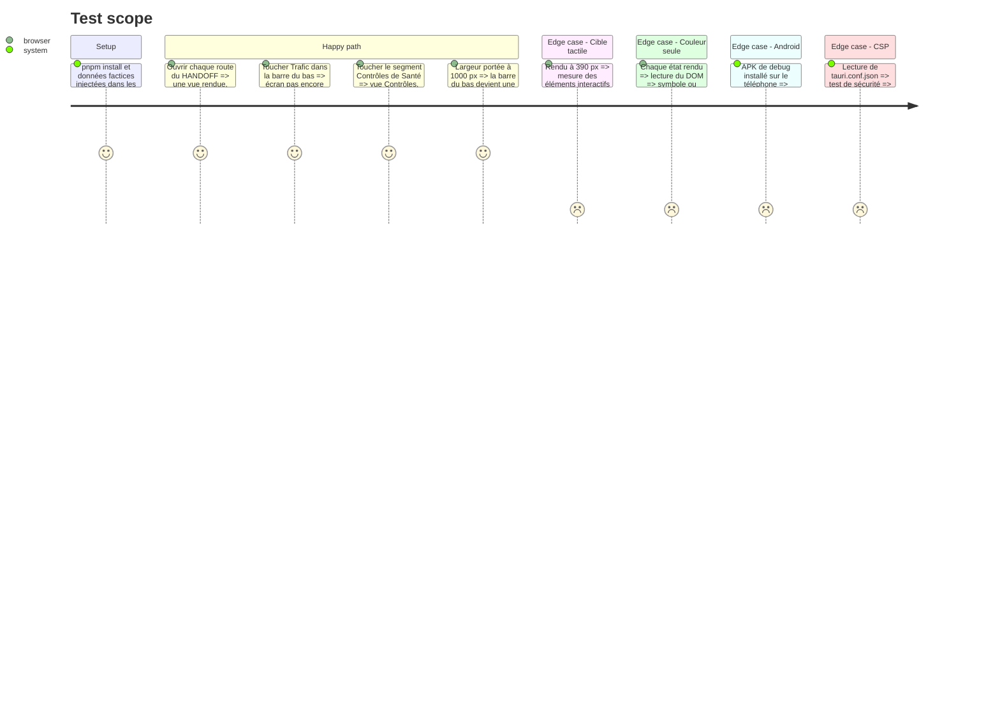

<!-- Fill or omit these sections; never add, rename, or reorder one. -->

# Instruction: Console, squelette, système visuel, navigation

## Architecture projection

> Tree of the final files. ✅ create · ✏️ modify · ❌ delete

```txt
.
├── .github/workflows/
│   └── console.yml                ✅ CI de la console : lint, vue-tsc, vitest, cargo clippy et test (Ubuntu, Windows)
└── vigie/app/                     ✅ projet Tauri 2, pnpm, Node 20
    ├── package.json               ✅ vue 3.5, vite 6, tailwindcss 3.4, vue-router 4, pinia 3, @fontsource IBM Plex
    ├── pnpm-lock.yaml             ✅ verrou
    ├── vite.config.ts             ✅ port 1420, alias @
    ├── tailwind.config.js         ✅ couleurs, tailles et rayons repris de tokens.css
    ├── postcss.config.js          ✅ tailwind et autoprefixer
    ├── eslint.config.js           ✅ config plate, vue et typescript, zéro avertissement
    ├── tsconfig.json              ✅ strict
    ├── index.html                 ✅ point d'entrée
    ├── src/
    │   ├── main.ts                ✅ montage, routeur, pinia
    │   ├── App.vue                ✅ coquille : en-tête, contenu, barre du bas ou colonne
    │   ├── styles/tokens.css      ✅ copie de aidd_docs/design/vigie-design/tokens.css
    │   ├── router/index.ts        ✅ toutes les routes du HANDOFF §3 et /appairage
    │   ├── lib/time.ts            ✅ heures en Europe/Paris, « lu il y a »
    │   ├── components/            ✅ AppHeader, BottomNav, SideNav, Segmented, StateSymbol, StatusChip, SiteRow, PointRow, NotYet, StateScreen
    │   ├── views/                 ✅ une vue par maquette ; Trafic, Journal, Blocages, Erreurs, Ressources, AjoutSite, Emails affichent NotYet
    │   └── **/*.spec.ts           ✅ tests vitest des composants et du routeur
    └── src-tauri/
        ├── Cargo.toml             ✅ tauri 2, serde, rust-version 1.93
        ├── rust-toolchain.toml    ✅ 1.93.0, cibles Windows et aarch64-linux-android
        ├── tauri.conf.json        ✅ identifiant, fenêtre, CSP 'self' et ipc:, bundle nsis, version lue dans package.json
        ├── capabilities/default.json ✅ core:default seulement
        ├── src/lib.rs             ✅ enregistrement des commandes
        ├── src/main.rs            ✅ point d'entrée desktop
        ├── gen/android/           ✅ projet Android produit par tauri android init, versionné (signature release en phase 5)
        └── icons/                 ✅ icônes générées par tauri icon
```

## User Journey



## Test Scope



## Wireframe

```txt
Coquille mobile (390 px)                 Coquille large (> 900 px)
┌──────────────────────────────┐         ┌──────────┬──────────────────────────────────────┐
│ (1) ‹ site · lu il y a  Relire│         │ (4) Vigie│ (1) site · lu il y a           Relire │
├──────────────────────────────┤         │  À traiter├──────────────────┬───────────────────┤
│ (2) Segments (Santé, Trafic) │         │  Trafic  │ (5) Liste          │ (6) Détail         │
├──────────────────────────────┤         │  Erreurs │  ┌──────────────┐  │                    │
│ (3) Contenu de la vue        │         │  Santé   │  │ ligne        │  │                    │
│                              │         │          │  └──────────────┘  │                    │
│                              │         │  ──────  │                    │                    │
├──────────────────────────────┤         │  Mes sites                    │                    │
│ (4) À traiter·Trafic·Err·Santé│        │  Réglages│                    │                    │
└──────────────────────────────┘         └──────────┴──────────────────┴───────────────────┘

Écran non disponible
┌──────────────────────────────┐
│ (1) En-tête du site           │
├──────────────────────────────┤
│ (7) Nom de la fonctionnalité  │
│     Ce qu'elle montrera       │
│     Ce qui manque pour        │
│     l'alimenter               │
│ (8) Lien vers ce qui existe   │
├──────────────────────────────┤
│ (4) Barre du bas              │
└──────────────────────────────┘
```

1. En-tête collant : retour, site, heure de dernière lecture, « Relire » toujours à la même place.
2. Sélecteur à trois segments, pour Trafic et Santé seulement.
3. Contenu de la vue courante.
4. Navigation d'un site, avec badges de points ouverts. En bas sur mobile, en colonne à gauche au-delà de 900 px, avec l'accès à Mes sites et à Réglages.
5. Liste (sites, points, contrôles) en vue large.
6. Détail de l'élément choisi, à côté de la liste en vue large.
7. Fonctionnalité nommée, sans aucune donnée d'exemple.
8. Renvoi vers l'écran alimenté le plus proche (par exemple Santé pour Ressources).

## Tasks to do

### `1)` Projet Tauri et outillage

> Avoir une app qui se construit et se teste sur la pile de lyremember.

1. Créer `vigie/app/` avec pnpm, Vue 3, Vite, Tailwind 3.4, TypeScript strict, ESLint plat et vitest (jsdom).
2. `src-tauri` : tauri 2, identifiant d'application sans domaine réel (dépôt public), bundle NSIS, `rust-toolchain.toml` en 1.93. La version de `tauri.conf.json` pointe vers `package.json`.
3. CSP : `default-src 'self'; connect-src 'self' ipc: http://ipc.localhost; img-src 'self' data:`, avec le test de sécurité repris de lyremember.
4. Polices IBM Plex Sans et Mono embarquées par @fontsource, sans requête externe.
5. Android : prérequis locaux vérifiés (SDK, NDK, Java 17), puis `tauri android init`, et `gen/android` versionné sans clé ni propriétés de signature.

### `2)` Système visuel

> Reprendre `tokens.css` tel quel, et les composants de la maquette Systeme.

1. Copier `tokens.css` et projeter ses jetons dans Tailwind (couleurs, tailles 12 à 22, rayons, cibles de 44 px).
2. Composants : symbole d'état `× ! i ✓ ?`, puce d'état, segments, ligne de site, ligne de point ouvert, en-tête, barre du bas et colonne.
3. Thème sombre seul, comme dessiné. Le réglage de thème de Reglages est affiché « pas encore disponible ».

### `3)` Routes et navigation

> Router tous les écrans du HANDOFF, en conservant le contexte.

1. Routes `/`, `/s/:site`, `/s/:site/alerte/:id`, `/s/:site/trafic`, `/trafic/journal`, `/trafic/blocages`, `/erreurs`, `/sante`, `/sante/ressources`, `/sante/controles`, `/parametres`, `/reglages`, `/ajouter`, et `/appairage`.
2. Paramètres `date`, `de`, `a`, `src` et `q` transmis par tous les liens internes.
3. Le retour depuis Paramètres ramène à l'écran d'origine.
4. Mise en page large au-delà de 900 px : colonne à gauche, liste et détail côte à côte.

### `4)` Écrans pas encore disponibles

> Nommer les fonctionnalités prévues sans afficher de fausses données.

1. Composant `NotYet` : nom, ce que l'écran montrera, la source qui manque (logs, ressources du compte, écriture sur le site), et un renvoi.
2. L'appliquer à Visiteurs, Journal, Blocages, Erreurs, Ressources, AjoutSite et Emails, ainsi qu'aux actions de sourdine et de file d'écriture.
3. Badges Trafic et Erreurs absents, et non « 0 », tant qu'aucune donnée n'existe.

### `5)` CI de la console

> Vérifier chaque changement de `vigie/app/` sur Linux et Windows.

1. `console.yml`, déclenché par `vigie/app/**` : pnpm 10, Node 20, lint, `vue-tsc`, vitest, `cargo clippy` et `cargo test` dans `src-tauri`.
2. Actions épinglées par SHA, comme dans `vigie.yml`.

## Test acceptance criteria

| Task | Acceptance criteria |
| ---- | ------------------- |
| 1 | `pnpm tauri dev` ouvre une fenêtre Windows sur l'écran d'accueil, sans requête réseau sortante au démarrage. |
| 1 | Le test de sécurité échoue si `unsafe-eval` ou une origine externe apparaît dans la CSP. |
| 1 | Un APK de debug produit par `tauri android build --debug` s'installe sur le téléphone et ouvre l'écran d'accueil. |
| 2 | Les couleurs, tailles et polices rendues correspondent à `tokens.css` ; aucune couleur n'est codée en dur dans une vue. |
| 2 | Chaque état affiche un symbole ou un libellé en plus de sa couleur. |
| 3 | Chaque route du HANDOFF rend une vue, et un lien interne conserve date, fenêtre, sources et filtre. |
| 3 | À 1000 px, la navigation est une colonne à gauche, et la liste et le détail sont côte à côte. |
| 4 | Les écrans sans source affichent leur nom et ce qui manque, sans aucun chiffre d'exemple. |
| 4 | Aucun badge « 0 » n'est affiché pour Trafic et Erreurs. |
| 5 | La CI de la console passe sur Ubuntu et Windows, et ne se déclenche pas pour un changement hors de `vigie/app/`. |
