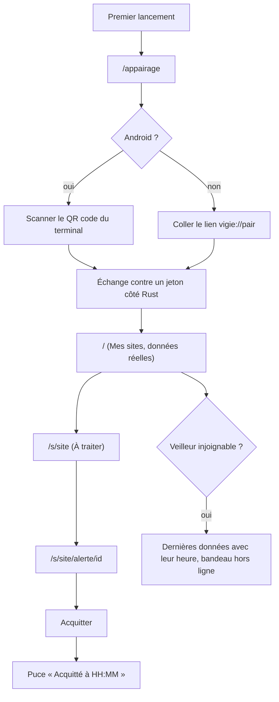
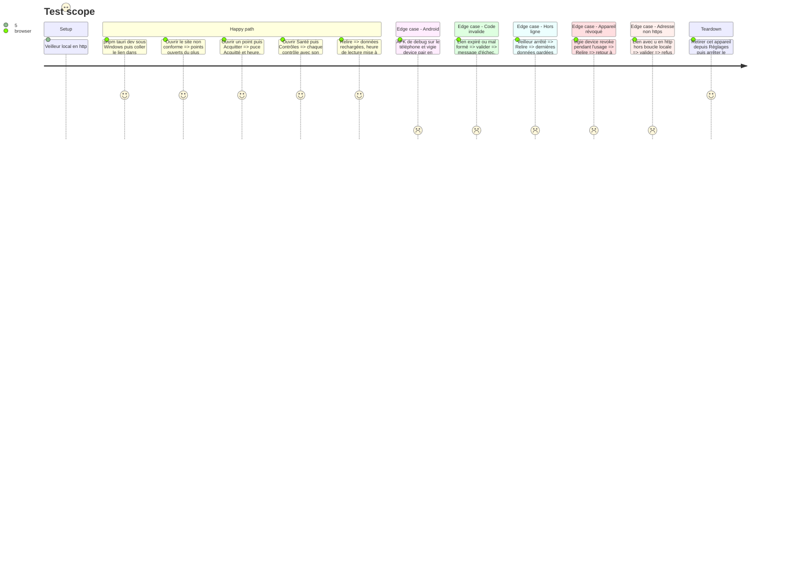

<!-- Fill or omit these sections; never add, rename, or reorder one. -->

# Instruction: Console, appairage et écrans alimentés

## Architecture projection

> Tree of the final files. ✅ create · ✏️ modify · ❌ delete

```txt
.
├── .github/workflows/
│   └── console.yml                      ✏️ déclenchée aussi par vigie/src/** et vigie/Cargo.*, pour le test de contrat
└── vigie/app/
    ├── package.json                     ✏️ @tauri-apps/plugin-barcode-scanner
    ├── src/
    │   ├── lib/api.ts                   ✅ appels invoke typés, types des réponses de l'API (phase 2)
    │   ├── lib/pairing.ts               ✅ lecture de vigie://pair?u=…&c=…, https exigé sauf boucle locale en build de debug
    │   ├── lib/platform.ts              ✅ mobile ou ordinateur (scan ou saisie)
    │   ├── stores/connection.ts         ✅ état d'appairage, joignable ou hors ligne, heure de dernière réponse
    │   ├── stores/sites.ts              ✅ overview, site, incidents, rechargés par « Relire »
    │   ├── views/Appairage.vue          ✅ scan du QR code (Android) ou code collé (Windows)
    │   ├── views/Main.vue               ✏️ sites réels, triés, avec fraîcheur
    │   ├── views/ATraiter.vue           ✏️ points ouverts, « le reste va bien », e-mails envoyés
    │   ├── views/Alerte.vue             ✏️ détail d'incident, chronologie, action Acquitter
    │   ├── views/Dispo.vue              ✏️ contrôles externes, incidents des 30 jours, certificat
    │   ├── views/Controles.vue          ✏️ contrôles d'agent et externes avec leur dernier résultat
    │   ├── views/Parametres.vue         ✏️ paramètres du site en lecture, actions CLI indiquées
    │   ├── views/Reglages.vue           ✏️ destinataire masqué, appareils, retrait de cet appareil, version de la console
    │   ├── views/Etats.vue              ✏️ aveugle, première lecture, hors ligne, vide, confirmation
    │   └── **/*.spec.ts                 ✏️ tests des stores, de pairing.ts et des vues alimentées
    └── src-tauri/
        ├── Cargo.toml                   ✏️ reqwest en rustls avec webpki-roots, tauri-plugin-barcode-scanner (cibles mobiles), vigie en dev-dependency par chemin
        ├── capabilities/mobile.json     ✅ barcode-scanner:allow-scan, allow-cancel, Android
        ├── src/client.rs                ✅ appels au veilleur, Bearer ajouté côté Rust, délais, erreurs typées
        ├── src/pairing.rs               ✅ échange code contre jeton, fichier privé dans app_data_dir
        ├── src/lib.rs                   ✏️ commandes pair, unpair, overview, site, incidents, incident, ack, settings
        └── tests/contract.rs            ✅ client.rs contre vigie::serve::router en processus, sur une base de fixture
```

## User Journey



## Test Scope



## Wireframe

```txt
Appairage (non dessiné dans les maquettes)
┌──────────────────────────────┐
│ (1) Vigie                     │
├──────────────────────────────┤
│ (2) Où obtenir le lien        │
│     d'appairage               │
├──────────────────────────────┤
│ (3) [ Scanner le QR code ]    │  ← Android
│ (4) Lien  [______________]    │  ← Windows, et repli Android
│ (5) [ Appairer ]              │
├──────────────────────────────┤
│ (6) Message d'échec           │
└──────────────────────────────┘

Mes sites                         À traiter                         Alerte
┌──────────────────────────────┐  ┌──────────────────────────────┐  ┌──────────────────────────────┐
│ (7) Mes sites · heure  Relire │  │ (1) ‹ site · lu il y a  Relire│  │ (1) ‹ site · lu il y a  Relire│
├──────────────────────────────┤  ├──────────────────────────────┤  ├──────────────────────────────┤
│ (8) × site  constat   lu à    │  │ (10) N points ouverts         │  │ (13) Puce d'état              │
│     ? site  aveugle   lu à    │  │  × titre · fait · où          │  │      Titre du constat         │
│     ! site  constat   lu à    │  │  ! titre · fait · où          │  │ (14) Quand : ouvert, e-mails  │
│     ✓ site  rien      lu à    │  ├──────────────────────────────┤  │ (15) Quoi : détail            │
├──────────────────────────────┤  │ (11) Le reste va bien         │  │ (16) Faits liés (agent)       │
│ (9) Ajouter un site (bientôt) │  ├──────────────────────────────┤  │ (17) [Acquitter] [Sourdine·NA]│
└──────────────────────────────┘  │ (12) Alertes envoyées         │  ├──────────────────────────────┤
                                  ├──────────────────────────────┤  │ (4) Barre du bas              │
                                  │ (4) Barre du bas              │  └──────────────────────────────┘
                                  └──────────────────────────────┘
```

1. En-tête : site et heure de la dernière lecture réussie.
2. Consigne : où obtenir le lien d'appairage.
3. Scan du QR code, affiché sur mobile seulement.
4. Saisie du lien complet, qui porte l'adresse et le code. Le nom de l'appareil est celui donné à `vigie device pair --name`.
5. Action unique de validation.
6. Échec explicite (lien expiré, adresse refusée, veilleur injoignable).
7. Titre, date et heure du jour, « Relire ».
8. Une ligne par site : symbole, constat principal, heure de lecture, dans l'ordre de gravité.
9. Ajout de site nommé, signalé « pas encore disponible ».
10. Points ouverts du plus grave au moins grave, avec l'écran où ils se traitent.
11. Contrôles sans constat.
12. E-mails d'ouverture, de relance et de clôture, avec leur heure.
13. État : en cours, acquitté à HH:MM, ou fermé à HH:MM.
14. Chronologie tirée des dates de l'incident.
15. Détail du constat tel que le veilleur l'a enregistré.
16. Faits du dernier rapport d'agent liés au contrôle.
17. Acquitter (seule écriture) ; sourdine nommée, signalée « pas encore disponible ».

## Tasks to do

### `1)` Appairage

> Lier un appareil au veilleur sans que le jeton passe par le webview.

1. `pairing.ts` : lecture de `vigie://pair`, adresse en `https` exigée, sauf la boucle locale dans un build de debug. Code au format attendu.
2. Android : scan par le plugin barcode-scanner, capability mobile seulement. Windows et repli : lien collé.
3. `pairing.rs` : `POST /api/v1/pair`, jeton écrit dans un fichier de `app_data_dir`, jamais renvoyé au front.
4. Retrait de cet appareil depuis Réglages : `DELETE /api/v1/devices/self`, puis suppression du fichier local. Si le veilleur est injoignable, le fichier est supprimé quand même, et l'écran indique la commande `vigie device revoke` à lancer.

### `2)` Client et état de connexion

> Lire l'API avec des erreurs lisibles et des données toujours datées.

1. `client.rs` : Bearer ajouté côté Rust, délai court, erreurs typées (hors ligne, non autorisé, introuvable, serveur).
2. Un 401 efface le jeton local et renvoie vers Appairage.
3. Stores Pinia : dernière réponse conservée avec son heure. « Relire » recharge la vue courante.
4. Bandeau hors ligne : dernières données affichées avec l'heure de leur lecture.
5. `tests/contract.rs` : chaque commande du client appelée contre le routeur du veilleur en processus, sur une base de fixture.
6. `console.yml` se déclenche aussi sur les sources du veilleur, pour qu'un changement de l'API rejoue le contrat.

### `3)` Écrans alimentés

> Brancher sur l'API les écrans qui ont une source réelle.

1. Main : sites, état, constat, heure de lecture.
2. ATraiter : points ouverts, « le reste va bien », e-mails envoyés tirés des dates de notification.
3. Alerte : chronologie, détail, faits liés, Acquitter avec confirmation de l'état obtenu.
4. Dispo : contrôles externes avec durée et heure, incidents des 30 jours, date d'expiration du certificat.
5. Controles : contrôles externes et d'agent avec leur état. Le jeu WordPress détaillé et les contrôles personnalisés sont signalés « pas encore disponible ».
6. Parametres et Reglages en lecture. Chaque action réservée à la CLI cite sa commande. Reglages affiche la version de la console, lue par `getVersion()`.
7. Etats : aveugle, première lecture, hors ligne, vide.

### `4)` Badges

> Faire correspondre les badges de la barre du bas aux points réellement ouverts.

1. À traiter : nombre d'incidents ouverts du site.
2. Santé : incidents ouverts sur les contrôles externes et d'agent.
3. Trafic et Erreurs : pas de badge.

## Test acceptance criteria

| Task | Acceptance criteria |
| ---- | ------------------- |
| 1 | Sous Windows, coller un lien valide mène à Mes sites. Sous Android, le scan du QR code de production mène au même écran. |
| 1 | Aucune réponse de commande ni aucun stockage du webview ne contient le jeton. |
| 1 | Un lien dont l'adresse est en http hors boucle locale est refusé sans requête réseau. Dans un build release, même la boucle locale est refusée. |
| 1 | Après « Retirer cet appareil », `vigie device list` montre l'appareil révoqué. |
| 2 | Avec le veilleur arrêté, « Relire » garde les dernières données avec leur heure, et le bandeau hors ligne apparaît. |
| 2 | Un appareil révoqué revient à Appairage au premier rechargement. |
| 2 | Le test de contrat échoue dès qu'un champ consommé par la console change dans une réponse du veilleur. |
| 3 | Mes sites, À traiter, Alerte, Disponibilité et Contrôles affichent les données de la base de fixture, et chaque donnée porte son heure. |
| 3 | Acquitter fait passer la puce à « Acquitté à HH:MM » ; l'incident reste listé tant qu'il n'est pas fermé. |
| 3 | Aucune valeur d'exemple des maquettes n'apparaît dans un écran alimenté. |
| 4 | Les badges À traiter et Santé correspondent au nombre d'incidents ouverts renvoyé par l'API. |
