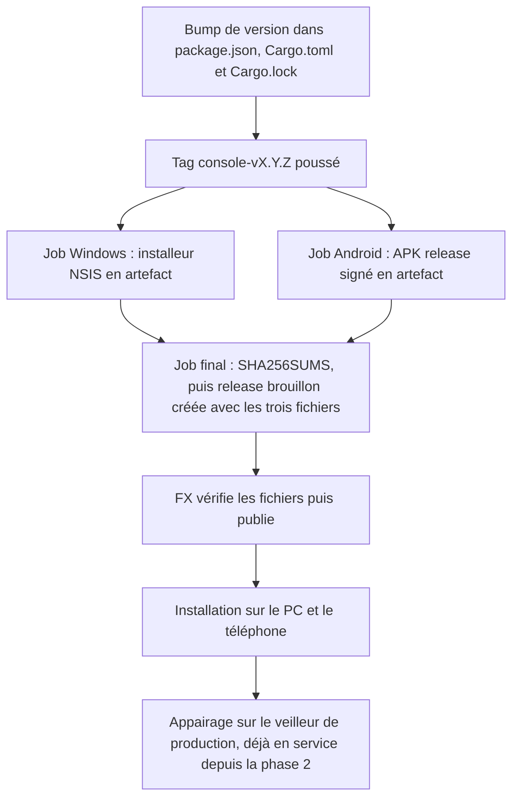
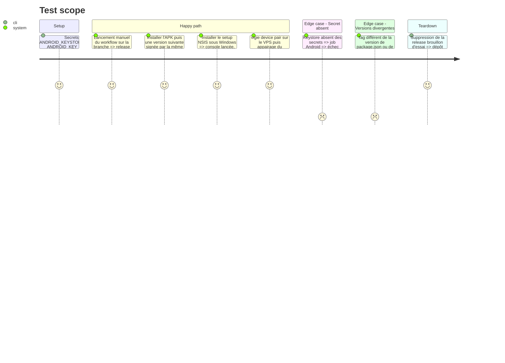

<!-- Fill or omit these sections; never add, rename, or reorder one. -->

# Instruction: Releases GitHub et mise en service

## Architecture projection

> Tree of the final files. ✅ create · ✏️ modify · ❌ delete

```txt
.
├── .github/workflows/
│   └── console-release.yml              ✅ tag console-v* ou lancement manuel : NSIS Windows et APK Android signé, release en brouillon
└── vigie/
    └── app/
        ├── .gitignore                   ✏️ keystore.properties, *.jks, sorties de build Android
        ├── README.md                    ✅ installation Windows et Android, appairage, procédure de release, bump de version
        ├── CHANGELOG.md                 ✅ historique des versions de la console
        └── src-tauri/gen/android/app/build.gradle.kts ✏️ signingConfig release lu depuis keystore.properties
```

## User Journey



## Test Scope



## Tasks to do

### `1)` Signature Android

> Signer l'APK avec une clé release stable, jamais versionnée.

1. Clé release créée par FX avec `keytool`, conservée hors du dépôt avec une sauvegarde.
2. `signingConfig` release dans `gen/android/app/build.gradle.kts` (projet versionné depuis la phase 3), qui lit `keystore.properties`.
3. Secrets GitHub posés par FX : keystore en base64, alias, mot de passe.
4. `.gitignore` : keystore, propriétés et sorties de build.

### `2)` Workflow de release

> Faire produire par GitHub les fichiers d'installation Windows et Android.

1. `console-release.yml` : déclenché par un tag `console-v*` ou à la main, avec permission `contents: write`.
2. Vérification préalable : les versions de `package.json` (que lit `tauri.conf.json`) et de `Cargo.toml` sont égales, et, sur un tag, égales au tag.
3. Job Windows : `pnpm tauri build --bundles nsis`, installeur déposé en artefact du workflow.
4. Job Android : Java 17, NDK, cible Rust `aarch64-linux-android`, `keystore.properties` reconstitué depuis les secrets, puis `tauri android build --apk --target aarch64`, APK déposé en artefact.
5. Job final, qui attend les deux autres : récupération des artefacts, `SHA256SUMS`, puis `gh release create console-vX.Y.Z --draft --target <sha>` avec les trois fichiers d'un coup. Aucun job n'écrit sur une release existante, donc aucune course. Un lancement manuel produit un brouillon sans tag, qu'on supprime après vérification.
6. Actions épinglées par SHA.

### `3)` Documentation de distribution

> Rendre la release et l'installation reproductibles.

1. `vigie/app/README.md` : installation Windows (avertissement SmartScreen, installeur non signé), installation Android (sources inconnues), appairage.
2. Procédure de release : les trois fichiers à bumper (`package.json`, `Cargo.toml`, `Cargo.lock`), le tag, la vérification des fichiers du brouillon avant de publier, puis à nouveau après.
3. `CHANGELOG.md` de la console.

### `4)` Mise en service

> Installer la première release et appairer les deux appareils.

1. Une première release `console-v0.1.0` en brouillon, vérifiée, puis publiée par FX.
2. Installation sur le PC et le téléphone depuis la release publiée. Les appareils de debug des phases 3 et 4 sont retirés.
3. Appairage des deux appareils sur le veilleur de production, puis contrôle par `vigie device list`.

## Test acceptance criteria

| Task | Acceptance criteria |
| ---- | ------------------- |
| 1 | Aucun keystore ni mot de passe n'apparaît dans l'historique git ou dans les journaux de la CI. |
| 1 | Une version N+1 s'installe par-dessus la version N sur le téléphone, sans désinstallation. |
| 2 | Un tag `console-v*` produit un brouillon de release contenant l'installeur Windows, l'APK et `SHA256SUMS`. |
| 2 | Un tag `v*` du module PrestaShop ne déclenche pas le workflow de la console. |
| 2 | Un tag qui ne correspond pas aux versions des fichiers arrête le workflow avant le build. |
| 2 | Un lancement manuel produit un brouillon complet sans créer de tag. |
| 3 | Les étapes du README suffisent pour installer et appairer sans autre source. |
| 4 | Le PC et le téléphone affichent les sites de production, et `vigie device list` les liste comme actifs. |
| 4 | Un appareil révoqué perd l'accès au premier rechargement, sans effet sur l'autre. |
