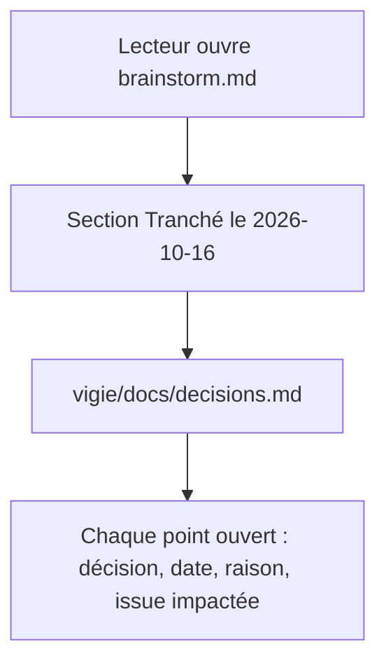

# Instruction: Registre des décisions

## Architecture projection

> Tree of the final files. ✅ create · ✏️ modify · ❌ delete

```txt
.
├── vigie/
│   ├── Cargo.toml                 ✏️ retirer « Nom provisoire » : le nom Vigie est figé
│   ├── README.md                  ✏️ lien vers docs/decisions.md
│   └── docs/
│       └── decisions.md           ✅ registre daté des décisions de produit
└── aidd_docs/tasks/2026_10/2026_10_15_veilleur-multisites/
    └── brainstorm.md              ✏️ section finale « Tranché le 2026-10-16 » qui renvoie au registre
```

## User Journey



## Test Scope

```mermaid
---
title: Test scope
---
journey
  section Setup
    Branche partie de main, arbre propre => état de départ connu: 5: cli
  section Happy path
    grep des sept points de #11 dans decisions.md => chaque point a une décision datée du 2026-10-16: 5: cli
    grep "provisoire" dans vigie/Cargo.toml => aucune ligne: 5: cli
    grep "decisions.md" dans brainstorm.md et vigie/README.md => un renvoi dans chacun: 5: cli
  section Edge case - données réelles
    Registre écrit => grep des domaines, IP et comptes réels => aucune occurrence: 1: cli
```

## Tasks to do

### `1)` Registre `vigie/docs/decisions.md`

> Une entrée par point ouvert de #11, avec la décision, la date, la raison et les issues qu'elle touche.

1. RGPD : logs d'accès conservés 30 jours puis purgés ; query strings masquées dès l'analyse ; contrat de sous-traitance avec chaque client avant de collecter ses logs (affaire de l'utilisateur, hors code). Touche #1 et #8.
2. Processus permanent chez Alwaysdata : sans objet. Le veilleur tourne sur le VPS, l'agent par tâche planifiée de l'hébergeur.
3. Hébergeurs sans tâche planifiée : constat de l'utilisateur (certains sites n'offrent que FTP et SQL). V1, choix par défaut faute de besoin exprimé et révisable : contrôles externes seuls, aucun accès stocké ; piste ultérieure : agent déposé par FTP au moment de l'installation, appelé par le veilleur en HTTPS signé.
4. Module PrestaShop : maintenu inchangé sur la boutique B jusqu'à ce que l'analyse de logs du veilleur (#7, #1, #8) le remplace.
5. Canal d'alerte : e-mail seul en V1 ; la console Android affiche les incidents.
6. Nom : Vigie, figé (déjà adopté le 2026-10-15 dans le plan du veilleur) ; « veilleur » reste le nom du démon.
7. Remis à plus tard, inchangé : Cloudflare, blocage pour Node, Core Web Vitals.
8. Décisions transverses prises le même jour, pour les issues suivantes : écriture sur les sites par proposition, validation, application (#10, #6, #13, #4) ; deux axes de typologie, CMS pour les contrôles et runtime php/node/static pour les commandes (#2, #4) ; signatures en base64 standard et ext-sodium native, contre l'hex et sodium_compat demandés par #9 et #6.
9. Points déjà tranchés ailleurs, cités avec leur source : conditions d'UptimeRobot (`vigie/docs/reception.md`), authentification du point d'entrée (`vigie/docs/protocole-agent.md`).

### `2)` Renvois et nom

> Les lecteurs trouvent le registre ; le nom n'est plus dit provisoire.

1. Ajouter à la fin de `brainstorm.md` une section « Tranché le 2026-10-16 » de deux lignes qui renvoie à `vigie/docs/decisions.md`, sans modifier le reste du fichier.
2. Ajouter le lien vers `docs/decisions.md` dans `vigie/README.md`, près des autres liens de docs.
3. Remplacer le commentaire de la ligne 2 de `vigie/Cargo.toml` par `# Vigie : nom figé le 2026-10-16 (vigie/docs/decisions.md).`

## Test acceptance criteria

| Task | Acceptance criteria |
| ---- | ------------------- |
| 1    | `vigie/docs/decisions.md` répond aux sept points de #11, chacun daté du 2026-10-16 avec sa raison et les issues touchées, et ne contient aucun domaine, IP ou compte réel |
| 2    | `brainstorm.md` garde sa section « Encore ouvert » intacte et finit par un renvoi au registre ; `vigie/README.md` le cite ; `vigie/Cargo.toml` ne dit plus « provisoire » et `cargo metadata` lit toujours la crate |
