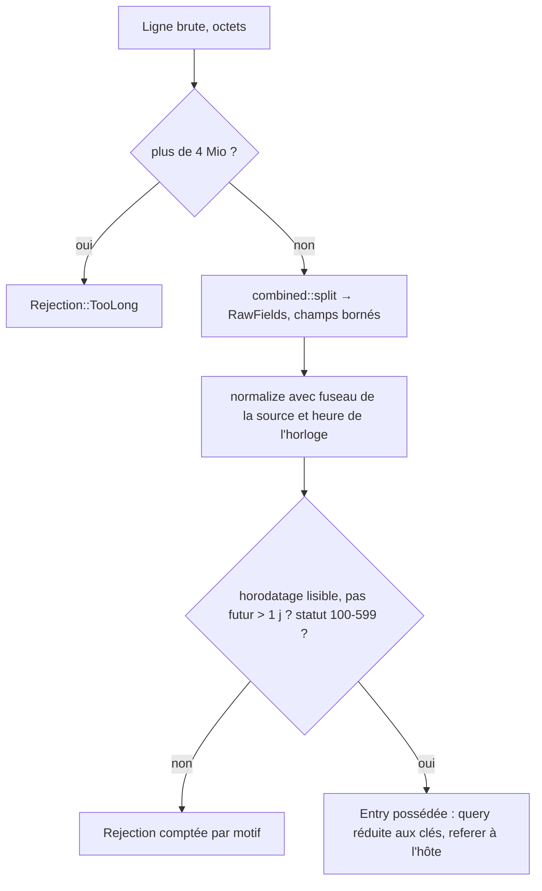

# Instruction: Entry, normalisation et découpeur combined

## Architecture projection

```txt
.
└── vigie/
    ├── Cargo.toml            ✏️ jiff (std, tzdb-bundle-always) ; flate2 en dev-dependency (fixture gz)
    └── src/
        ├── lib.rs            ✏️ déclare logs
        └── logs/
            ├── mod.rs        ✅ Entry (+ Entry::new), RawFields, Rejection, limites, normalize
            ├── time.rs       ✅ horodatage Apache → millisecondes UTC (décalage écrit, sinon fuseau IANA de la source)
            └── combined.rs   ✅ découpeur Apache combined par état : hôte en tête facultatif, champs en queue (protocole, durée) facultatifs, guillemets échappés
```

## User Journey



## Test Scope

```mermaid
journey
  section Happy path
    Ligne Alwaysdata standard IPv4 +0200 => Entry en UTC, ms exactes: 5: logs
    Ligne Alwaysdata advanced => protocole ignoré, durée 0.123 s => 123000 µs: 5: logs
    IPv6 2001:db8::1 => ip Some(V6): 5: logs
    GET /a?token=secret&q=x HTTP/1.1 => path /a, query_keys [token, q], aucune trace de secret: 5: logs
    GET /reset?AbC123jetonLong HTTP/1.1 => query_keys [?], aucune trace du jeton: 1: logs
    Ligne Apache standard sans hôte => ip, date et requête à leur place: 5: logs
    Utilisateur « john doe » avec ou sans hôte => ip et date à leur place: 1: logs
    Ligne coupée à 16 Kio au milieu de l'UA => Entry, UA tronqué: 1: logs
    Referer https://www.example.org/p?x => referer_host www.example.org: 5: logs
  section Edge case - hostile
    user_agent de 1 Mo dans une ligne => Entry, UA tronqué à 512 octets sur une frontière de caractère: 1: logs
    Chemin avec octets invalides => U+FFFD, jamais de panique: 1: logs
    Guillemet échappé dans l'UA => champ suivant intact: 1: logs
    Requête HTTP/0.9 "GET /" => GET, / ; "get /.env" => méthode None, path /.env: 1: logs
    Requête illisible (octets TLS) => méthode None, chemin vide: 1: logs
    10 000 lignes d'octets aléatoires (graine fixe) => aucune panique, champs dans leurs limites: 1: logs
  section Edge case - temps
    Sans décalage ni fuseau déclaré => Timestamp ; date à now + 2 j => Future: 1: logs
    Sans décalage, Europe/Paris, été puis hiver => +02:00 puis +01:00 ; recul d'heure => plus tôt: 1: logs
```

## Tasks to do

### `1)` Types

1. `Entry { timestamp_ms: i64, host: Option<String>, ip: Option<IpAddr>, method: Option<String>, path: String, query_keys: Vec<String>, status: u16, size: Option<u64>, referer_present: bool, referer_host: Option<String>, user_agent: String, duration_us: Option<u64> }`, champs publics, `Clone`, `Debug`, `PartialEq`, sans `non_exhaustive` (les tests d'intégration construisent des entrées). `Entry::new(timestamp_ms, path, status)` remplit le reste à vide.
2. `RawFields<'a>` : `Option<&'a [u8]>` par champ (`host`, `ip`, `timestamp`, `request`, `status`, `size`, `referer`, `user_agent`, `duration`).
3. `Rejection` (`Ord`, pour compter par motif) : `TooLong`, `Malformed`, `Timestamp`, `Future`, `Status`. `Display` stable.
4. Limites : `MAX_LINE = 4 Mio`, `MAX_USER_AGENT = 512`, `MAX_PATH = 2048`, `MAX_HOST = 253`, `MAX_METHOD = 16`, `MAX_QUERY_KEYS = 16`, `MAX_QUERY_KEY = 64`, `MAX_FUTURE_MS = 1 j`.

### `2)` Découpeur combined

1. `combined::split(line: &[u8]) -> Result<RawFields, Rejection>` : automate sur octets. Hôte en tête facultatif, reconnu par la forme des jetons avant le premier `[` : si le 1er est une IP ou `-`, pas d'hôte ; sinon, si le 2e l'est, le 1er est l'hôte ; sinon `Malformed`. Après l'IP, l'ident puis l'utilisateur, qui prend tout jusqu'au `[` (il peut contenir une espace) et n'est jamais exposé ; `ip ident user [date] "requête" statut taille "referer" "ua"` ; jetons en queue : un nombre décimal final est la durée, le reste est ignoré. Dans un champ entre guillemets, `\"` et `\\` ne ferment pas le champ. Une ligne coupée après le statut reste valide : un champ entre guillemets non fermé se clôt en fin de ligne, les champs suivants manquent (règle de coupe de l'agent, `logs.md`).
2. Plus de `MAX_LINE` octets → `TooLong` ; structure absente → `Malformed`.

### `3)` Normalisation

1. `truncate_utf8(bytes, max) -> String` : `from_utf8_lossy`, puis césure par `char_indices` au dernier caractère qui tient.
2. Requête : jetons séparés par des espaces ; 2 ou 3 jetons → cible = 2e ; méthode = 1er si lettres majuscules ASCII de 1 à 16, sinon `None` ; 1 ou plus de 3 jetons → méthode `None`, chemin vide. Cible coupée au premier `?` : chemin non décodé ; query → clés seulement, dans l'ordre, sans doublon, bornées, et seulement pour un paramètre `clé=…` dont la clé fait 1 à 32 caractères de `[A-Za-z0-9_.-]` ou `[]` ; tout autre paramètre (sans `=`, clé longue ou exotique, qui peut être un jeton) est remplacé une fois par la marque `?`.
3. Hôte : minuscules, sans port ni point final, borné. IP : `-` ou illisible → `None`. Referer : `-` ou vide → absent ; sinon hôte de l'URL, normalisé comme l'hôte.
4. Taille `-` → `None`. Durée : secondes décimales → µs, illisible → `None`. Statut hors 100-599 → `Status`.
5. `normalize(raw, tz, now_ms) -> Result<Entry, Rejection>` ; `now_ms` vient d'une `Clock`.

### `4)` Horodatage

1. `time::parse_apache(bytes, tz: Option<&TimeZone>) -> Option<i64>` : `[dd/Mon/yyyy:HH:MM:SS ±HHMM]`, crochets facultatifs. Sans décalage : fuseau de la source, ambiguïtés en mode `compatible` (recul d'heure : la plus tôt ; trou d'heure : après le trou), documenté.
2. Années hors 1970-9999 → `None`.

### `5)` Fuzz

1. Test à graine fixe, sans dépendance (xorshift) : 10 000 lignes d'octets aléatoires et 10 000 lignes combined mutées passent par `split` puis `normalize` sans panique ; toute `Entry` respecte les limites.

## Test acceptance criteria

| Task | Acceptance criteria |
| ---- | ------------------- |
| 1-3  | Aucune entrée de la section hostile ne panique ; chaque champ texte respecte sa limite et reste de l'UTF-8 valide ; aucune valeur de query n'apparaît dans une `Entry` |
| 4    | Les cas de fuseau donnent les millisecondes UTC attendues ; sans décalage ni fuseau, rejet |
| 5    | Le fuzz passe en moins de 5 s en debug |
