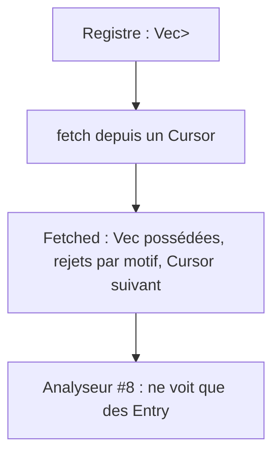

# Instruction: Trait LogSource, fixtures et contrat écrit

## Architecture projection

```txt
.
└── vigie/
    ├── src/logs/
    │   ├── mod.rs            ✏️ déclare source
    │   └── source.rs         ✅ BoxFuture, Cursor, Fetched (more), SourceError (CursorInvalid), trait LogSource, MemorySource
    ├── tests/
    │   ├── logs_contract.rs  ✅ registre Vec<Box<dyn LogSource>>, fixtures passées au découpeur et comparées à expected.json, gz compris
    │   └── fixtures/logs/
    │       ├── README.md                 ✅ origine synthétique, règles de données publiques, attendu par fichier
    │       ├── alwaysdata-standard.log   ✅ IPv4, IPv6, HTTP/0.9, taille -, requête illisible, ligne tronquée
    │       ├── alwaysdata-advanced.log   ✅ même chose avec protocole et durée, et une ligne coupée à 16 Kio au milieu de l'UA
    │       ├── apache-combined.log       ✅ Apache standard, sans hôte en tête
    │       ├── alwaysdata-rotated.log.gz ✅ fichier de la veille, compressé
    │       ├── hostile-bytes.log         ✅ octets invalides dans le chemin et l'UA
    │       ├── hostile-clock.log         ✅ horodatages qui reculent (rotation) et futurs
    │       └── expected.json             ✅ par fichier : lignes, acceptées, rejetées par motif
    └── docs/
        ├── logs.md           ✅ contrat : Entry, limites, fuseau, LogSource, ajout d'un serveur
        └── decisions.md      ✏️ section #7 : écarts à l'issue
```

## User Journey



## Test Scope

```mermaid
journey
  section Happy path
    Deux MemorySource dans un Vec<Box<dyn LogSource>> => fetch des deux, Entry possédées: 5: logs
    fetch depuis le Cursor rendu => seulement la suite: 5: logs
  section Edge case
    user_agent de 1 Mo généré à l'exécution => normalisé sans panique: 1: logs
    expected.json => chaque fichier, .gz décompressé compris, donne ses comptes par split + normalize: 1: logs
    fetch(max 2) sur 5 entrées => 2 entrées, more vrai ; puis 2, puis 1 et more faux: 1: logs
```

## Tasks to do

### `1)` Trait

1. `pub type BoxFuture<'a, T> = Pin<Box<dyn Future<Output = T> + Send + 'a>>`.
2. `Cursor` : chaîne opaque, propre à l'adaptateur, que le veilleur persiste sans l'interpréter. `Cursor::START`.
3. `Fetched { entries: Vec<Entry>, rejected: BTreeMap<Rejection, u64>, next: Cursor, more: bool }` ; `entries.len() <= max_entries`.
4. `trait LogSource: Send + Sync { fn id(&self) -> &str; fn fetch<'a>(&'a self, from: &'a Cursor, max_entries: usize) -> BoxFuture<'a, Result<Fetched, SourceError>>; }` ; `SourceError` (`thiserror`) : `Unavailable`, `CursorInvalid { restart: Cursor }` (position qui ne vaut plus rien : rotation, fichier remplacé ; l'adaptateur dit d'où repartir), `Corrupt`, `Internal`.
5. `MemorySource` (lignes déjà normalisées, curseur = rang) : sert aux tests de #8 et de #13.

### `2)` Fixtures

1. Lignes synthétiques au format réel d'Alwaysdata, IP RFC 5737 et `2001:db8::/32`, hôtes `site-a.example.org`, `site-b.example.org`.
2. `expected.json` donne pour chaque fichier le nombre de lignes, d'acceptées et de rejets par motif, plus le fuseau à utiliser et l'heure de référence ; le test de contrat le vérifie avec `combined::split` et `normalize`.
3. Les fixtures de 1 Mo sont générées par le test, pas committées.

### `3)` Contrat écrit

1. `docs/logs.md` : modèle push (le veilleur ne lit jamais un hébergeur ; l'adaptateur Alwaysdata de #1 sert des lots reçus de l'agent et stockés, avec un curseur propre au veilleur ; la position d'octet dans le fichier de l'hébergeur vit côté agent), séparation acquisition / analyse, persistance des entrées et du curseur dans une même transaction (« exactement une fois » côté veilleur seulement : un lot renvoyé par l'agent après une réponse perdue arrive deux fois, et #1 le déduplique par son identité, fichier et offset de début), règle de coupe de l'agent (chaque ligne coupée à 16 Kio en gardant le début ; le statut tombe avant dans tous les cas réalistes, `LimitRequestLine` valant 8190 ; sinon la ligne est `Malformed` et comptée comme telle), aucun ordre garanti, rejet du futur, MAX_LINE de 4 Mio comme borne défensive du veilleur seulement, champs d'`Entry` et leurs limites, règle du fuseau, `LogSource`, recette d'ajout d'un serveur (un adaptateur qui découpe en `RawFields`, une fixture, une entrée dans `expected.json`).

## Test acceptance criteria

| Task | Acceptance criteria |
| ---- | ------------------- |
| 1    | Un `Vec<Box<dyn LogSource>>` compile et se parcourt ; les entrées rendues sont possédées |
| 2    | Les fixtures ne contiennent aucune IP hors plages de documentation ni domaine réel ; l'index est cohérent |
| 3    | `logs.md` décrit le contrat sans renvoyer au code pour les limites ; `decisions.md` consigne les écarts à l'issue (fixtures synthétiques, champs ajoutés, découpeur avancé de #1) |
