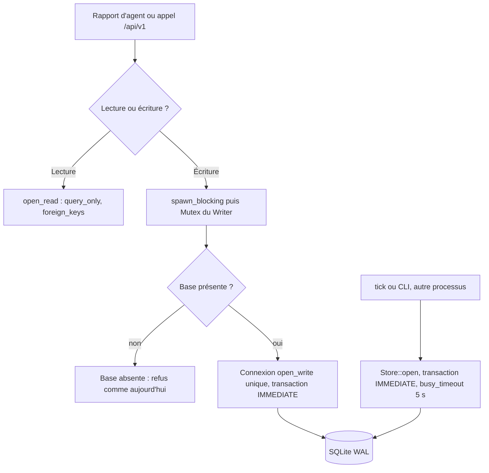
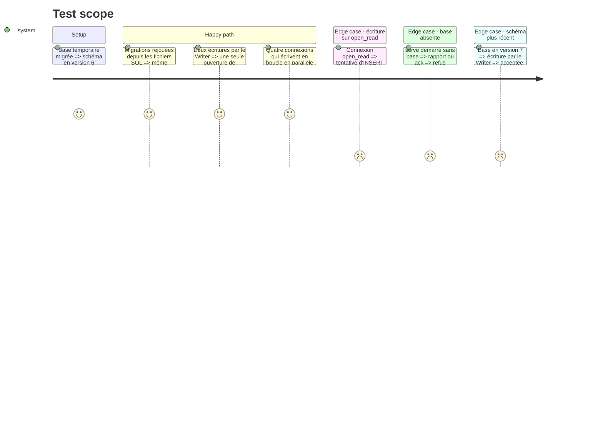

# Instruction: Store : connexions et writer unique

## Architecture projection

> Tree of the final files. ✅ create · ✏️ modify · ❌ delete

```txt
.
└── vigie/
    ├── migrations/
    │   └── 0001.sql … 0006.sql   ✅ SQL des six migrations actuelles, à l'octet près
    ├── src/
    │   ├── store.rs              ✏️ MIGRATIONS par include_str!, open_write, open_read en lecture seule, transactions d'écriture IMMEDIATE
    │   ├── writer.rs             ✅ écrivain unique de serve : une connexion open_write, ouverte à la première écriture, sous Mutex
    │   ├── lib.rs                ✏️ déclare writer
    │   ├── serve.rs              ✏️ AppState porte le Writer ; report_handler écrit par lui
    │   ├── ingest.rs             ✏️ ingest reçoit un &mut Store au lieu d'un chemin
    │   └── api.rs                ✏️ consume_pairing, touch_seen, ack, revoke_device par le Writer ; lectures par open_read
    └── tests/
        ├── ingest.rs             ✏️ adapté à la signature d'ingest
        ├── replay_2026_09_07.rs  ✏️ adapté à la signature d'ingest
        └── store_concurrency.rs  ✅ contention de plusieurs connexions écrivantes
```

## User Journey



## Test Scope



## Tasks to do

### `1)` Migrations en fichiers SQL

> Le SQL du schéma vit dans des fichiers embarqués, sans changer une seule instruction.

1. Déplacer chaque chaîne de `MIGRATIONS` (`store.rs`) dans `vigie/migrations/000N.sql`, contenu identique.
2. `MIGRATIONS` devient un tableau de `include_str!("../migrations/000N.sql")`.
3. Les tests de migration existants passent sans modification.

### `2)` Writer unique de serve

> Dans serve, une seule connexion écrit ; serve ne crée toujours pas la base et tolère un schéma plus récent.

1. `store.rs` : `open_write(path) -> Result<Option<Store>>` ouvre sans créer (`None` si le fichier manque), pose `busy_timeout` 5 s, `journal_mode=WAL`, `synchronous=NORMAL`, `foreign_keys=ON`, et ne migre pas. La migration reste celle du démarrage de serve (`serve.rs`) et de `tick`.
2. `writer.rs` : `Writer { path, conn: Mutex<Option<Store>> }` et `fn write<R>(&self, f: impl FnOnce(&mut Store) -> Result<R>) -> Result<Option<R>>`. À la première écriture, la connexion est ouverte par `open_write` puis gardée. `Ok(None)` signale une base absente. Un mutex empoisonné rend une erreur, jamais une panique. L'appel se fait toujours depuis `spawn_blocking`.
3. `AppState` porte un `Writer` construit par `router_with_clock`.
4. `ingest` reçoit `&mut Store` à la place de `database: &Path`. `report_handler` l'appelle par le Writer ; une base absente donne le même refus `UnknownSite` qu'aujourd'hui. `tests/ingest.rs` et `replay_2026_09_07.rs` ouvrent la base et passent le `Store`.
5. Les écritures de `api.rs` passent par le Writer : `consume_pairing`, `touch_seen`, `ack`, `revoke_device`. Les lectures restent sur `open_devices` → `open_read`.

### `3)` Connexions et transactions

> Aucune écriture ne peut échouer en SQLITE_BUSY sans avoir attendu le verrou. Cette tâche suit la 2 : avant elle, l'API écrit encore par `open_read`.

1. `open_read` pose `PRAGMA foreign_keys=ON` et `PRAGMA query_only=ON`, et garde l'ouverture sans création ainsi que la tolérance au schéma plus récent.
2. Les quatre transactions encore DEFERRED de `store.rs` (`record_tick`, `reconcile`, `close_unwatched`, `remove_key`) passent en `TransactionBehavior::Immediate` ; aucune `transaction()` sans comportement ne reste dans `store.rs`.
3. Test `store_concurrency.rs` : quatre threads ont chacun leur connexion `Store::open`. Ils écrivent en boucle quelques secondes (ticks, résultats, acquittements, rapports), et aucun n'échoue.

## Test acceptance criteria

| Task | Acceptance criteria |
| ---- | ------------------- |
| 1    | Une base neuve migrée depuis les fichiers SQL a le même schéma (`sqlite_master`) que celle du code d'avant, et son `user_version` vaut 6 |
| 2    | Hors démarrage, serve n'appelle plus `Store::open`. Le Writer garde une seule connexion. Sans base, rapport et API répondent comme avant et aucun fichier n'est créé. Sur une base en version 7, une écriture passe. Rapports, appairage, acquittement et révocation fonctionnent comme avant. |
| 3    | Une écriture sur `open_read` est refusée. `foreign_keys` vaut 1 sur les trois sortes de connexion. `grep "transaction()" src/store.rs` ne rend rien. Le test de contention passe sans SQLITE_BUSY. |
