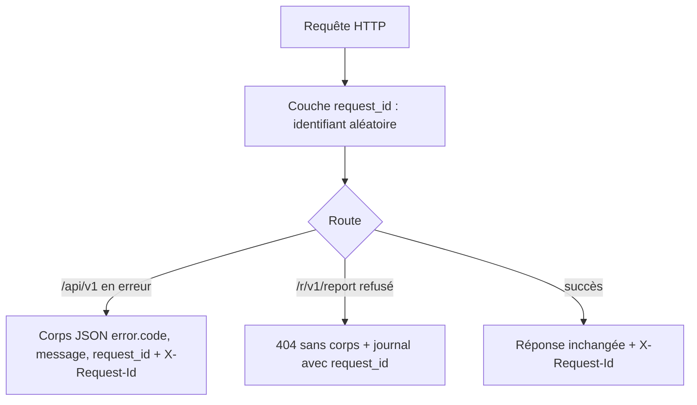
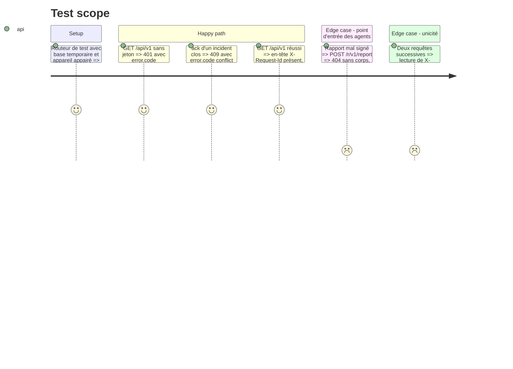

# Instruction: Erreurs uniformes et request_id

## Architecture projection

> Tree of the final files. ✅ create · ✏️ modify · ❌ delete

```txt
.
└── vigie/
    ├── src/
    │   ├── error.rs          ✅ ApiError (code, message, request_id) et son rendu JSON
    │   ├── request_id.rs     ✅ couche axum : génère l'identifiant, l'expose en X-Request-Id, le rend aux handlers
    │   ├── lib.rs            ✏️ déclare error et request_id
    │   ├── serve.rs          ✏️ pose la couche ; refus de /r/v1/report journalisés avec request_id, 404 sans corps inchangé
    │   └── api.rs            ✏️ erreurs 401, 404, 409, 500 rendues par ApiError
    ├── docs/
    │   └── api-console.md    ✏️ format d'erreur et X-Request-Id
    └── app/src-tauri/        ✏️ seulement si le client lit le corps des erreurs : il doit tolérer le nouveau corps
```

## User Journey



## Test Scope



## Tasks to do

### `1)` Module d'erreurs

> Une seule forme d'erreur pour l'API de la console.

1. `error.rs` : `ApiError { status, code, message }` ; le rendu ajoute le `request_id` courant et produit `{"error":{"code":…,"message":…,"request_id":…}}` avec `Cache-Control: no-store`.
2. Codes stables : `unauthorized`, `not_found`, `conflict`, `internal`. Le message d'un `internal` ne révèle rien de la cause ; la cause va au journal avec le request_id.

### `2)` Identifiant de requête

> Chaque requête porte un identifiant qu'on retrouve dans la réponse et dans le journal.

1. `request_id.rs` : 16 octets aléatoires (`getrandom`) encodés en hex, posés en extension de requête et en en-tête de réponse `X-Request-Id` ; un `X-Request-Id` entrant est ignoré.
2. Les `log::error!` et `log::warn!` de `serve.rs` et `api.rs` citent le request_id.

### `3)` Brancher l'API et la documentation

> L'API de la console rend ses erreurs par le module ; le point d'entrée des agents ne change pas de comportement.

1. Remplacer les statuts nus de `api.rs` par `ApiError`, y compris les routes inconnues ou les méthodes refusées sous `/api/v1` : les `.fallback(not_found)` de `api::routes()` passent à une variante JSON. Le fallback global du routeur et `/r/v1/report` gardent la réponse vide.
2. `/r/v1/report` : réponses inchangées (204 ou 404 sans corps) ; le motif du refus et le request_id vont au journal.
3. Vérifier que `vigie/app/src-tauri` tolère le corps d'erreur (tests de l'app verts) ; l'adapter seulement si nécessaire.
4. Documenter le format d'erreur et `X-Request-Id` dans `vigie/docs/api-console.md`.

## Test acceptance criteria

| Task | Acceptance criteria |
| ---- | ------------------- |
| 1    | Chaque erreur de `/api/v1` porte un corps JSON avec `code`, `message` et `request_id` ; une erreur interne n'expose pas sa cause |
| 2    | Toute réponse porte un `X-Request-Id` unique, égal au `request_id` du corps d'erreur et à celui du journal |
| 3    | `/r/v1/report` répond exactement comme avant ; la console Android fonctionne sans changement visible ; `api-console.md` décrit le format |
