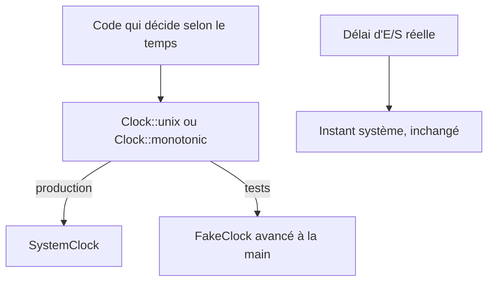
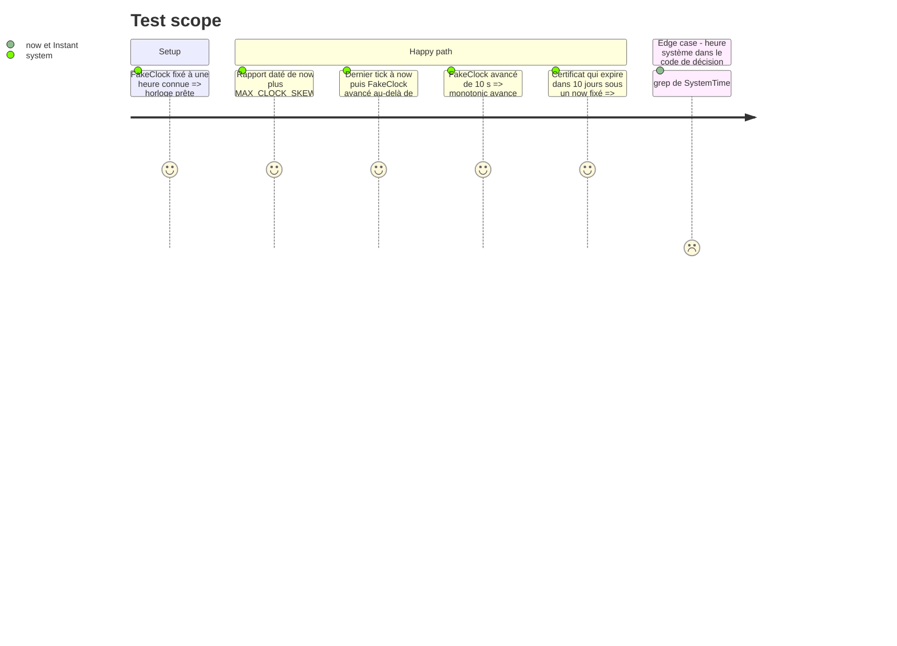

# Instruction: Horloge injectable

## Architecture projection

> Tree of the final files. ✅ create · ✏️ modify · ❌ delete

```txt
.
└── vigie/src/
    ├── clock.rs        ✅ trait Clock (unix, monotonic), SystemClock, FakeClock pour les tests
    ├── lib.rs          ✏️ déclare clock ; now() délègue à SystemClock
    ├── serve.rs        ✏️ AppState porte Arc<dyn Clock> à la place de Arc<dyn Fn() -> i64>
    ├── api.rs          ✏️ lit l'heure par le Clock
    ├── main.rs         ✏️ les commandes CLI prennent l'heure d'un SystemClock unique
    └── checks/
        ├── mod.rs      ✏️ witness_path tiré de getrandom
        └── tls.rs      ✏️ jours avant expiration calculés sur le now injecté par tick, plus sur crate::now()
```

## User Journey



## Test Scope



## Tasks to do

### `1)` Trait Clock

> Une seule source de temps injectable pour les décisions.

1. `clock.rs` : `trait Clock: Send + Sync { fn unix(&self) -> i64; fn monotonic(&self) -> Instant; }`, `SystemClock`, et `FakeClock` (heure Unix et décalage monotone avancés à la main, base `Instant` fixée à la création).
2. `crate::now()` délègue à `SystemClock` pour ne pas casser les appelants.

### `2)` Injection

> Le code de décision ne lit plus l'heure système directement.

1. `AppState.clock` devient `Arc<dyn Clock>` et `router_with_clock` prend un `Arc<dyn Clock>`. `FakeClock` est public, sans `cfg(test)`, car les tests d'intégration le partagent. Ces tests (`api_auth.rs`, `api_read.rs`, `ingest.rs`, `interop.rs`) remplacent leur fermeture sur un `AtomicI64` par un `FakeClock`, comme les tests internes de `serve.rs` et `api.rs`.
2. `checks/tls.rs` reçoit le `now` du passage de `tick` au lieu d'appeler `crate::now()`.
3. Les commandes de `main.rs` lisent l'heure d'un seul `SystemClock` créé au début de la commande.
4. Les délais d'E/S restent sur `Instant` système : `tick.rs`, `http.rs`, `checks/tls.rs`, `store.rs` (patience d'ouverture), `tokio::time::timeout` de `serve.rs` et `api.rs`. Un commentaire dans `clock.rs` donne cette règle.
5. `witness_path` (`checks/mod.rs`) tire son suffixe aléatoire de `getrandom` au lieu de `SystemTime::now()` : ce n'est pas une lecture de l'heure.

## Test acceptance criteria

| Task | Acceptance criteria |
| ---- | ------------------- |
| 1    | `FakeClock` rend des valeurs Unix et monotones reproductibles, avancées seulement à la main |
| 2    | Les tests de fenêtre passent avec une heure fixée : décalage d'horloge d'un rapport, âge du dernier tick, jours avant expiration TLS. Hors `clock.rs`, `SystemTime::now` n'apparaît plus, et `Instant::now` n'apparaît que pour les délais d'E/S listés. |
