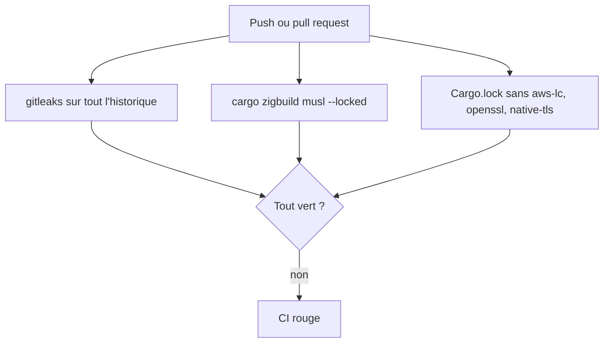
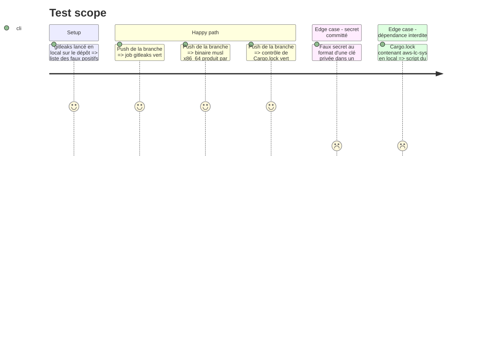

# Instruction: CI, clés et secrets

## Architecture projection

> Tree of the final files. ✅ create · ✏️ modify · ❌ delete

```txt
.
├── .github/workflows/
│   └── vigie.yml                 ✏️ jobs gitleaks, build musl par zigbuild, contrôle de Cargo.lock
├── .gitleaks.toml                ✅ seulement si des faux positifs (clés de test) l'exigent, allowlist par chemin
└── vigie/docs/
    ├── protocole-agent.md        ✏️ règle d'une clé par usage, épinglage côté agent, rotation
    ├── hebergement.md            ✏️ inventaire des secrets et de leur stockage
    └── decisions.md              ✏️ section « Socle (issue #9) »
```

## User Journey



## Test Scope



## Tasks to do

### `1)` CI

> La CI attrape un secret committé, une régression TLS et un build musl cassé.

1. Job gitleaks : image ou action épinglée par digest ou SHA, `fetch-depth: 0`, `--redact`, sur tout l'historique ; `permissions: contents: read`.
2. Lancer gitleaks en local d'abord ; un `.gitleaks.toml` n'est ajouté que pour des faux positifs avérés (clés de test des fixtures), avec une allowlist par chemin, jamais par motif large. Un vrai secret trouvé dans l'historique n'est jamais mis en allowlist : le plan passe en `blocked`, l'utilisateur décide de la rotation.
3. Job Linux : `cargo zigbuild --release --locked --target x86_64-unknown-linux-musl` dans `vigie/`, outils épinglés (version de zig et de cargo-zigbuild).
4. Contrôle : la CI échoue si `vigie/Cargo.lock` ou `vigie/app/src-tauri/Cargo.lock` contient `aws-lc-sys`, `aws-lc-rs`, `openssl-sys` ou `native-tls`.

### `2)` Règles de clés et de secrets

> Ce que #10 et #6 devront respecter est écrit avant eux.

1. `protocole-agent.md` : une clé Ed25519 sert un seul usage (rapports d'agent aujourd'hui ; commandes signées par le veilleur, avec une clé distincte, quand #10 et #6 les livreront) ; l'agent épinglera la clé publique des commandes du veilleur, reçue à `--init` ; la rotation des clés de rapport reste celle de `agent-php.md`.
2. `hebergement.md` : inventaire des secrets (mot de passe SMTP en fichier 0600 vérifié par le code, clé privée de l'agent 0600 vérifiée par l'agent, jetons d'appareil stockés hachés) ; aucun secret en variable d'environnement.
3. `decisions.md` : section « Socle (issue #9) » qui reprend les décisions du plan (writer de serve et IMMEDIATE entre processus, portée de l'horloge, erreurs, base64 gardé, clés par usage différées à #10 et #6).

## Test acceptance criteria

| Task | Acceptance criteria |
| ---- | ------------------- |
| 1    | Les trois nouveaux contrôles tournent et sont verts sur la branche ; un faux secret est détecté en local ; un `Cargo.lock` contenant `aws-lc-sys` fait échouer le contrôle |
| 2    | `protocole-agent.md`, `hebergement.md` et `decisions.md` portent les règles ; aucun domaine, IP ou compte réel dans le diff |
