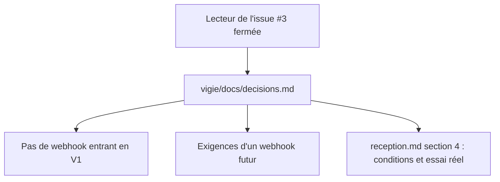

# Instruction: Preuves et décision sur le webhook

## Architecture projection

> Tree of the final files. ✅ create · ✏️ modify · ❌ delete

```txt
.
└── vigie/docs/
    └── decisions.md     ✏️ section « Sonde UptimeRobot (issue #3) »
```

## User Journey



## Test Scope

```mermaid
---
title: Test scope
---
journey
  section Setup
    Branche partie de main avec le registre de #11 => decisions.md présent: 5: cli
  section Happy path
    grep "UptimeRobot" dans decisions.md => section avec le renvoi à reception.md: 5: cli
    grep des exigences (HMAC-SHA256, 300 s, 10/min, champs inconnus, lecture seule, secret distinct) => chacune présente: 5: cli
  section Edge case - code
    grep des routes dans serve.rs => aucune route ne reçoit d'appel d'UptimeRobot: 5: cli
    grep des domaines, IP et comptes réels dans le diff => aucune occurrence: 1: cli
```

## Tasks to do

### `1)` Section « Sonde UptimeRobot (issue #3) » dans `vigie/docs/decisions.md`

> Relier chaque case de #3 à sa preuve et consigner la décision sur le webhook.

1. Ajouter, après « Décisions transverses du 2026-10-16 », une section « Sonde UptimeRobot (issue #3) » : rôle (surveille le veilleur, pas les sites), renvoi à `reception.md` § 4 pour les conditions de l'offre gratuite et l'essai du 2026-10-16, et `/health` (503 quand le dernier `tick` a plus de 3 min).
2. Décision du 2026-10-16 : pas de webhook entrant en V1 ; les alertes UptimeRobot n'entrent pas dans la base et restent à usage interne (`reception.md`, clause de non-revente).
3. Exigences si un webhook entrant devient utile : secret partagé rotable distinct des clés Ed25519 ; HMAC-SHA256 du corps et de l'horodatage, comparaison en temps constant ; anti-rejeu ±300 s ; limite de débit par IP (10/min) ; schéma JSON strict qui refuse les champs inconnus ; traitement strictement en lecture seule, aucune action déclenchée.

## Test acceptance criteria

| Task | Acceptance criteria |
| ---- | ------------------- |
| 1    | `decisions.md` porte la section, renvoie à `reception.md`, contient les six exigences et la décision « pas de webhook en V1 » ; aucune route de `serve.rs` ne reçoit d'appel d'UptimeRobot ; le diff ne contient aucune donnée réelle |
