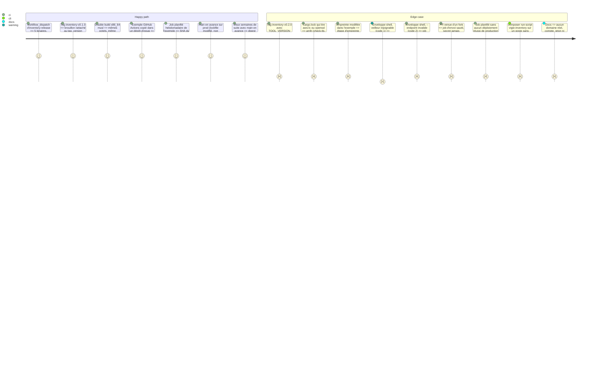

# Instruction: Publication, enveloppes de CI et documentation

## Architecture projection

```txt
.
├── CHANGELOG.md                                   ✏️ ligne #20 après fusion, comme les issues précédentes
├── .github/workflows/
│   └── inventory-release.yml                      ✅ tag inventory-v* ou lancement manuel : version, tls-deps, builds (5 cibles, images et zig épinglés, sans cache), double build musl comparé, release en brouillon avec SHA256SUMS
└── vigie/
    ├── README.md                                  ✏️ binaire vigie-inventory, renvoi vers docs/inventaire.md
    ├── examples/inventaire/
    │   ├── vigie-inventory-push.sh                ✅ enveloppe shell commune : code 1 → avertissement et 0, autre code transmis
    │   ├── github-actions.yml                     ✅ job de déploiement (environment production, if hors fork) : étape téléchargement + empreinte, étape envoi ; job planifié hebdomadaire dans l'environnement dédié vigie-inventory, sur le SHA du dernier déploiement réussi de production (API Deployments)
    │   ├── gitlab-ci.yml                          ✅ même chose pour GitLab CI : variable protégée et masquée, job de déploiement ; job planifié séparé, sans environment:, rules $CI_PIPELINE_SOURCE == "schedule", sur le SHA du dernier déploiement réussi (API des déploiements)
    │   ├── composer.json                          ✅ extrait scripts.vigie-inventory (composer run-script vigie-inventory), gardé par command -v
    │   └── package.json                           ✅ extrait scripts.vigie:inventory, appelé par le déploiement (pas postinstall)
    └── docs/
        ├── inventaire.md                          ✅ installation, empreinte, clé (keygen, dossier 0700, inventory-key, rotation), CI, scripts, formats et limites, horloge, péremption
        ├── protocole-agent.md                     ✏️ « Une clé par usage » : ligne Inventaires de CI ; /r/v1/inventory : champ source, choix de la clé, débit et plafond par source, péremption par source
        ├── failles.md                             ✏️ Contrôle vulns : source ci, péremption 7 j / 35 j, règles pour F7 (ci ne clôt pas un constat de l'agent, absence par source), hors registre compté
        └── decisions.md                           ✏️ section « Outil d'inventaire (issue #20, F6) » datée
```

## Test Scope



## Tasks to do

1. **Workflow** `.github/workflows/inventory-release.yml` (sur le modèle de `console-release.yml`, `permissions: contents: read` sauf le job de release en `contents: write`) :
   - déclencheurs `push: tags: ["inventory-v*"]` et `workflow_dispatch` ; `concurrency` par ref ;
   - **images épinglées** : `ubuntu-24.04`, `windows-2022`, `macos-14` ; **aucun `actions/cache`** ; actions tierces épinglées par SHA de commit ;
   - job `version` : lit `TOOL_VERSION` dans `vigie/src/inventory/mod.rs`, l'égalise au tag (sans le préfixe), sinon arrêt ; en manuel, nom `inventory-v<version>-manuel.<run_number>` ;
   - job `guards` : `vigie/scripts/check-tls-deps.sh vigie/Cargo.lock` ;
   - job `linux` (`ubuntu-24.04`, toolchain de `rust-toolchain.toml`, cargo-zigbuild 0.23.4 comme `vigie.yml`, **zig téléchargé à une version épinglée et vérifié par sa SHA-256**, relevées à l'implémentation et notées dans `decisions.md`) : `x86_64-unknown-linux-musl` et `aarch64-unknown-linux-musl`, `cargo zigbuild --release --locked --bin vigie-inventory --target …`, `file … | grep -q "statically linked"` ; `SOURCE_DATE_EPOCH` = date du commit ; `RUSTFLAGS="--remap-path-prefix=$GITHUB_WORKSPACE=/build --remap-path-prefix=$CARGO_HOME=/cargo"` ; `CFLAGS="-ffile-prefix-map=$GITHUB_WORKSPACE=/build -ffile-prefix-map=$CARGO_HOME=/cargo"` (code C de rusqlite `bundled` et de ring) ; **deux builds x86_64 dans deux dossiers de travail différents**, `cmp` des binaires, échec si différents ;
   - job `windows` (`windows-2022`) : `x86_64-pc-windows-msvc` ; job `macos` (`macos-14`) : `aarch64-apple-darwin` et `x86_64-apple-darwin` ; mêmes `RUSTFLAGS` et `SOURCE_DATE_EPOCH`, reproductibilité non vérifiée ;
   - artefacts nommés `vigie-inventory-<version>-<cible>[.exe]` ;
   - job `release` (seul à écrire) : `sha256sum -- vigie-inventory-* > SHA256SUMS`, `gh release create <tag> --draft` (préversion en manuel), notes qui listent les empreintes ; aucune écriture sur une release existante.
   À essayer en `workflow_dispatch` avant le premier tag ; une cible qui échoue est retirée du workflow et notée dans `decisions.md` plutôt que de bloquer les autres.
2. **Enveloppe shell** `vigie/examples/inventaire/vigie-inventory-push.sh` (POSIX `sh`, `set -u`) :
   ```sh
   rc=0
   vigie-inventory push "$@" || rc=$?
   if [ "$rc" -eq 1 ]; then
     echo "::warning::inventaire non envoyé au veilleur (code 1) : déploiement poursuivi"
     exit 0
   fi
   exit "$rc"
   ```
   Variante GitLab : même script, ligne d'avertissement sans `::warning::`. Ni `continue-on-error`, ni `allow_failure`.
3. **Exemples de CI** (`vigie/examples/inventaire/`), version et SHA-256 en variables en tête (`VIGIE_INVENTORY_VERSION`, `VIGIE_INVENTORY_SHA256`, valeurs factices `0.1.0` et `<empreinte de SHA256SUMS>` clairement marquées) :
   - **étape 1, à part** : téléchargement de `https://github.com/RebelliousSmile/alwaysdata_monitor/releases/download/inventory-v${VERSION}/vigie-inventory-${VERSION}-x86_64-unknown-linux-musl`, `echo "${SHA256}  vigie-inventory" | sha256sum -c -`, `chmod +x`, installation dans le `PATH` du job ;
   - **étape 2** : `sh vigie-inventory-push.sh --site site-a --endpoint https://vigie.example.org` après le build ;
   - **portée du secret** : GitHub, job de déploiement avec `environment: production` et secret d'environnement `VIGIE_INVENTORY_KEY`, condition `if: github.event_name != 'pull_request' || github.event.pull_request.head.repo.full_name == github.repository` (l'envoi ne tourne de toute façon que sur la branche déployée) ; GitLab, variable `VIGIE_INVENTORY_KEY` **protégée et masquée**, job limité à la branche ou au tag déployé (`rules:` sur `$CI_COMMIT_REF_PROTECTED`) ;
   - **job planifié hebdomadaire** (péremption `ci` de 35 jours), qui renvoie l'inventaire du **SHA du dernier déploiement réussi**, jamais celui d'une branche :
     - GitHub : `schedule` (`cron` d'un jour de semaine, minute non ronde) dans un job à part, **environnement dédié et obligatoire `vigie-inventory`** (même secret `VIGIE_INVENTORY_KEY`, sans relecteur), **jamais `production`** : un job dans `production` créerait lui-même le « dernier déploiement réussi » qu'il interroge ; étape « ref déployée » : `gh api "repos/$GITHUB_REPOSITORY/deployments?environment=production&per_page=30"` puis, pour chaque déploiement du plus récent au plus ancien, `…/deployments/<id>/statuses` ; le premier dont le dernier statut est `success` donne `sha` ; `permissions: deployments: read, contents: read`, `GH_TOKEN: ${{ github.token }}` ; aucun → message et **code 2** ; puis `actions/checkout` avec `ref: <sha>`, étapes 1 et 2 ;
     - GitLab : **job séparé**, jamais le job de déploiement, **sans `environment:`** (il ne crée donc aucun déploiement), `rules: - if: $CI_PIPELINE_SOURCE == "schedule"` ; le job de déploiement exclut les pipelines planifiés ; la variable protégée n'est lue que si la ref planifiée est protégée ; `GET /projects/:id/deployments?environment=production&status=success&order_by=finished_at&sort=desc&per_page=1` → `sha` (jeton : `CI_JOB_TOKEN` si l'API l'admet, sinon jeton de projet en lecture seule, **à vérifier à l'implémentation**) ; aucun → code 2 ; `git checkout <sha>` puis étapes 1 et 2 ;
     - le SHA retrouvé est affiché ; l'exemple suppose que le déploiement est enregistré par la CI elle-même (environnement GitHub ou GitLab), ce que la doc dit ;
   - Composer (`composer.json`) : script explicite `"vigie-inventory": "command -v vigie-inventory >/dev/null 2>&1 || exit 0; sh vigie-inventory-push.sh --site site-a --endpoint https://vigie.example.org --skip-without-key"`, lancé par `composer run-script vigie-inventory` depuis le déploiement ; jamais `post-install-cmd` ; `command -v` et `sh` supposent un shell POSIX (Linux, macOS) : ne marche pas tel quel sous Windows, écrit dans la doc ;
   - npm (`package.json`) : script `vigie:inventory` équivalent, appelé par le déploiement (`npm run vigie:inventory`) ; `postinstall` déconseillé en commentaire de la doc.
4. **Docs** :
   - `vigie/docs/inventaire.md` : à quoi sert l'outil (sites `node`, `static`, projets déployés par CI) ; un inventaire de CI décrit ce qui **va** être déployé, l'agent PHP reste la vérité du serveur ; installation depuis la release et vérification par `SHA256SUMS` en étape à part ; côté veilleur `[sites.inventory] sources = ["ci"]` puis `vigie site inventory-key <site> add --pubkey …` ; côté projet `keygen` (fichier de graine dans un **dossier en 0700**, sinon `--key-file` est refusé), secret d'environnement de déploiement, suppression du fichier de graine ; une clé publique ne sert qu'une fois (agent ou inventaire, un seul site) ; sous-commandes et options ; formats admis et refusés, un lockfile npm par dossier (plusieurs → code 2, en désigner un par `--lockfile`), membres du projet ignorés, dépendances hors registre comptées (`complete = false` ; Composer : registre si et seulement si `notification-url` est présent ou le nom est `wpackagist-plugin/…` ou `wpackagist-theme/…`), portée `dev` (inconnue pour pnpm 9, yarn, Cargo : tout `required`), `--omit-dev` (`complete = false`), `--cms wordpress`, `prestashop-module` en `pkg:composer` ; bornes (2 000, 512 Kio, ordre global de troncature) ; codes de sortie et enveloppe shell ; **horloge** : la machine de CI doit être à ±5 min du veilleur ; débit `ci` (renvoi inchangé 240 s, nouveaux 24 par jour) ; **péremption** (35 jours sans inventaire `ci` → « inventaire périmé », d'où le job hebdomadaire sur le SHA du dernier déploiement réussi ; **un `schedule` sur un `environment` protégé par des relecteurs attend une approbation chaque semaine** : d'où l'environnement dédié `vigie-inventory`, sans relecteur et au secret identique, obligatoire dans les exemples ; jamais `production`, sinon le job planifié crée le déploiement qu'il lit) ; script Composer limité à un shell POSIX (pas Windows) ; rotation (nouvelle graine, `inventory-key rotate`, mise à jour du secret ; envois refusés entre les deux) ; retrait (`inventory-key remove`, `site remove`) ; reproductibilité (Linux musl vérifiée, Windows et macOS non garanties) ; fixtures suffixées `.fixture` (pas d'alerte Dependabot ni de graphe de dépendances) ; limites V1 du plan.
   - `protocole-agent.md` : ligne « Inventaires de CI » dans « Une clé par usage » (signe : `vigie-inventory` avec la clé d'inventaire, préfixe `vigie-inventory-v1\n` ; vérifie : le veilleur, `site inventory-key` ; clé privée : secret d'environnement de déploiement) et la règle « une clé publique n'est enregistrée qu'une fois, toutes tables confondues » ; section `/r/v1/inventory` de F5 complétée : champ `source`, choix de la clé par la signature, débit par source (`ci` : 240 s pour le renvoi inchangé seulement), plafond et `seq` par source, péremption 7 jours (`agent`) et 35 jours (`ci`), horloge ±300 s, `inventory-key rotate` et `site remove`.
   - `failles.md` : « Contrôle `vulns` » : source `ci` déclarée par `[sites.inventory]` (au lieu de « clé d'inventaire enregistrée » seule) ; péremption par source (7 jours `agent`, 35 jours `ci`) ; **un inventaire `ci`, même complet, ne clôt jamais un constat vu sur l'inventaire `agent`** ; l'absence d'un composant se juge par source ; dépendances hors registre comptées dans `skipped` (agent et outil) ; inventaire de CI ≠ ce qui tourne.
   - `decisions.md` : section « Outil d'inventaire (issue #20, F6) » datée du jour d'implémentation : forme (binaire du crate), aucune dépendance (lecteurs ligne à ligne), clé dédiée et unicité des clés publiques, choix par signature, `sources`, stockage et débit par source, péremption par source, codes de sortie et enveloppe shell, HTTP (sans proxy, https seul), publication et reproductibilité, versions et SHA-256 de `cyclonedx-cli` et de zig, numéro de migration pris, écarts constatés sur les dépôts Composer publics vérifiés (règle de registre), écarts constatés à F5 et à ce plan.
   - `vigie/README.md` : le second binaire et le renvoi vers `inventaire.md`.
5. **CHANGELOG** : ligne « Added » pour #20 après fusion, sur le modèle des lignes #14 et #22.
6. **Première release** (après fusion, hors CI de PR) : tag `inventory-v0.1.0`, relecture du brouillon (empreintes recalculées sur un poste), publication ; pose sur un site d'essai (`generic`, `runtime = "static"`) : `[sites.inventory] sources = ["ci"]`, `inventory-key add`, exemple GitHub Actions ; relevé consigné dans `hebergement.md` en nombres seulement (composants, `complete`), aucun composant ni version réels.

## Test acceptance criteria

| Task | Acceptance criteria |
| ---- | ------------------- |
| 1 | Run `workflow_dispatch` vert, cinq binaires et `SHA256SUMS` dans le brouillon ; un tag dont la version diffère de `TOOL_VERSION` s'arrête au job `version` ; `cmp` des deux builds musl vert ; `grep -n "actions/cache\|-latest" .github/workflows/inventory-release.yml` ne trouve rien |
| 2 | Le script testé avec un faux `vigie-inventory` qui sort 0, 1 et 2 : codes 0, 0 (avec avertissement) et 2 |
| 3 | Les exemples passent `actionlint` (GitHub) et la validation de syntaxe YAML ; aucun `continue-on-error` ni `allow_failure` ; téléchargement et envoi en étapes distinctes ; condition hors fork et environnement présents ; dans le dépôt d'essai, le job planifié retrouve le SHA du dernier déploiement réussi (affiché), renvoie un inventaire inchangé quand `main` est en avance, et sort en code 2 sans déploiement réussi ; aucune variable `VIGIE_DEPLOYED_REF` ; le job planifié GitHub porte `environment: vigie-inventory` et lit `environment=production` ; le job planifié GitLab n'a pas d'`environment:` ; deux runs planifiés de suite, `main` en avance, laissent le même digest et aucun nouveau déploiement `production` ; aucun secret ni domaine réel ; empreinte factice clairement marquée |
| 4 | `grep -rniE "alwaysdata\.net\|@[a-z0-9-]+\.(fr\|com)\|ghp_\|glpat-" vigie/docs/inventaire.md vigie/examples/inventaire` ne trouve rien ; gitleaks vert ; les docs ne citent que site A, site B, `example.org`, `192.0.2.0/24` |
| 4 | `failles.md`, `protocole-agent.md` et `decisions.md` disent la même chose sur `sources`, la clé d'inventaire, le débit `ci`, la péremption par source et les règles pour F7 |
| 5-6 | Commit `ci(inventory): publication, enveloppes et docs de vigie-inventory (#20)` ; release publiée et inventaire de CI du site d'essai accepté (journal « inventaire accepté … source ci … nouveau ») sans effet sur `reports.last_valid_at` |
