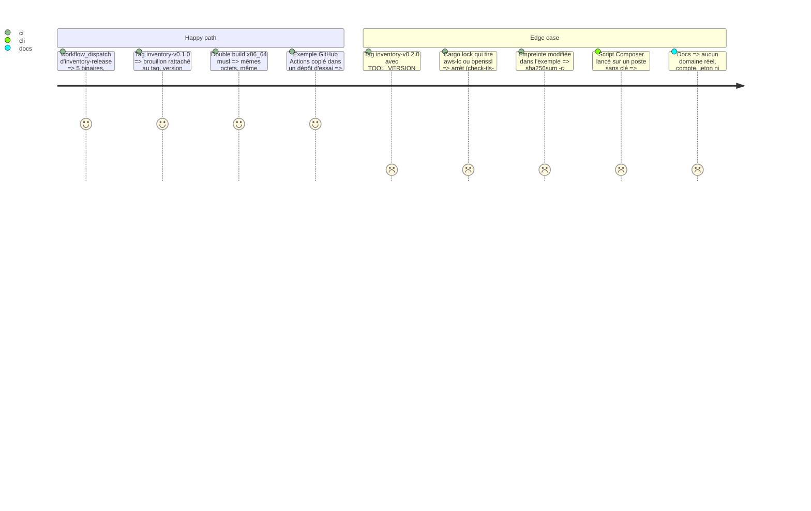

# Instruction: Publication, enveloppes de CI et documentation

## Architecture projection

```txt
.
├── CHANGELOG.md                                   ✏️ ligne #20 après fusion, comme les issues précédentes
├── .github/workflows/
│   └── inventory-release.yml                      ✅ tag inventory-v* ou lancement manuel : version, tls-deps, builds (5 cibles), double build musl comparé, release en brouillon avec SHA256SUMS
└── vigie/
    ├── README.md                                  ✏️ binaire vigie-inventory, renvoi vers docs/inventaire.md
    ├── examples/inventaire/
    │   ├── github-actions.yml                     ✅ étape après le build : téléchargement épinglé (version + SHA-256), push, continue-on-error
    │   ├── gitlab-ci.yml                          ✅ même étape pour GitLab CI, variable masquée et protégée
    │   ├── composer.json                          ✅ extrait scripts.post-install-cmd → script vigie-inventory push --skip-without-key
    │   └── package.json                           ✅ extrait scripts.vigie:inventory, appelé par le déploiement (pas postinstall)
    └── docs/
        ├── inventaire.md                          ✅ installation, vérification d'empreinte, clé (keygen, inventory-key, rotation), CI, scripts, formats et limites
        ├── protocole-agent.md                     ✏️ « Une clé par usage » : ligne Inventaires de CI ; /r/v1/inventory : champ source, choix de la clé, débit et plafond par source
        ├── failles.md                             ✏️ Contrôle vulns : source ci ; inventaire de CI ≠ serveur ; portée dev non connue pour pnpm 9, yarn, Cargo
        └── decisions.md                           ✏️ section « Outil d'inventaire (issue #20, F6) » datée
```

## Test Scope



## Tasks to do

1. **Workflow** `.github/workflows/inventory-release.yml` (sur le modèle de `console-release.yml`, `permissions: contents: read` sauf le job de release en `contents: write`) :
   - déclencheurs `push: tags: ["inventory-v*"]` et `workflow_dispatch` ; `concurrency` par ref ;
   - job `version` : lit `TOOL_VERSION` dans `vigie/src/inventory/mod.rs`, l'égalise au tag (sans le préfixe), sinon arrêt ; en manuel, nom `inventory-v<version>-manuel.<run_number>` ;
   - job `guards` : `vigie/scripts/check-tls-deps.sh vigie/Cargo.lock` ;
   - job `linux` (`ubuntu-24.04`, toolchain de `rust-toolchain.toml`, cargo-zigbuild 0.23.4 comme `vigie.yml`) : `x86_64-unknown-linux-musl` et `aarch64-unknown-linux-musl`, `cargo zigbuild --release --locked --bin vigie-inventory --target …`, `file … | grep -q "statically linked"` ; `SOURCE_DATE_EPOCH` = date du commit, `RUSTFLAGS=--remap-path-prefix=$GITHUB_WORKSPACE=/build --remap-path-prefix=$HOME/.cargo=/cargo` ; **deux builds x86_64 dans deux dossiers de travail différents**, `cmp` des binaires, échec si différents ;
   - job `windows` (`windows-latest`) : `x86_64-pc-windows-msvc` ;
   - job `macos` (`macos-latest`) : `aarch64-apple-darwin` et `x86_64-apple-darwin` ;
   - artefacts nommés `vigie-inventory-<version>-<cible>[.exe]` ;
   - job `release` (seul à écrire) : `sha256sum -- vigie-inventory-* > SHA256SUMS`, `gh release create <tag> --draft` (préversion en manuel), notes qui listent les empreintes ; aucune écriture sur une release existante.
   À essayer en `workflow_dispatch` avant le premier tag ; une cible qui échoue est retirée du workflow et notée dans `decisions.md` plutôt que de bloquer les autres.
2. **Exemples** (`vigie/examples/inventaire/`) : version et SHA-256 en variables en tête (`VIGIE_INVENTORY_VERSION`, `VIGIE_INVENTORY_SHA256`, valeurs factices `0.1.0` et `<empreinte de SHA256SUMS>` à remplacer) ; téléchargement de `https://github.com/RebelliousSmile/alwaysdata_monitor/releases/download/inventory-v${VERSION}/vigie-inventory-${VERSION}-x86_64-unknown-linux-musl`, `echo "${SHA256}  vigie-inventory" | sha256sum -c -`, `chmod +x` ; `push --site site-a --endpoint https://vigie.example.org` ; graine dans un secret (`secrets.VIGIE_INVENTORY_KEY`, variable GitLab masquée et protégée) ; `continue-on-error: true` (GitHub) et `allow_failure: exit_codes: [1]` (GitLab) : un code 1 n'arrête pas le déploiement, un code 2 si. Composer : `post-install-cmd` qui appelle `vigie-inventory push --skip-without-key …` (binaire supposé installé par la CI). npm : script `vigie:inventory`, appelé explicitement par le déploiement ; `postinstall` déconseillé en commentaire.
3. **Docs** :
   - `vigie/docs/inventaire.md` : à quoi sert l'outil (sites `node`, `static`, projets déployés par CI) ; un inventaire de CI décrit ce qui **va** être déployé, l'agent PHP reste la vérité du serveur ; installation depuis la release et vérification par `SHA256SUMS` ; côté veilleur `[sites.inventory] sources = ["ci"]` puis `vigie site inventory-key <site> add --pubkey …` ; côté projet `keygen`, secret de CI, suppression du fichier de graine ; sous-commandes et options ; formats admis et refusés, ce qui est ignoré, portée `dev` (inconnue pour pnpm 9, yarn, Cargo : tout `required`), `--omit-dev`, `--cms wordpress`, `prestashop-module` en `pkg:composer` ; bornes (2 000, 512 Kio, `complete`) ; codes de sortie ; rotation (nouvelle graine, `inventory-key rotate`, mise à jour du secret ; envois refusés entre les deux) ; retrait (`inventory-key remove`, `site remove`) ; reproductibilité (Linux musl vérifiée, Windows et macOS non garanties) ; limites V1 du plan.
   - `protocole-agent.md` : ligne « Inventaires de CI » dans « Une clé par usage » (signe : `vigie-inventory` avec la clé d'inventaire, préfixe `vigie-inventory-v1\n` ; vérifie : le veilleur, `site inventory-key` ; clé privée : secret de CI) ; section `/r/v1/inventory` de F5 complétée : champ `source`, choix de la clé par la signature, débit, plafond et `seq` par source, `inventory-key rotate` et `site remove`.
   - `failles.md` : « Contrôle `vulns` » : source `ci` déclarée par `[sites.inventory]` (au lieu de « clé d'inventaire enregistrée » seule), les deux sources gardées et distinguées pour F7 ; inventaire de CI ≠ ce qui tourne.
   - `decisions.md` : section « Outil d'inventaire (issue #20, F6) » datée du jour d'implémentation : forme (binaire du crate), aucune dépendance (lecteurs YAML maison), clé dédiée et choix par signature, `sources`, stockage par source, codes de sortie, publication et reproductibilité, version et SHA-256 de `cyclonedx-cli`, écarts constatés à F5 et à ce plan.
   - `vigie/README.md` : le second binaire et le renvoi vers `inventaire.md`.
4. **CHANGELOG** : ligne « Added » pour #20 après fusion, sur le modèle des lignes #14 et #22.
5. **Première release** (après fusion, hors CI de PR) : tag `inventory-v0.1.0`, relecture du brouillon (empreintes recalculées sur un poste), publication ; pose sur un site d'essai `static` : `[sites.inventory] sources = ["ci"]`, `inventory-key add`, exemple GitHub Actions ; relevé consigné dans `hebergement.md` en nombres seulement (composants, `complete`), aucun composant ni version réels.

## Test acceptance criteria

| Task | Acceptance criteria |
| ---- | ------------------- |
| 1 | Run `workflow_dispatch` vert, cinq binaires et `SHA256SUMS` dans le brouillon ; un tag dont la version diffère de `TOOL_VERSION` s'arrête au job `version` ; `cmp` des deux builds musl vert |
| 2 | Les exemples passent `actionlint` (GitHub) et la validation de syntaxe YAML ; aucun secret ni domaine réel ; empreinte factice clairement marquée |
| 3 | `grep -rniE "alwaysdata\.net|@[a-z0-9-]+\.(fr|com)|ghp_|glpat-" vigie/docs/inventaire.md vigie/examples/inventaire` ne trouve rien ; gitleaks vert ; les docs ne citent que site A, site B, `example.org`, `192.0.2.0/24` |
| 3 | `failles.md`, `protocole-agent.md` et `decisions.md` ne se contredisent pas sur `sources`, la clé d'inventaire et les bornes |
| 4-5 | Commit `ci(inventory): publication, enveloppes et docs de vigie-inventory (#20)` ; release publiée et inventaire de CI du site d'essai accepté (journal « inventaire accepté … source ci … nouveau ») sans effet sur `reports.last_valid_at` |
