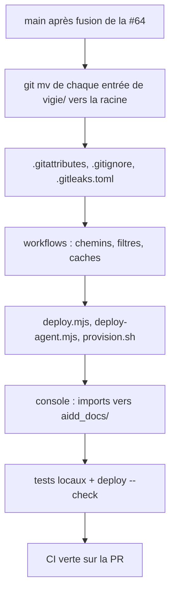

<!-- Fill or omit these sections; never add, rename, or reorder one. -->

# Instruction: Déplacement, CI et déploiement

## Architecture projection

> Tree of the final files. ✅ create · ✏️ modify · ❌ delete

```txt
.
├── .gitattributes                    ✏️ /vigie/** text=auto eol=lf → * text=auto eol=lf
├── .gitignore                        ✏️ préfixe /vigie retiré (/target/, /deploy/targets.json, /config.toml, /remote.toml, !tests/fixtures/logs/*.log), plus /vigie/ de transition
├── .gitleaks.toml                    ✏️ allowlist : ^tests/fixtures/rfc8032\.json$, ^app/src/test/veilleur\.ts$, ^app/src-tauri/src/lib\.rs$
├── .github/workflows/
│   ├── vigie.yml                     ✏️ working-directory vigie retiré, filtres paths « tout sauf app/ » par exclusions, cache target/, hashFiles('Cargo.lock'), agent/php/tests/run.php, artefact target/…/vigie
│   ├── console.yml                   ✏️ vigie/app → app, filtres paths (app/**, src/**, Cargo.*, tests/support/**), caches
│   ├── console-release.yml           ✏️ vigie/app → app (cd, working-directory, package_json_file, caches, chemins d'artefacts)
│   ├── inventory-release.yml         ✏️ cd vigie et cd "$dir/vigie" retirés, ../dist → dist, src/inventory/mod.rs, target/… et $COPY/target/…, check-tls-deps
│   └── garde-fous.yml                ✏️ scripts/check-tls-deps.sh, scripts/check-osv-exceptions.py, --lockfile=Cargo.lock, app/src-tauri/Cargo.lock, app/pnpm-lock.yaml
├── Cargo.toml, Cargo.lock, rust-toolchain.toml, config.example.toml   ✏️ déplacés depuis vigie/ (git mv)
├── README.md                         ✏️ déplacé depuis vigie/README.md
├── src/, tests/, migrations/, examples/, docs/                        ✏️ déplacés depuis vigie/
├── agent/                            ✏️ déplacé depuis vigie/agent/
├── app/                              ✏️ déplacé depuis vigie/app/
│   ├── src/design.spec.ts            ✏️ import '../../aidd_docs/design/vigie-design/tokens.css?raw'
│   └── vite.config.ts                ✏️ fs.allow : '../aidd_docs/design/vigie-design'
├── deploy/                           ✏️ déplacé depuis vigie/deploy/
│   ├── .gitattributes                ✏️ commentaire : HEAD:deploy
│   └── provision.sh                  ✏️ git archive … HEAD:deploy
├── scripts/                          ✏️ déplacé depuis vigie/scripts/
│   ├── deploy.mjs                    ✏️ repoRoot = racine, archive du commit entier, git status hors aidd_docs/ et .claude/, deploy/targets.json
│   └── deploy-agent.mjs              ✏️ repoRoot = racine, AGENT_PATH = agent/php/vigie-agent.php, deploy/targets.json
└── vigie/                            ❌ vidé par les git mv
```

## User Journey



## Test Scope

```mermaid
---
title: Test scope
---
journey
  section Setup
    Branche créée depuis main contenant la #64 => racine sans fichiers du module: 5: cli
  section Happy path
    cargo test --locked --all-targets à la racine => tous verts: 5: cli
    cargo clippy --locked --all-targets -- -D warnings => aucun avertissement: 5: cli
    node --test scripts/deploy-lib.test.mjs => 18 réussis: 5: cli
    php agent/php/tests/run.php dans php:8.1-cli => 0 échec: 5: cli
    pnpm test et pnpm build dans app/ => verts, design.spec.ts lit tokens.css: 5: cli
    cargo test dans app/src-tauri => contract.rs trouve tests/support/veilleur.rs: 5: cli
    node scripts/deploy.mjs veilleur --check => build WSL du commit réussi: 5: cli
    node scripts/deploy-agent.mjs site-a-agent --check => agent lu au commit: 5: cli
  section Edge case - fins de ligne
    * text=auto eol=lf à la racine => git add --renormalize . => aucun fichier modifié ou modifications isolées dans un commit dédié: 3: cli
  section Edge case - archive de déploiement
    archive du commit entier, include_str! de tests/fixtures/htaccess/protected-uas.txt => deploy.mjs --check => build réussi, archive d'environ 7 Mo sous maxBuffer: 3: cli
  section Edge case - filtres CI
    PR qui ne touche que CHANGELOG.md ou aidd_docs/ => workflows vigie et console non déclenchés ; PR qui ne touche que config.example.toml ou docs/ => vigie déclenché: 3: cli
  section Edge case - releases hors PR
    console-release et inventory-release lancés par workflow_dispatch sur la branche, après accord => jobs verts, brouillons de prérelease supprimés ensuite: 3: cli
```

## Tasks to do

### `1)` Déplacer vigie/ à la racine

> Un seul commit de pur déplacement, pour que `git log --follow` et le blame suivent.

1. Depuis `main` à jour (après la #64), créer la branche `chore/vigie-a-la-racine`.
2. `git mv vigie/<entrée> <entrée>` pour : `Cargo.lock`, `Cargo.toml`, `README.md`, `agent`, `app`, `config.example.toml`, `deploy`, `docs`, `examples`, `migrations`, `rust-toolchain.toml`, `scripts`, `src`, `tests`.
3. Vérifier que `vigie/` ne contient plus aucun fichier suivi (`git ls-files vigie` vide).
4. Commit du seul déplacement, sans retouche de contenu.

### `2)` Configuration de la racine

> Les règles de dépôt visent les nouveaux chemins.

1. `.gitattributes` : `* text=auto eol=lf` (commentaire repris), puis `git add --renormalize .` ; toute modification produite va dans un commit à part, listée dans la PR.
2. `.gitignore` : retirer le préfixe `/vigie` des cinq lignes, garder `*.log` et l'exception des fixtures de logs ; ajouter `/vigie/` avec le commentaire « ancien emplacement : résidus ignorés des copies d'avant le déplacement (targets.json réel, target/, node_modules/) ». Sans elle, `vigie/deploy/targets.json` d'une copie existante devient non suivi et non ignoré dans un dépôt public.
3. `.gitleaks.toml` : les trois chemins de l'allowlist sans `vigie/` : `^(vigie|monitor)/tests/fixtures/rfc8032\.json$` → `^tests/fixtures/rfc8032\.json$`, puis `veilleur.ts` et `lib.rs`.

### `3)` Workflows

> Mêmes noms de jobs (vérifications requises inchangées), chemins réécrits.

1. `vigie.yml` : retirer `defaults.run.working-directory: vigie` des trois jobs ; filtres `paths` de même sens qu'aujourd'hui (« vigie/** sauf vigie/app/** »), dans cet ordre : `"**"`, `"!app/**"`, `"!aidd_docs/**"`, `"!.claude/**"`, `"!.github/**"`, `"!CHANGELOG.md"`, `".github/workflows/vigie.yml"` ; une liste blanche oublierait `config.example.toml` (lu par `include_str!` dans `src/config.rs`), `docs/` et `examples/` ; caches `target`, `hashFiles('Cargo.lock')` ; `php agent/php/tests/run.php` ; artefact `target/x86_64-unknown-linux-musl/release/vigie`.
2. `console.yml` et `console-release.yml` : `vigie/app` → `app` partout (`cd`, `working-directory`, `package_json_file`, `cache-dependency-path`, caches, `hashFiles`, chemins `path=`), filtres `app/**`, `src/**`, `Cargo.*`, `tests/support/**`, notes de release `app/README.md` et `app/CHANGELOG.md`.
3. `inventory-release.yml` : retirer `cd vigie` et `(cd vigie && …)`, `cd "$dir/vigie"` → `cd "$dir"` (double build), et dans le job windows `../dist` → `dist` (trois occurrences : `mkdir -p`, `cp`, `sha256sum`), sinon il écrit hors du dépôt ; `src/inventory/mod.rs`, `target/…`, `$GITHUB_WORKSPACE/target/…` et `$COPY/target/…`, `scripts/check-tls-deps.sh Cargo.lock`.
4. `garde-fous.yml` : `scripts/check-tls-deps.sh Cargo.lock app/src-tauri/Cargo.lock`, `scripts/check-osv-exceptions.py`, les trois `--lockfile` sans `vigie/`.
5. Les commentaires « même version que vigie/rust-toolchain.toml » deviennent `rust-toolchain.toml`.

### `4)` Scripts de déploiement

> Le build du veilleur ne compile que ce qu'il compilait, sans dépendre du sous-dossier.

1. `scripts/deploy.mjs` : `repoRoot` = dossier parent de `scripts/` ; `git archive` du commit entier (`${commit}` au lieu de `${commit}:vigie` : environ 7 Mo contre 5,8 Mo aujourd'hui, `maxBuffer` 64 Mo inchangé ; le build lit aussi `tests/fixtures/htaccess/protected-uas.txt` par `include_str!`, une liste de chemins l'oublierait) ; `git status --porcelain -- . ':!aidd_docs' ':!.claude'` ; messages `deploy/targets.json` et `Cargo.toml absent` ; retirer le commentaire sur `/vigie export-ignore`.
2. `scripts/deploy-agent.mjs` : `repoRoot` = dossier parent de `scripts/`, `AGENT_PATH = 'agent/php/vigie-agent.php'`, `deploy/targets.json`.
3. `deploy/provision.sh` et `deploy/.gitattributes` : `HEAD:deploy` ; garder `deploy/.gitattributes` (une archive de sous-arbre perd toujours les attributs de la racine).

### `5)` Console : chemins vers aidd_docs/

> Les deux seuls chemins qui sortaient de vigie/ remontent d'un niveau de moins.

1. `app/src/design.spec.ts` : `'../../aidd_docs/design/vigie-design/tokens.css?raw'`.
2. `app/vite.config.ts` : `fs.allow` `'../aidd_docs/design/vigie-design'`.
3. Vérifier qu'aucun autre fichier ne remonte au-dessus de son ancien `vigie/` (`git grep -E "\.\./\.\./\.\.|\.\./aidd_docs|\.\./\.github"`).

### `6)` Vérifier

> Tout ce que la CI lance, plus les deux `--check`.

1. Lancer les commandes du Test scope ; agent PHP sous Docker `php:8.1-cli` épinglé comme en CI (sodium absent du PHP local).
2. `git grep -n "vigie/" -- .github .gitattributes .gitignore .gitleaks.toml scripts deploy app/src app/vite.config.ts` : ne reste que des chemins serveur (`/home/vigie/vigie/…` des unités systemd, `vigie/deploy.lock` et `vigie/bin/vigie` relatifs au home distant) ou des noms (`vigie-inventory`, `vigie-agent`).
3. Pousser la branche, ouvrir la PR, CI verte ; la description demande une fusion par merge commit (pas de squash), pour garder le commit de pur déplacement.
4. Releases, que la CI de la PR ne lance jamais (tags `console-v*`, `inventory-v*`) : après accord de l'utilisateur (chaque lancement crée un brouillon de prérelease), `gh workflow run console-release.yml --ref chore/vigie-a-la-racine` et de même `inventory-release.yml` ; jobs verts, puis suppression des deux brouillons (`gh release delete <tag> --cleanup-tag`), après accord aussi. Sans accord : relecture ligne à ligne des deux fichiers, et le risque est écrit dans la PR.

## Test acceptance criteria

| Task | Acceptance criteria              |
| ---- | -------------------------------- |
| 1 | `vigie/` n'existe plus dans l'arbre ; le premier commit de la PR ne contient que des renommages à 100 % |
| 2 | Les fichiers ignorés hier sous `vigie/` (cible de build, `targets.json`, `config.toml`) le sont à la racine, et `vigie/` entier reste ignoré ; gitleaks passe |
| 3 | Les jobs gardent leurs noms ; une PR qui ne touche que `CHANGELOG.md` ne lance ni `vigie` ni `console`, une qui touche `config.example.toml` lance `vigie` ; osv-scanner lit trois lockfiles et passe |
| 4 | `deploy.mjs veilleur --check` compile le binaire du commit ; `deploy-agent.mjs site-a-agent --check` lit l'agent au commit |
| 5 | `design.spec.ts` compare toujours la console aux jetons de `aidd_docs/design/vigie-design/tokens.css` ; `contract.rs` compile |
| 6 | Tous les tests du Test scope passent en local et en CI ; les deux releases sont passées par `workflow_dispatch` (brouillons supprimés), ou le risque est écrit dans la PR |
