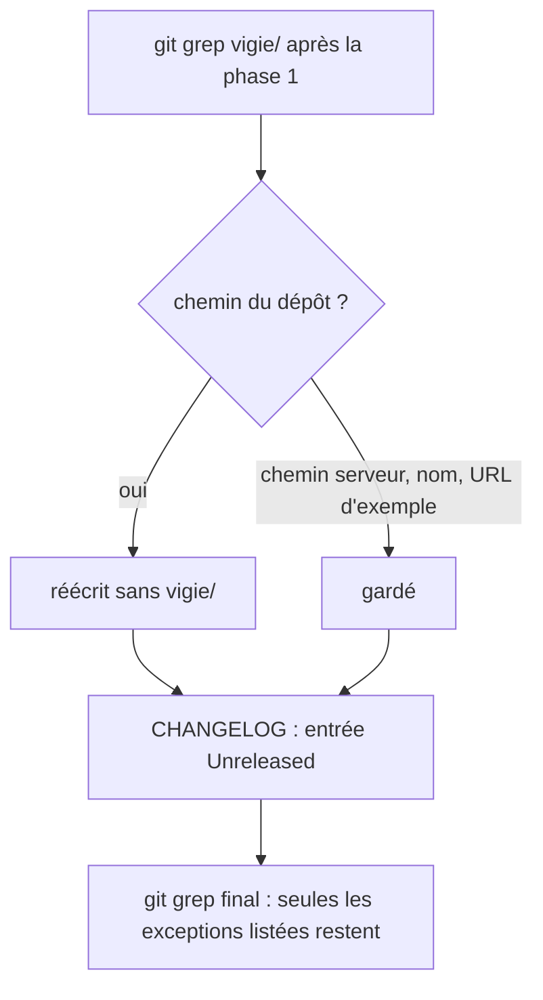
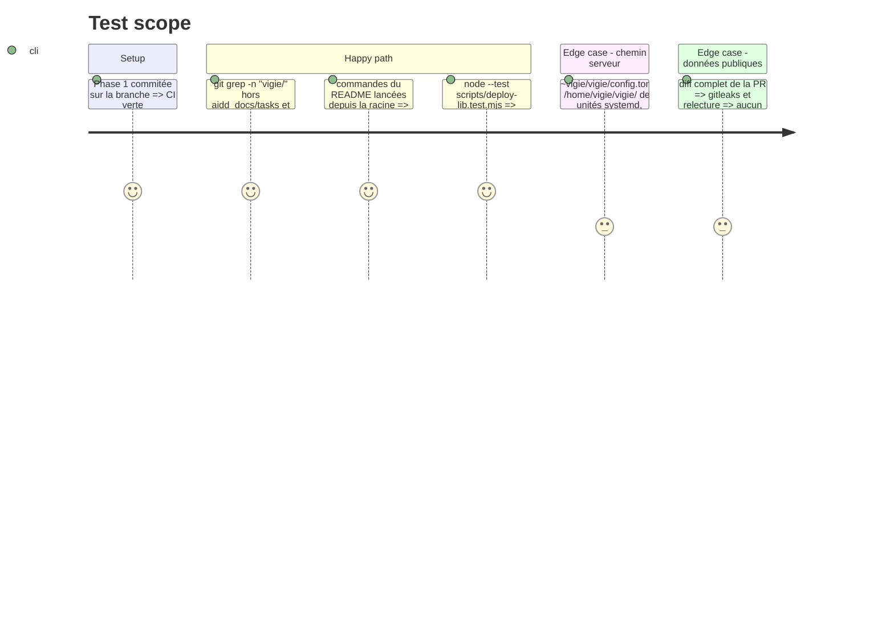

<!-- Fill or omit these sections; never add, rename, or reorder one. -->

# Instruction: Docs, commentaires et changelog

## Architecture projection

> Tree of the final files. ✅ create · ✏️ modify · ❌ delete

```txt
.
├── README.md                         ✏️ 42 mentions vigie/ : commandes sans « cd vigie », chemins relatifs à la racine, phrase d'ouverture « dépôt de vigie »
├── CHANGELOG.md                      ✏️ Unreleased/Changed : vigie/ remonté à la racine
├── Cargo.toml                        ✏️ commentaire docs/decisions.md
├── docs/
│   ├── hebergement.md                ✏️ HEAD:deploy, deploy/.gitattributes, job musl ; chemins serveur ~vigie/vigie/ gardés
│   ├── agent-php.md, api-console.md, audit-chemin-critique.md, decisions.md,
│   │   failles.md, htaccess.md, inventaire.md, logs.md, protocole-agent.md   ✏️ chemins du dépôt sans vigie/
│   └── reception.md                  ✏️ cargo test sans « cd vigie && »
├── agent/php/vigie-agent.php         ✏️ commentaires docs/…, src/vulns/purl.rs (User-Agent vigie/0.3.0 gardé)
├── agent/php/tests/*.php             ✏️ commentaires et messages : php agent/php/tests/…, tests/…
├── app/
│   ├── README.md, CHANGELOG.md       ✏️ chemins du dépôt sans vigie/
│   ├── osv-scanner.toml, src-tauri/osv-scanner.toml   ✏️ en-têtes : app/pnpm-lock.yaml, app/src-tauri/Cargo.lock, docs/decisions.md, scripts/check-osv-exceptions.py
│   ├── src-tauri/rust-toolchain.toml ✏️ « même version que le veilleur (rust-toolchain.toml) »
│   ├── src-tauri/src/client.rs, src/lib/api.ts, src/lib/logs.ts   ✏️ docs/api-console.md
│   └── scripts/android-no-backup.sh  ✏️ « lancé depuis app »
├── examples/inventaire/*             ✏️ docs/inventaire.md
├── scripts/deploy-lib.mjs, deploy-lib.test.mjs, deploy.mjs, deploy-agent.mjs, replay-incident.mjs   ✏️ usage node scripts/*.mjs, docs/agent-php.md ; vigie/deploy.lock (chemin distant) gardé
└── aidd_docs/design/vigie-design/HANDOFF.md   ✏️ arbre du dépôt (plus de « vigie/ (workspace Cargo) »), app/src/styles/tokens-light.css
```

## User Journey



## Test Scope



## Tasks to do

### `1)` Réécrire les chemins du dépôt

> Toute mention d'un fichier du dépôt le nomme depuis la racine.

1. Lister `git grep -n "vigie/" -- ':!aidd_docs/tasks' ':!CHANGELOG.md'` (inclut `aidd_docs/design/vigie-design/HANDOFF.md`).
2. Réécrire chaque chemin du dépôt (`vigie/docs/…` → `docs/…`, `vigie/src/…` → `src/…`, `vigie/tests/…` → `tests/…`, `vigie/app/…` → `app/…`, `vigie/scripts/…` → `scripts/…`, `vigie/deploy/…` → `deploy/…`, `vigie/agent/…` → `agent/…`) ; retirer `cd vigie` et `cd vigie &&` des blocs de commandes.
3. Garder : chemins serveur (`~vigie/vigie/…`, `~/vigie`, `/home/vigie/vigie/…` des unités `deploy/systemd/*.service`, `/srv/vigie/…` de `tests/config_edges.rs`, et les chemins relatifs au home distant `vigie/deploy.lock`, `vigie/bin/vigie`, `vigie/data` de `deploy.mjs`, `deploy-lib.mjs` et `deploy-lib.test.mjs`, qui ont la forme d'un chemin du dépôt sans en être un), `vigie/0.3.0` (User-Agent), `https://example.org/vigie/…`, `org.example.vigie`, noms `vigie-inventory`, `vigie-agent`, `vigie-deploy`. Aucune réécriture globale par motif : chaque ligne est décidée à la lecture.
4. Tests node : le message d'usage de `deploy-lib.mjs` devient `node scripts/deploy.mjs <cible> [--apply]` ; ajuster l'assertion si elle le cite.

### `2)` README et changelog

> Le README est celui du dépôt ; le changelog trace le déplacement.

1. `README.md` : l'ouverture présente le dépôt sc-vigie (veilleur, agent PHP, console) ; plus de « ce dossier ».
2. `CHANGELOG.md`, `[Unreleased]` / `Changed` : « The Vigie sources moved from `vigie/` to the repository root; paths in workflows, deployment scripts and docs follow ».

### `3)` Vérifier

> Rien d'oublié, rien de serveur cassé.

1. `git grep -n "vigie/" -- ':!aidd_docs/tasks' ':!CHANGELOG.md'` : chaque ligne restante est une exception de la tâche 1.3.
2. Relire le diff de `docs/hebergement.md`, `deploy/provision.sh`, `deploy/systemd/` et `scripts/deploy-lib*.mjs` : chemins serveur intacts (`deploy/systemd/` ne doit pas apparaître dans le diff).
3. Relire le diff complet contre `.claude/rules/07-quality/7-public-repo-data.md`.

## Test acceptance criteria

| Task | Acceptance criteria              |
| ---- | -------------------------------- |
| 1 | Tout chemin du dépôt cité dans les docs, commentaires et messages existe tel quel depuis la racine |
| 2 | Le README se lit comme celui du dépôt ; `[Unreleased]` mentionne le déplacement |
| 3 | Le `git grep` final ne montre que les exceptions listées ; aucun chemin serveur n'a changé ; aucune donnée réelle dans le diff |
