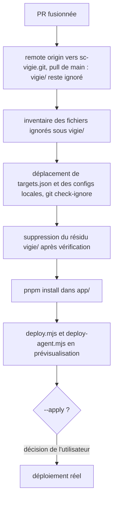
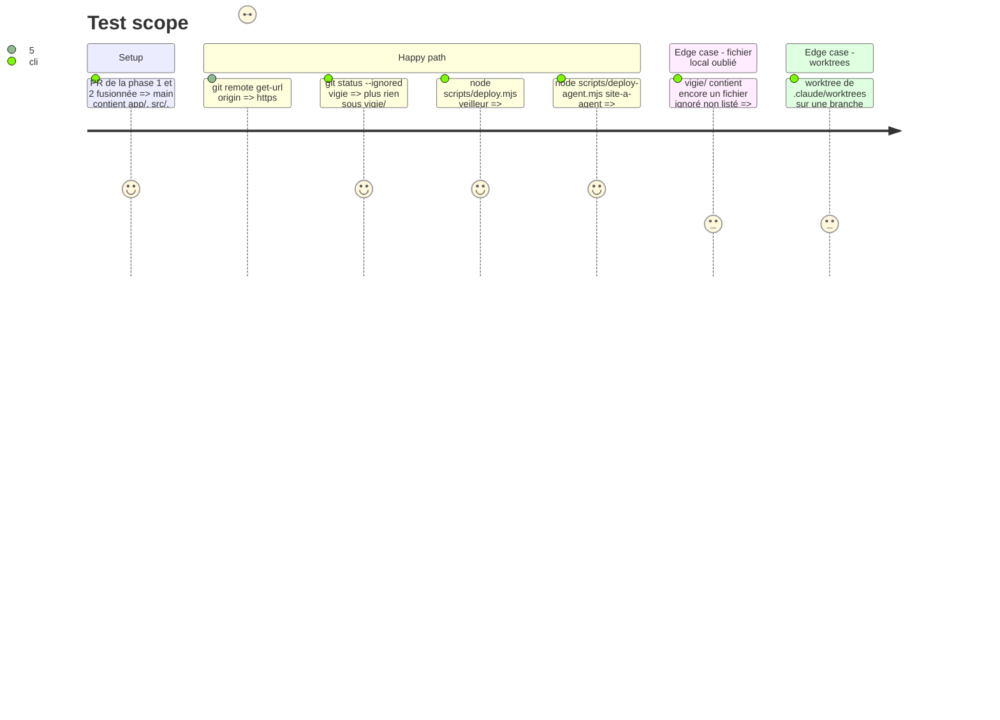

<!-- Fill or omit these sections; never add, rename, or reorder one. -->

# Instruction: Copie locale et premier déploiement

## Architecture projection

> Tree of the final files. ✅ create · ✏️ modify · ❌ delete

```txt
sc-vigie/ (copie locale, fichiers ignorés par git, jamais commités)
├── deploy/targets.json               ✏️ déplacé depuis vigie/deploy/targets.json
├── config.toml, remote.toml          ✏️ déplacés depuis vigie/ s'ils existent
├── target/                           ✅ recréé par le premier cargo build
└── vigie/                            ❌ résidu ignoré (target/, app/node_modules/, fichiers ci-dessus) supprimé après déplacement
.git/config                           ✏️ remote origin → https://github.com/RebelliousSmile/sc-vigie.git
```

## User Journey



## Test Scope



## Tasks to do

### `1)` Remote et main

> La copie locale suit le dépôt renommé ; le pull vient d'abord, parce que le `/vigie/` de transition garde le résidu ignoré, alors qu'un fichier déplacé avant le pull serait non suivi sous l'ancien `.gitignore`.

1. `git remote set-url origin https://github.com/RebelliousSmile/sc-vigie.git`, puis `git pull` sur `main` ; `git status` ne montre aucun fichier non suivi.
2. `git worktree list` : retirer le worktree `chore/split-module` (fusionnée) et signaler tout autre worktree d'avant le déplacement.

### `2)` Fichiers locaux ignorés

> Rien de local n'est perdu ni exposé : `git mv` ne déplace pas les fichiers ignorés.

1. `git status --ignored --short vigie` : inventaire complet, montré avant toute suppression.
2. Déplacer `vigie/deploy/targets.json` vers `deploy/targets.json`, et `vigie/config.toml`, `vigie/remote.toml` vers la racine s'ils existent ; `git check-ignore -v deploy/targets.json` (et les configs déplacées) confirme qu'ils sont ignorés, `git status` reste vide.
3. Supprimer le résidu (`vigie/target/`, `vigie/app/node_modules/`) seulement après confirmation de l'utilisateur ; `pnpm install` dans `app/`.

### `3)` Prévisualisation des déploiements

> Les deux scripts fonctionnent depuis la racine sur une vraie cible, sans rien écrire.

1. `node scripts/deploy.mjs veilleur` puis `node scripts/deploy-agent.mjs site-a-agent` : prévisualisation seule.
2. Le `--apply` reste une décision de l'utilisateur.

## Test acceptance criteria

| Task | Acceptance criteria              |
| ---- | -------------------------------- |
| 1 | `origin` pointe sur `sc-vigie.git` ; `main` local égale `origin/main` ; `git status` sans fichier non suivi ; aucun worktree d'avant le déplacement ne reste sans être signalé |
| 2 | `targets.json` et les configurations locales sont à leur nouvelle place, ignorées (`git check-ignore`) ; `vigie/` n'existe plus ; rien n'a été supprimé sans inventaire montré |
| 3 | Les deux prévisualisations aboutissent depuis la racine, sans écriture distante |
